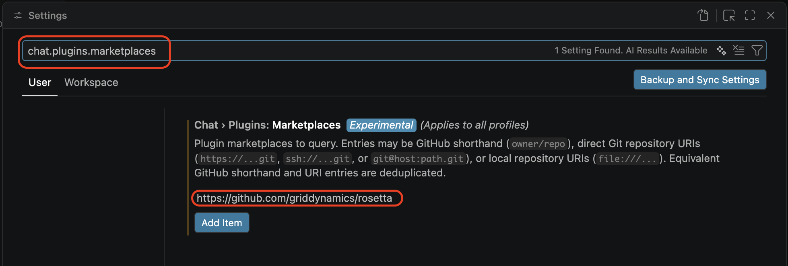
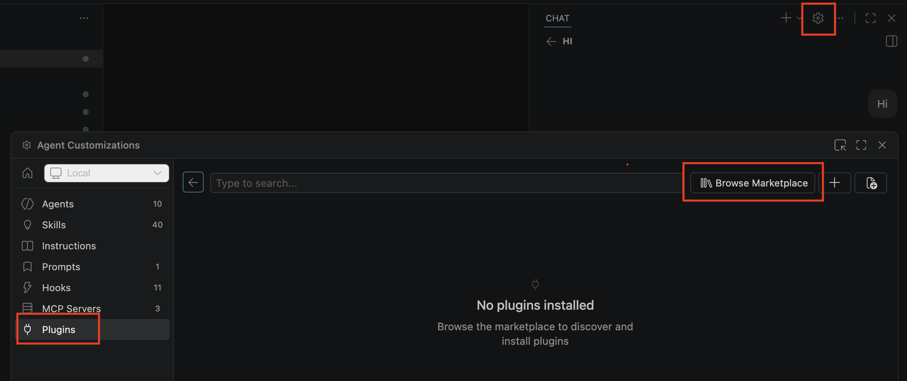
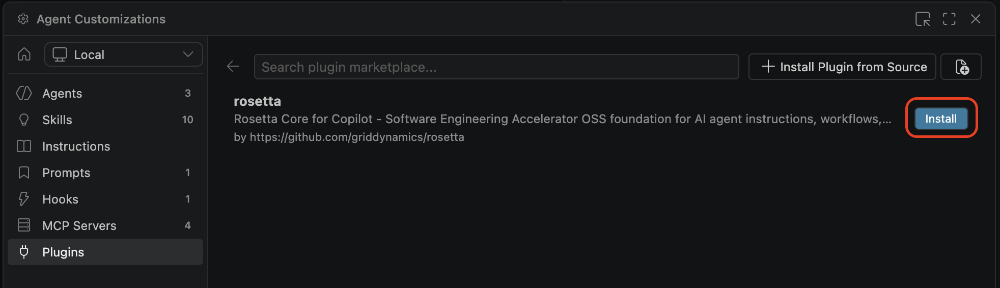
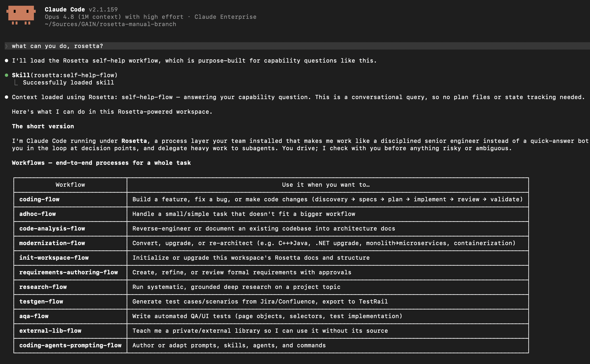
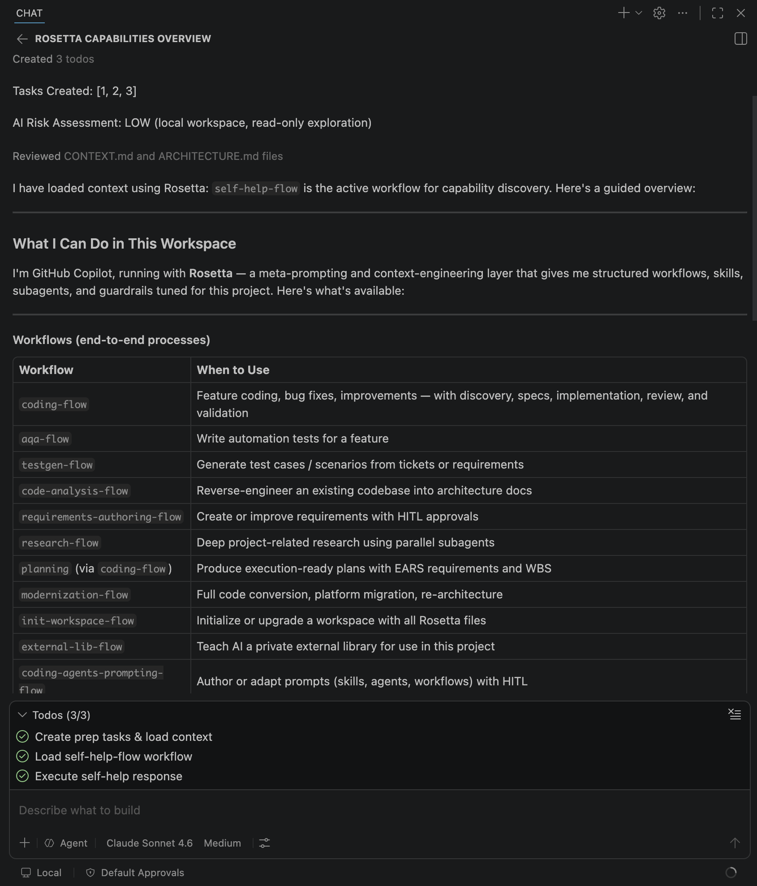

# Plugins

Rosetta plugins bundle the bootstrap rule, skills, agents, workflows, and other instructions directly into your IDE. The agent loads them locally — no live connection to Rosetta is needed at request time.

> [!WARNING]
> **Before you start:** get approval from your manager and company. Use **Sonnet 5.5 medium**, **GPT-6-luna-high**, **gemini-3.8-flash-high** or newer models. Avoid Auto model selection. Details: [Before you install](user-guide/02-install.md#before-you-install).

> [!NOTE]
> There will be conflict if you have similar plugins installed: JUXT, Superpowers, GSD, AI-DevKit. Use the ones you have the most experience with.

## Step 1: Install Plugin

Installation steps for every IDE (Claude Code, Cursor, GitHub Copilot, Codex, Antigravity), including Marketplace and Standalone (zip) methods, live in one place: the [install guide](user-guide/02-install.md).

Screenshots for GitHub Copilot Marketplace install (VS Code):







## Step 2: Verify

Ask the agent:

```
What can you do, Rosetta?
```

The agent will follow Rosetta prompts and show Rosetta workflows and execute `help-flow` (see screenshots from different tools below):

**Claude Code:**



**GitHub Copilot:**



## Upgrading

See [Keeping it up to date](user-guide/02-install.md#keeping-it-up-to-date) and [INSTALLATION.md#upgrading](INSTALLATION.md#upgrading).

## Next Steps

Once the plugin is verified:

- **Use Rosetta day to day** — see the [User Guide](user-guide/README.md).
- **Run your first session and initialize the repo** — see [QUICKSTART.md](QUICKSTART.md).
- **Explore the workflows** (coding, requirements authoring, modernization, and more) — see [USAGE_GUIDE.md — Workflows](USAGE_GUIDE.md#workflows).
