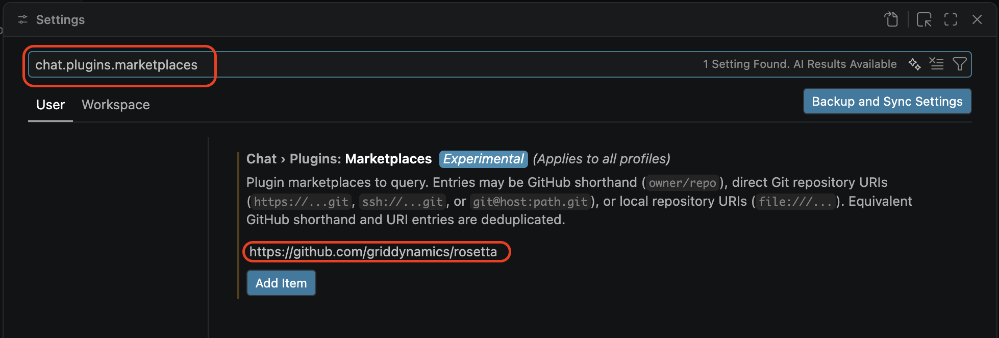
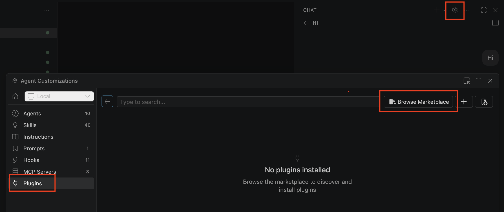
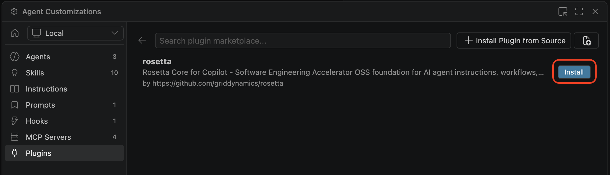
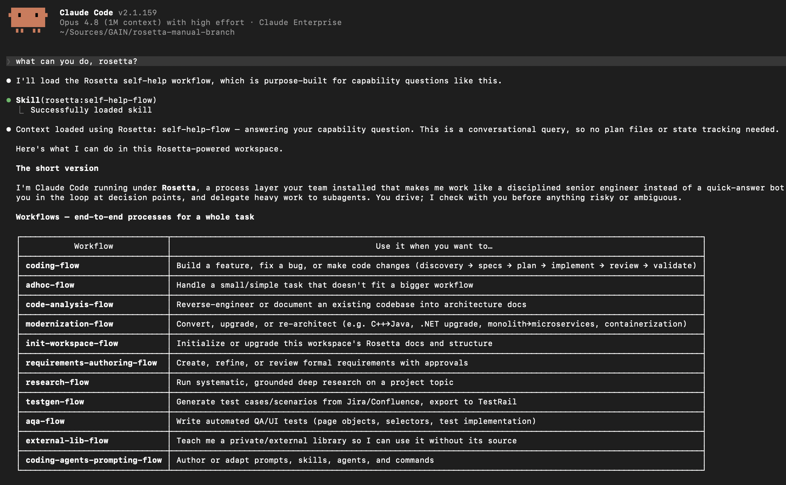
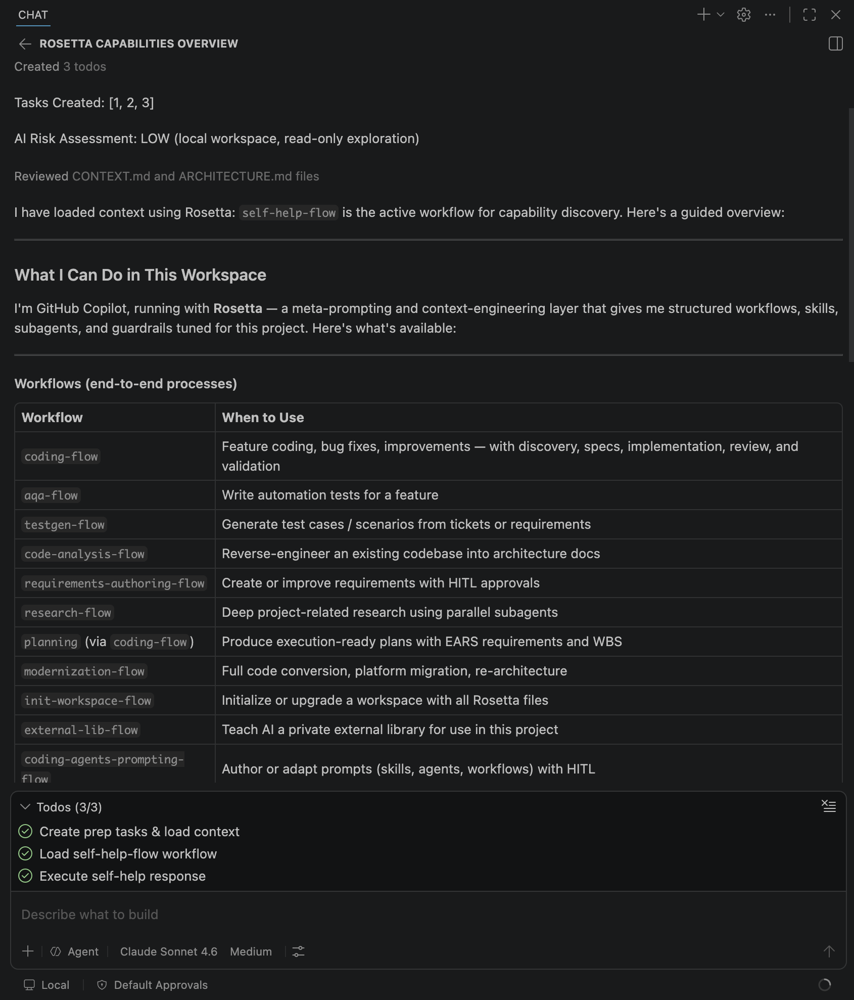

# Plugins

Rosetta plugins bundle the bootstrap rule, skills, agents, workflows, and other instructions directly into your IDE. The agent loads them locally — no live connection to Rosetta is needed at request time.

Every plugin supports two installation methods:

- **Marketplace** — managed install from a plugin marketplace. Easier; preferred when available.
- **Standalone** — manual zip extraction into your repo. For agents without a marketplace path, or environments that block external marketplaces.

> [!CAUTION]
> You must receive prior approval from your manager and company to use Rosetta.

> [!WARNING]
> Use **Sonnet 5.5 medium**, **GPT-6-luna-high**, **gemini-3.8-flash-high** or newer models. Avoid Auto model selection.

> [!NOTE]
> There will be conflict if you have similar plugins installed: JUXT, Superpowers, GSD, AI-DevKit. Use the ones you have the most experience with.

## Which plugin do I install

Rosetta ships as two plugins.

| Plugin | Contains |
| ------ | -------- |
| `rosetta` | Skills, rules, subagents, workflows, and guardrail hooks. |
| `rosetta-light` | The same content, lightweight profile (simpler workflows, smaller models). |

Install one of them, not both. Installing both puts every skill, agent, and workflow into your session twice under two namespaces. Nothing stops you; nothing warns you either.

**Most people want `rosetta`.** It is what the rest of this page assumes.

To add your organization's own instructions to either plugin, see [Build customized plugins](#build-customized-plugins).

## Step 1: Install Plugin

<details>
<summary><b>Claude Code</b></summary>

### Claude Code

#### Marketplace

```sh
claude plugin marketplace add griddynamics/rosetta
claude plugin install rosetta@rosetta
```

For the lightweight plugin, install `rosetta-light@rosetta` instead.
</details>

<details>
<summary><b>Cursor</b></summary>

### Cursor

#### Marketplace

> [!NOTE]
> To add the plugin you need to have the appropriate Cursor plans, such as Teams and Enterprise. 

To Import the Rosetta github repository to your team/company internal marketplace:
* Use the following repository: https://github.com/griddynamics/rosetta

For detailed setup instructions, see the Cursor documentation:
* https://cursor.com/docs/plugins#team-marketplaces

**ALTERNATIVE**: Plugins installed in Claude Code are automatically available in Cursor.

> [!WARNING]
> Cursor automatically detects and uses Claude Code plugins. To avoid duplicate tools, commands, and context, do not install the same plugin separately in both Claude Code and Cursor. If you don't want Cursor to pick up Claude Code plugins at all, go to **Cursor Settings → Rules, Skills, Subagents** and turn off **Include third-party Plugins, Skills, and other configs**.

#### Standalone

1. Download `rosetta-cursor-standalone-<version>-<date>.zip` from the [latest release](https://github.com/griddynamics/rosetta/releases/latest).
2. Extract the archive contents into your repository.
3. Verify you can see a file `.cursor/agents/architect.md`. Ensure there are no `.cursor/.cursor` folders.

</details>

<details>
<summary><b>GitHub Copilot</b></summary>

### GitHub Copilot

GitHub Copilot runs in VS Code and JetBrains. Use **Marketplace** install when available; **Standalone** is a fallback for either IDE.

#### Marketplace (VS Code and JetBrains)

1. In VS Code settings, add `https://github.com/griddynamics/rosetta` to `chat.plugins.marketplaces`. In JetBrains, add the same URL under the GitHub Copilot plugin's marketplace setting (menu path may vary by IDE version).
2. Open the Copilot chat panel, click the settings gear icon to open agent customizations.
3. Click **Browse Marketplaces**, then **install** for `rosetta`.







#### Standalone (VS Code and JetBrains) — fallback

Use when your Marketplace/plugin catalog isn't available, or to avoid a live registry dependency.

> [!NOTE]
> The standalone installation is also detected by VS Code, so installing Rosetta through the standalone and marketplace methods will result in duplicate tools, commands, and context.

1. Download `rosetta-copilot-standalone-<version>-<date>.zip` from the [latest release](https://github.com/griddynamics/rosetta/releases/latest).
2. Extract the archive contents into your repository.
3. Verify you can see a file `.github/agents/architect.agent.md`. Ensure there are no `.github/.github` folders.

</details>

<details>
<summary><b>Codex</b></summary>

### Codex

> [!NOTE]
> Codex plugins currently support hooks, MCPs, and skills only (as of April 2026).

#### Standalone

1. Download `rosetta-codex-<version>-<date>.zip` from the [latest release](https://github.com/griddynamics/rosetta/releases/latest).
2. Extract the archive contents into your repository.
3. Enable hooks:

   ```sh
   codex features enable hooks
   ```

</details>

<details>
<summary><b>Antigravity</b></summary>

### Antigravity

One plugin serves Antigravity 2.0, Antigravity CLI, and Antigravity IDE.

#### Standalone

1. Download `rosetta-antigravity-<version>-<date>.zip` from the [latest release](https://github.com/griddynamics/rosetta/releases/latest).
2. Create the folder `.agents/plugins/rosetta/` at your workspace root.
3. Extract the archive contents into it.
4. Verify you can see a file `.agents/plugins/rosetta/plugin.json`. Ensure there are no `.agents/plugins/rosetta/rosetta-antigravity` folders.

For all workspaces instead of one, extract into `~/.gemini/config/plugins/rosetta/` — same contents.

</details>

## Step 2: Verify

Ask the agent:

```
What can you do, Rosetta?
```

The agent will follow Rosetta prompts and show Rosetta workflows and execute `help-flow` (see screenshots from different tools below):

**Claude Code:**



**GitHub Copilot:**



## Build customized plugins

For organizations that add or adjust Rosetta instructions without forking the repository. You keep your additions in a separate folder, the generator merges them into Rosetta, and you install the plugin it produces.

Requires `rosettify-plugins` 3.5.0 or newer. Customization applies to plugins you generate yourself.

### Layout

A customization root mirrors `instructions/`: `<root>/<release>/<folder>/...`. Rosetta's own files live in `instructions/r3/core/`, so yours go in `<root>/r3/core/`.

```text
acme-rosetta/
  r3/
    core/
      skills/acme-deploy/SKILL.md                 new skill
      skills/coding/references/acme-rules.md      new file in an existing skill
      workflows/coding-flow.md                    appended to Rosetta's coding-flow.md
      rules/speckit-integration-policy~overwrite~.md   replaces Rosetta's file of that name
```

A customization root can be its own repository. Only `<root>/<release>/` is checked. Files at the root (`README.md`, `LICENSE`, `.git/`, `docs/`) and entries starting with `.` under the release folder are ignored. Any other folder or loose file under `<root>/r3/` is an error, so a typo does not silently ship nothing.

### What a file does

The file's path decides.

- **New path, new file.** `skills/acme-deploy/SKILL.md` adds a skill Rosetta does not have.
- **Same path as a Rosetta file, appended.** Your body goes after Rosetta's content. Rosetta's frontmatter stays and the frontmatter of your file is dropped. To change frontmatter, such as a skill `description`, replace the file.
- **`name~overwrite~.md`, replaced.** The file replaces everything that came before it at that path. With several overwrites at one path, the last wins. An overwrite with nothing to replace in a build is an error.

Example, appending to a workflow. Rosetta ships `coding-flow.md` with its own frontmatter. Your `r3/core/workflows/coding-flow.md`:

```markdown
---
description: ACME
---
## ACME rules
Run `make lint` before every commit.
```

The generated `coding-flow.md` is Rosetta's file followed by `## ACME rules ...`. The `description: ACME` is dropped.

### Limit a file to some builds

Filename tokens work as in the main source. Put them between `~` marks before the extension.

- `coding-flow~profile-lightweight-only~.md` appends only in `rosetta-light`.
- `coding-flow~ide-claude-only~.md` appends only in Claude Code builds.
- Combine tokens: `speckit-integration-policy~overwrite~ide-claude-only~.md`.

Filtering happens first. A file filtered out of a build neither overwrites nor counts as something to replace.

### Control the order

Several files can contribute to one path. They apply in this order.

1. Source: Rosetta first, then each customization root.
2. File path.
3. OrderToken: a leading token such as `001`, as in `coding-flow~001~.md` and `coding-flow~002~.md`.

OrderToken is 1 to 4 characters, starts with a digit, and holds only digits and lowercase letters. It sorts as plain text, so `10` comes before `2`. Pad it yourself: `001`, `002`, `010`. A file with no token sorts before files with one.

### Several roots

`--customizations acme,team` merges Rosetta, then `acme`, then `team`. Later roots append after earlier ones and an overwrite replaces what came before it. The option can be repeated; order is left to right. Maximum 25 roots. Duplicates are allowed.

A relative path resolves against `--source`. An absolute path is used as written. A root with no folder for the release you build contributes nothing and is not an error. A missing path or a path to a file is an error.

### Build

Clone Rosetta, then run the generator against it:

```sh
npx -y rosettify-plugins@latest \
  --source <rosetta checkout> \
  --customizations <path to acme-rosetta> \
  --publish rosetta,rosetta-light \
  --output <dir>
```

`--publish` names the plugins to write. Without it, the generator also writes the internal `core` plugin. Errors in a customization root are reported before anything is written.

The result is the same `rosetta` and `rosetta-light` plugins, one folder per IDE, with your files merged in. Option details are in the [generator README](src/rosettify-plugins/README.md#customizations).

### Install

The output holds one plugin folder per IDE (for example `rosetta-claude`, `rosetta-claude-light`), the same layout as the standalone download. Install it the way [Step 1](#step-1-install-plugin) describes for standalone: copy or extract the folder for your IDE into your repository. Then continue with [Step 2: Verify](#step-2-verify).

## Upgrading

- Standalone upgrades require to redownload and replace files (install again).
- Marketplace plugins usually automatically upgrade.

See [INSTALLATION.md#upgrading](INSTALLATION.md#upgrading) for upgrade instructions for your installation method.

## Next Steps

Once the plugin is verified:

- **Use Rosetta day to day** — see the [User Guide](user-guide/README.md).
- **Run your first session and initialize the repo** — see [QUICKSTART.md](QUICKSTART.md).
- **Explore the workflows** (coding, requirements authoring, modernization, and more) — see [USAGE_GUIDE.md — Workflows](USAGE_GUIDE.md#workflows).
