<div align="center">
  <picture>
    <source media="(prefers-color-scheme: dark)" srcset="docs/web/assets/brand/rosetta-logo-full-color-white-text.png">
    
  </picture>
  <p><strong>Engineering governance and context for AI coding agents — shared instructions, architecture, standards, workflows, and guardrails in every session.</strong></p>
</div>

## What is Rosetta

https://github.com/user-attachments/assets/6df6e217-3e5c-4691-84ed-7440701a87de

AI coding agents are great — until you try to use them across a real team. Everyone builds their own prompts and instructions, knowledge stays in silos, and the agent — not knowing your architecture or constraints — guesses from a few open files and confidently does the wrong thing.

That's why we built Rosetta — open-source engineering governance and context for AI coding agents. It's not another proprietary agent; it works with the tools you already use (Claude Code, Cursor, Copilot, Codex, and other MCP-compatible agents) and loads your team's shared engineering instructions into every session. Everything is versioned in Git and can run inside your perimeter.

**Teach agents how to think, not what to do.** The model already knows Python and React; what it lacks is your engineering discipline. That's what Rosetta encodes.

> [!NOTE]
> Rosetta pays off when a team wants one consistent way of working with AI coding agents.

## [Quick Start](QUICKSTART.md)

On company code? Get approval from your manager and company first.

Up and running in three steps:

**1. Install** the plugin. In your terminal (Claude Code):

```sh
claude plugin marketplace add griddynamics/rosetta
claude plugin install rosetta@rosetta
```

**2. Initialize** your repository (once). Type this in your agent's chat as a plain sentence:

```text
Initialize this repository using the respective Rosetta workflow
```

Then start a new session.

**3. Run** your first task:

```text
/coding-flow Add password reset to the auth service
```

**[Open the full Quick Start](QUICKSTART.md)**

## Why Rosetta

| Without Rosetta | With Rosetta |
| --- | --- |
| Each developer writes their own prompts and instructions | One versioned, shared source of truth |
| The agent guesses from a few open files | It reads your architecture and conventions first |
| Starts coding immediately | Prepare, research, plan, act, validate |
| Reviews its own work in the same context | A fresh-context reviewer checks it |
| "Generate and hope" | Validation with real execution evidence |
| Knowledge stuck in senior engineers' heads | Captured once, reused everywhere |

A worked example ("Add rate limiting to the checkout API") and why Rosetta is more than IDE rules: [Why Rosetta](docs/WHY.md).

## [User Guide](user-guide/README.md)

Rosetta-guided work follows five phases — **Prepare → Research → Plan → Act → Validate** — with approval gates at the key decision points.

Read more in the [User Guide](user-guide/README.md).

## How it works

Rosetta layers your instructions at runtime — core, then organization, then project, each building on the one above — and adapts the result to whatever agent you use:

```mermaid
flowchart LR
    A["<b>Core</b><br/>best practices & workflows"] --> B["<b>Organization</b><br/>standards, policies & guardrails"]
    B --> C["<b>Project</b><br/>architecture, context & constraints"]
    C --> R["<b>Rosetta Runtime</b><br/>context engineering + instruction orchestration"]
    R --> AD["<b>Agent Adapters</b>"]
    AD --> G["<b>Guided Execution</b><br/>workflows • guardrails • validation"]
    G --> T["Claude Code · Cursor · Copilot · Codex · Antigravity"]

    classDef rosetta fill:#1f6feb,stroke:#1b4fb8,color:#ffffff;
    classDef yours fill:#2da44e,stroke:#1a7f37,color:#ffffff;
    classDef third fill:#d0d7de,stroke:#8c959f,color:#1f2328;
    class A,R,AD,G rosetta
    class B,C yours
    class T third
```



**Legend:** 🟦 blue ships with Rosetta, 🟩 green is written by your organization and project, ⬜ grey is your existing AI tools.

A change in a higher layer reaches every project automatically, and teams customize without forking.

## Commands

| I want to… | Command |
| --- | --- |
| Write a feature, fix a bug, add tests | `/coding-flow` |
| Define what to build first | `/requirements-authoring-flow` |
| Understand a codebase or research options | `/code-analysis-flow` · `/research-flow` |
| Generate or automate tests | `/testgen-flow` · `/ui-aqa-flow` · `/api-aqa-flow` |
| Migrate or upgrade a system | `/modernization-flow` |
| Not sure | `/help-flow What can you do?` |

All 17 workflows and 43 skills: [Workflows and skills](docs/CATALOG.md). As a diagram: [workflow map](user-guide/workflow-map.md).

## Security and privacy

Rosetta itself does not see or process your source code: the agent requests instructions by tag. Your coding agent and its model provider still see the code they work on. The plugin runs locally with no server connection. Optional MCP mode can run inside your perimeter, and write mode is off by default. See [Security](SECURITY.md) and the [one-pager](docs/SecurityOnePager.md).

## Documentation

| I want to... | Read |
| --- | --- |
| Use Rosetta day to day | [User Guide](user-guide/README.md) |
| Install Rosetta and run a first task | [Quick Start](QUICKSTART.md) |
| Install in every mode (plugin, MCP, offline) | [Installation Guide](INSTALLATION.md) |
| Connect over MCP (optional, secondary) | [MCP](MCPs.md) |
| Configure your coding-agent workspace | [Configuration](CONFIGURATION.md) |
| Understand what Rosetta is and how to think about it | [Overview](OVERVIEW.md) |
| Learn how to use Rosetta flows | [Usage Guide](USAGE_GUIDE.md) |
| Understand the system architecture | [Architecture](docs/ARCHITECTURE.md) |
| Navigate the codebase | [Developer Guide](DEVELOPER_GUIDE.md) |
| Debug a problem | [Troubleshooting](TROUBLESHOOTING.md) · [FAQ](FAQ.md) |
| See release history | [Changelog](CHANGELOG.md) |
| Self-host MCP for my organization (optional, rare) | [Deployment guide](docs/mcp/DEPLOYMENT_GUIDE.md) |

## Contributing

Use Rosetta plugins to develop Rosetta.

Contributions welcome. See [CONTRIBUTING.md](CONTRIBUTING.md) for workflow and expectations.

## Community & Support

- [Website](https://griddynamics.github.io/rosetta/)
- [rosetta-support@griddynamics.com](mailto:rosetta-support@griddynamics.com)

## Notice

> [!WARNING]
> Rosetta is intended for legitimate software engineering workflows.
> Users are responsible for ensuring their use complies with applicable laws, regulations, and contractual obligations.

## For AI Only

Full information: https://griddynamics.github.io/rosetta/llms-full.txt

## License

Apache-2.0. See [LICENSE](LICENSE) for details.
