# plugin-customizations — Architecture Notes

Scope: generator part only (multi-source VFS · order key · overwrite · publish filter). Content collapse and ripple are plan items, not design.
Requirements (authoritative, not restated): FR-CUST-0001..0003 · FR-CLI-0035, 0036 · FR-ARCH-0021, 0022, 0024, 0026 (+ touched: FR-ARCH-0010, 0012, 0013/0014, 0020, 0041, 0042 · FR-SET-0010, 0020 · FR-CLI-0041). Decisions: ASSUMPTIONS.md OQ-8..OQ-15.

## 1. Current-state facts (verified 2026-11-05, HEAD a3e42a6c)

| # | Fact | Evidence (file · symbol · quote) |
|---|---|---|
| F1 | `SourceFile.order` = index within one raw-relPath group, never sorted | `src/rosettify-plugins/src/vfs/build-vfs.ts` `buildVfs` · ``order: `${i}` `` |
| F2 | Grouping is raw-relPath-major (Map insertion), folder-minor; clean-path merge via linear `find` | `src/vfs/source-resolver.ts` `collectSourceFiles` · `fileMap.set(normalizedRel, existing)`; `build-vfs.ts` · `virtualFiles.find((vf) => vf.path === cleanRelPath)` |
| F3 | Missing layer dir throws (correct for main, wrong for customizations) | `source-resolver.ts` `resolveSourceDirs` · `throw new Error(\`Instruction source not found` |
| F4 | No OrderToken; duplicate tokens silently de-duplicated | `src/vfs/directives.ts` `parseDirectives` · `const conditions = new Set<DirectiveToken>(rawDirectives)` |
| F5 | Overwrite keeps from FIRST surviving overwrite; overwrite at index 0 silently kept | `src/file-processors/file-apply-overrides.ts` · `findIndex((sf) => sf.conditions.has('overwrite'))`, `firstOverwriteIdx > 0 ? slice` |
| F6 | `order` read nowhere | `grep -rn "\.order\b" src` → only `types.ts` decl + `build-vfs.ts` write |
| F7 | Disk mutation only in 4 processors + run-level sweep, all gated by `dryRun` | `plugin-cleanup.ts`, `plugin-copy.ts`, `plugin-sync-bundles.ts` (incl. `sweepUndeclaredBundles` rm), `plugin-write.ts`; `generate.ts` `sweepOrphanDestinations` |
| F8 | `pluginCopy` also produces `.tmpl` frames needed by `pluginRenderTemplates` → cannot be dropped from an unpublished pipeline | `plugin-copy.ts` · `draft.frames = [...draft.frames, ...tmplFrames]` |
| F9 | Dry-run "would write" is `logger.info` per file (default level `info`) | `plugin-write.ts:35`, `plugin-copy.ts` `reportDryRunWrite` |
| F10 | Processor throw / frame errors are recorded per spec AFTER cleanup ran → not "without writing any output folder" | `generate.ts` run loop `catch (err) { allErrors.push(...)` |
| F11 | Orphan sweep keep-list = every catalog-declared destination (all releases/sets/variants) | `generate.ts` `sweepOrphanDestinations` → `allDeclaredDestinations(catalog)` |
| F12 | Pre-flight errors abort before sweep and before any pipeline | `generate.ts` · `if (preflightErrors.length > 0) { ... return 1; }` |
| F13 | Published `rosettify-plugins@latest` = 3.3.10 (= origin/main, pre-#315); local = 3.4.0 (unpublished) | `npm view rosettify-plugins version` → `3.3.10`; `git show origin/main:src/rosettify-plugins/package.json` |

## 2. Byte-identity risk on today's tree (FR-CUST-0001.AC5)

Fact: r3 directive files = exactly 11, all `~profile-lightweight-only~overwrite~` with a same-folder base (`workflows/agents/{architect,discoverer,engineer,executor,planner,prompt-engineer,requirements-engineer,researcher,reviewer,validator}`, `workflows/workflows/coding-flow`). r2: none. No OrderToken anywhere.
- Single overwrite per VirtualFile → first == last → FR-ARCH-0024 change is output-neutral.
- Both sources key `A:<path>:`; tie → raw filename order (`.` 0x2E < `~` 0x7E) = today's order.
- Cross-folder clean-path collisions in the `rosetta` set: 0 (command in PLAN step 0) → folder-major vs raw-major order is dormant.
- No orphan overwrite in any build (base always survives profile filter).
Conclusion: zero predicted diff. Proven by PLAN gate (baseline vs new on the same tree), not assumed.
Test fixtures are NOT neutral: `tests/fixtures/sample-instructions/r2/core/rules/order-swap-fixture~overwrite~ide-claude-only~.md` has no base (orphan in the claude build; `e2e/sample.e2e.test.ts:296` asserts it ships) and `unit/file-processors/file-apply-overrides.test.ts:80` asserts "overwrite at index 0 keeps all sources" — both reworked in PLAN S4/S6b.

## 3. Alternatives

| | A. Ordered source list into `buildVfs`, key at collection, sort before freeze, `WriteMode` threaded (CHOSEN) | B. One VFS per source, merge by path, re-sort | C. Filesystem union into temp tree + per-spec temp output |
|---|---|---|---|
| Idea | `buildVfs(main, release, folders, customizationRoots)` loads source→folder→sorted raw path, assigns key `<L>:<path>:<tok>`, stable-sorts each VirtualFile, freezes. Overwrite + no-predecessor via one shared pure helper. Unpublished specs run with `WriteMode='suppressed'`. | Build N frozen VFSs with today's code, then merge VirtualFiles by path and sort SourceFiles. | Copy `<root>/<release>/<folder>` of all sources into a temp dir (rename to keep letters), run unchanged generator; write unpublished specs to a throw-away output. |
| + | One ingress, one sort, explicit key (FR-ARCH-0026 literal); immutability kept (sort pre-freeze); errors name real origins; minimal surface (≈8 src files) | Reuses buildVfs as-is | Zero generator core change |
| − | Signature change (≈9 test call sites); 4 processors take a mode | Duplicates parse/validate, merge reimplements grouping, two freeze passes; no single place owning order | Breaks FR-ARCH-0033 single ingress; same raw filename in two sources collides on disk; origin/letter provenance lost in errors; disk I/O; temp cleanup; publish via temp output still runs `pluginCleanup` paths |
| Verdict | ✔ | ✘ dominated by A (same result, more code) | ✘ violates FR-ARCH-0026/0033, unfit for AC naming files |

Considered & rejected for publish suppression: (i) `dryRun=true` + discarding sink — floods `info` logs with "dry-run: would write" (F9) for ~1.7k files; (ii) split `pluginCopy` into frame/disk halves — SRP-clean but byte-identity risk on the hottest processor; out of scope.

## 4. Decision (A) — key points

1. **Load order** constructed, not inherited: source letter (A=main, B…Z) → set `folders` order → raw relPath lexicographic (`sortPaths`). Then group by clean VFS path (Map), stable `Array.prototype.sort` by key (ES2019 stable), then deep-freeze (FR-ARCH-0013/0014 unchanged).
2. **Key** `<letter>:<cleanRelPath>:<orderToken|''>`; stored in existing `SourceFile.order` (F6: no reader → no ripple).
3. **Missing dirs**: main `<root>/<release>/<folder>` missing → throw (unchanged, FR-SET-0010). Customization: missing `<release>/` or `<folder>/` → no contribution (FR-CUST-0003.AC3).
4. **Overwrite** (FR-ARCH-0024): one pure helper `resolveEffectiveSources(sources, matchCtx, profile)` → `{kept, orphan}`: filter (`-only`) → if `kept[0]` has `overwrite` ⇒ orphan → else slice from LAST overwrite. Used by `fileApplyOverrides` (frame hard error, defensive) and by a **pre-flight** pass over every planned spec × VirtualFile (F10 forces pre-flight: ACs say "without writing any output folder"). Error names origin path + `spec.destination`; messages de-duplicated (origin × destination) so one fault is not repeated per IDE.
5. **Customization validation** at pre-flight (count ≤ 25, root is dir; only `<root>/<release>/` inspected, dot-entries ignored, loose files and undeclared folders rejected vs folders the whole catalog declares for the release — amended FR-CUST-0002, D3).
6. **Publish**: plugin name = `set.manifest.name + variant.manifestNameSuffix`; unknown name ⇒ pre-flight error; the repo catalog keeps `core` declared and unpublished, and `pre_commit.py` passes `--publish rosetta,rosetta-light` to npx (user decision D1); per planned (set, variant) `published` ⇒ `WriteMode` `'write' | 'dry-run' | 'suppressed'`; sweep unchanged (F11 keeps unlisted declared folders untouched).
7. Placement: OrderToken parse in `directives.ts`; source letters + validation in new `vfs/customizations.ts`; overwrite helper in new `vfs/effective-sources.ts`; orchestration in `generate.ts` only.

Confidence: design 0.9; byte-identity 0.9 (gate-proven); validation-(b) comparability 0.6 (SPECS §9; both literal and adjusted runs, D2).

## 5. Diagram

```mermaid
%%{init: {'theme':'base','themeVariables':{'primaryColor':'#1f4e79','primaryTextColor':'#ffffff','primaryBorderColor':'#0b2540','lineColor':'#7f8c8d','secondaryColor':'#2e7d32','tertiaryColor':'#6a1b9a'}}}%%
flowchart LR
  CLI["cli.ts<br/>--customizations --publish"]:::io --> PF["generate.ts pre-flight<br/>catalog · domain · customizations · publish names"]:::pf
  PF --> VFS["buildVfs<br/>A..Z × folders × sorted raw<br/>key → stable sort → freeze"]:::core
  VFS --> OW["pre-flight orphan-overwrite<br/>per spec × VirtualFile"]:::pf
  OW --> SW["sweepOrphanDestinations<br/>(unchanged)"]:::io
  SW --> PIPE["per spec pipeline<br/>WriteMode write | dry-run | suppressed"]:::core
  classDef io fill:#455a64,stroke:#263238,color:#ffffff;
  classDef pf fill:#6a1b9a,stroke:#38006b,color:#ffffff;
  classDef core fill:#1f4e79,stroke:#0b2540,color:#ffffff;
  linkStyle default stroke:#7f8c8d,stroke-width:2px;
```

