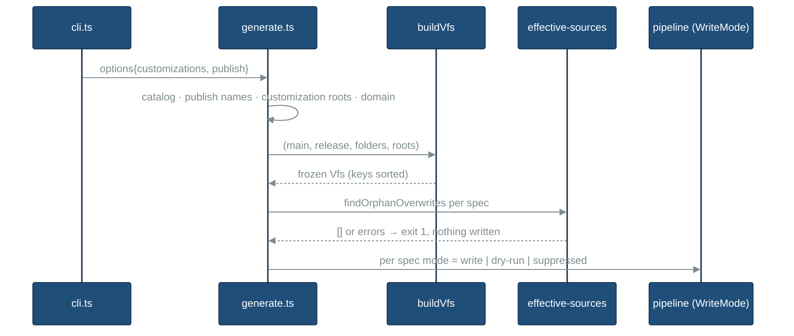

# plugin-customizations — SPECS (WHAT)

<CRITICAL ATTRIBUTION="DO NOT COMPACT/OPTIMIZE/SUMMARIZE/REPHRASE, PASS AS-IS">

## TLDR

- Generator (`src/rosettify-plugins`, 3.4.0 → 3.5.0): multi-source VFS (`--customizations`, letters A..Z), order key `<L>:<vfsPath>:<OrderToken>` sorted before freeze, OrderToken grammar + duplicate rejection, last-overwrite-wins + pre-flight orphan-overwrite error, `--publish` write filter via `WriteMode`.
- Content: `instructions/r3/{workflows,qe,search,modernization}/**` git-mv'd back into `instructions/r3/core/` (0 collisions, verified); 24 `(requires the \`X\` plugin[s])` marker lines removed (regex `\(requires the [^)]*plugins?\)`); split recorded first in `docs/REQUIREMENTS/plugin-generator/assets/`.
- Catalog: `rosetta` = `[core]` (standard + `-light`); `core` declared, unpublished (D1); four domain sets removed (kept dormant in `assets/plugins.split.json`).
- Output: `plugins/` = 14 folders `rosetta-<ide>[-light]`; `core-*` git-rm'd once; others swept by the generator.
- Ripple: manifests, CI, verify scripts, tests, docs, user docs + customization usage section.
- Gates: no-customization output byte-identical to baseline (FR-CUST-0001.AC5); post-collapse diff = markers only; final diff vs published npx explained per class.
- Multi-set capability is preserved end to end (plugin sets, `template-<ide>`, multiset fixtures, `set-<id>-only`, `--domain`); the user re-splits later.
- Requirements are authoritative; this file references IDs only. Decisions D1–D10: PLAN § Decisions. Design rationale: `architecture-notes.md`. Steps: `plugin-customizations-PLAN.md`.

## 1. Scope

In: FR-CUST-0001..0003 · FR-CLI-0035, 0036 · FR-ARCH-0021, 0022, 0024, 0026 (the 9 units) + touched FR-ARCH-0010, 0012, 0013/0014, 0020, 0041 · FR-SET-0010, 0020 · FR-CLI-0041. Content collapse, catalog, ripple, docs.
Out: MCP path (OQ-14) — but H3 checks MCP re-publish/tag-path impact of moved files; `pre_commit.py` generator switch (ARCHITECTURE § Plugins, settled); re-splitting; `template-<ide>` and multiset fixtures (kept, unused by repo catalog); plugin versions in `template-<ide>`/marketplace manifests (D5: untouched; user merges main later). In: stale `core-<ide>` paths in hooks-authoring SKILL (r2, r3) and `docs/hooks-verify.md` (D6); requirement texts naming split sets → Draft (D10).

## 2. NFR / ASR

| ID | Requirement | Verified by |
|---|---|---|
| ASR-1 | No-customization, no-`--publish` output byte-identical to pre-change generator on the same tree (FR-CUST-0001.AC5, NFR-0002/0003) | PLAN gate G-AC5 `diff -r` empty |
| ASR-2 | Every new hard error raised at pre-flight; output dir untouched (FR-SET-0010.AC9 shape) | generate tests assert output dir mtime/listing unchanged |
| ASR-3 | VFS immutable after build; sort happens before freeze (FR-ARCH-0013/0014) | existing frozen-VFS tests stay green |
| ASR-4 | Determinism: order depends only on invocation + filenames (FR-ARCH-0026) | build-vfs unit tests with shuffled fs order irrelevant (fast-glob order) |
| ASR-5 | Library API backward compatible: new `GenerateOptions` fields optional | typecheck of existing tests unchanged signatures for `generate()` |
| ASR-6 | Coverage ≥ existing threshold for touched modules | `npm --prefix src/rosettify-plugins run test:coverage` |

## 3. Components & contracts

Signatures only. Paths under `src/rosettify-plugins/src/`.

### 3.1 `types.ts`
- `type WriteMode = 'write' | 'dry-run' | 'suppressed'` — `suppressed`: no fs mutation, nothing to the dry-run sink, no per-file "would write" log.
- `SourceFile.order: string` — now the FR-ARCH-0026 key (doc comment updated; no reader exists).
- `GenerateOptions.customizations?: string[]` — absolute, resolved, in CLI order (FR-CLI-0035). Absent ≡ `[]`.
- `GenerateOptions.publish?: string[]` — plugin names; absent ⇒ write all (FR-CLI-0036.AC4).

### 3.2 `vfs/directives.ts` (FR-ARCH-0020, 0021, 0022)
- `ORDER_TOKEN_PATTERN = /^[0-9][0-9a-z]{0,3}$/`
- `ParsedFilename { cleanName; conditions: Set<DirectiveToken>; orderToken: string | null }`
- `parseDirectives(filename): ParsedFilename` — first token matching pattern ⇒ `orderToken`; else validated as directive. Throws on: unknown token (existing message), duplicate token, OrderToken-shaped token at position > 0. Each message names filename + token. `conditions` never holds the OrderToken.
- Trap: shape cannot collide with directives (all contain `-` or equal `overwrite`).

### 3.3 `vfs/customizations.ts` (new; FR-CUST-0002, 0003, FR-ARCH-0026.AC5)
- `MAX_CUSTOMIZATION_ROOTS = 25`
- `sourceLetter(index: number): string` — `0→'A'` (main), `1→'B'` …; throws > 25.
- `validateCustomizationRoots(roots: readonly string[], release: string, declaredFolders: ReadonlySet<string>): string[]` — returns all violations (empty = ok): count > 25; root missing / not a dir; under `<root>/<release>/` ONLY (FR-CUST-0002 as amended, D3): entry whose name starts with `.` ⇒ ignored; non-directory entry ⇒ violation; directory ∉ `declaredFolders` ⇒ violation. Entries directly under `<root>/` other than release directories are never inspected. `<root>/<release>/` absent ⇒ no violation. Messages name absolute paths.
- `collectSourceFiles` must likewise skip dot-entries directly under a customization `<root>/<release>/` (so an ignored `.DS_Store`/`.gitkeep` there never becomes a VFS file); deeper `.DS_Store` skipping is unchanged (FR-COPY-0010).

### 3.4 `spec/plugin-sets.ts`
- `pluginName(set, variant): string` = `set.manifest.name + variant.manifestNameSuffix`
- `allDeclaredPluginNames(catalog): string[]` — sorted, unique, all releases.
- `declaredFoldersForRelease(catalog, release): Set<string>` — union of `folders` of every set whose `releases` includes `release` (whole catalog, NOT the `--domain` selection; FR-CUST-0002).

### 3.5 `vfs/source-resolver.ts` (FR-CUST-0001, FR-CUST-0003.AC3, FR-SET-0010)
- `interface LayerDir { letter: string; dir: string }`
- `resolveLayerDirs(instructionsSource, customizationRoots, release, folders): LayerDir[]` — order: letter A..; within letter, `folders` order. Main missing folder ⇒ throw (unchanged). Customization missing `<release>/` or `<folder>/` ⇒ skipped.
- `interface LoadedFile { letter: string; relPath: string; absPath: string }`
- `collectSourceFiles(layers): LoadedFile[]` — load order = layers order, then `sortPaths` raw relPath; `.DS_Store` skipped (FR-COPY-0010, unchanged).
- `resolveSourceDirs` may be removed or kept as wrapper; owner updates its tests.

### 3.6 `vfs/build-vfs.ts` (FR-ARCH-0010, 0012, 0026)
- `buildVfs(instructionsSource: string, release: string, domain: string, customizationRoots: readonly string[] = []): Vfs` — default keeps the ≈9 existing call sites valid.
- Per LoadedFile: parse (rethrow as `"<absPath>: <message>"`), key `` `${letter}:${cleanRelPath}:${orderToken ?? ''}` `` → `SourceFile.order`.
- Group by clean path (Map, not `find`); stable sort each group by `order` (`lexicographicCompare`); VirtualFiles sorted by path (unchanged); deep-freeze (unchanged).

### 3.7 `vfs/effective-sources.ts` (new; FR-ARCH-0024, 0041)
- `interface EffectiveSources { kept: readonly SourceFile[]; orphanOverwrite: SourceFile | null }`
- `resolveEffectiveSources(sources, ctx: TargetMatchContext, activeProfile: string | null): EffectiveSources` — filter `matchesTarget && matchesProfile`; if `filtered[0]` has `overwrite` ⇒ `orphanOverwrite = filtered[0]`, `kept = filtered`; else `kept = filtered.slice(lastOverwriteIdx ≥ 0 ? lastOverwriteIdx : 0)`.
- `findOrphanOverwrites(vfs, ctx, activeProfile): { path: string; origin: string }[]` — whole VFS of the build (assumption A3).

### 3.8 `file-processors/file-apply-overrides.ts`
- Delegates to `resolveEffectiveSources`. Orphan ⇒ returns frame with `errors += {kind:'hard', target, file: origin, message}` (defensive; pre-flight makes it unreachable in a CLI run). Lead-change `target_contents` refresh kept. Unchanged input ⇒ same instance (FR-ARCH-0014).

### 3.9 Writers + `spec/targets.ts`
- `pluginCleanup(outputDir, mode: WriteMode)`, `pluginCopy(outputDir, mode, out)`, `pluginSyncBundles(hooksSource, outputDir, deterministicHooks, mode)`, `pluginWrite(outputDir, mode, out)`; `'dry-run'` = today's `dryRun=true` behavior byte-for-byte; `'suppressed'` also skips `sweepUndeclaredBundles` and every sink/log emission. `pluginCopy` still returns `.tmpl` frames in every mode. `pluginSyncBundles` in `'suppressed'` still runs its checks and reports their errors (e.g. missing bundle dir, undeclared module) but copies and removes nothing.
- `SpecBuildContext.publish?: boolean` (default `true`); `buildPipeline` derives `mode = publish === false ? 'suppressed' : dryRun ? 'dry-run' : 'write'`.

### 3.10 `cli.ts` (+ new pure `cli-args.ts`)
- `parseListArg(value: string, previous: string[]): string[]` — split on `,`, trim; any empty token ⇒ `InvalidArgumentError` (usage error, exit ≠ 0). Repeatable, accumulates left→right.
- `resolveCustomizationRoots(sourceRoot: string, values: readonly string[]): string[]` — pure; `path.resolve(sourceRoot, v)` per value, absolute values verbatim, order preserved (FR-CLI-0035.AC1-3). Tests: relative, absolute verbatim, order across commas + repeats, missing value (commander) / empty token (parser).
- `--customizations <dir[,dir...]>` → `parseListArg` then `resolveCustomizationRoots`.
- `--publish <name[,name...]>` → same parser (assumption A1), de-duplicated.
- Help text: Source model + new "Customizations" and "Publish filter" blocks; directive block gains OrderToken.

### 3.11 `generate.ts` — pre-flight order (all before `sweepOrphanDestinations`)
1. release → 2. catalog → 3. `--publish` names ⊆ `allDeclaredPluginNames` else `return 1` listing declared names (FR-CLI-0036.AC3) → 4. `validateCustomizationRoots` with `declaredFoldersForRelease` → `return 1` on any → 5. `--domain` check (unchanged) → 6. `selectSets` (unchanged) → 7. existing pre-flight (templates, bundles, profiles, `buildVfs(..., customizations)`) → 8. NEW per planned spec: `findOrphanOverwrites(vfs, {target: spec.name, set: spec.set}, activeProfile)` → error `"<origin>: overwrite has no predecessor in build <spec.destination>"` (FR-ARCH-0024.AC4/AC6) → 9. abort if any → sweep (unchanged) → run.
- De-duplication of pre-flight messages: orphan-overwrite errors keyed by (origin, set-variant destination prefix `<set>-…<suffix>`, IDE `spec.name`) — one line per distinct key; `buildVfs` errors keyed by message (one VFS per set is built once, but the same customization fault surfaces in several sets). Exit code unaffected.
- `published = publish === undefined || publish.includes(pluginName(set, variant))`; passed via `SpecBuildContext.publish`. Unpublished specs: full pipeline, errors counted (FR-CLI-0036.AC6, FR-CLI-0041), one `info` log `"Not published (--publish): writes suppressed"` per spec.
- Orphan sweep unchanged: unlisted declared destinations untouched (FR-CLI-0036.AC2), undeclared swept (also in `--publish` runs).

### 3.12 Sequence

## 4. Data — target catalog (`src/rosettify-plugins/plugins.json`)

| set | folders | releases | variants | published by repo |
|---|---|---|---|---|
| `rosetta` | `["core"]` | `["r3"]` | `""` (no profile), `-light` (`lightweight`) — unchanged | yes |
| `core` | `["core"]` | `["r2","r3"]` | unchanged (`lightweight`, no suffix) | no — excluded by `--publish rosetta,rosetta-light` (D1) |
| `workflows`, `qe`, `search`, `modernization` | removed | — | — | — |

`assets/plugins.split.json` = byte-copy of today's `plugins.json` (`cmp` equal). `$schema-note` of the live catalog mentions `--publish` and the dormant split asset.

## 5. Content target state

- `instructions/r3/` holds only `core/`. Mapping (same relative subpaths): `workflows/agents/**→core/agents/`, `workflows/workflows/**→core/workflows/`, `qe/skills/**→core/skills/`, `qe/workflows/**→core/workflows/`, `search/skills/**→core/skills/`, `modernization/workflows/**→core/workflows/`. 149 files.
- Collision check (run 2026-11-05): raw-path dups among moved = 0; moved ∩ core = 0; cross-folder clean-VFS-path collisions = 0. Re-run before moving (PLAN S10).
- Markers: 24 lines (8 per file; 22 singular + 2 plural `(requires the \`modernization\` and \`workflows\` plugins)` at `arrange-workspace-flow.md:101`, `init-workspace-flow.md:158`). Regex `\(requires the [^)]*plugins?\)`; strip each with its leading whitespace (lines read `"…"   (requires …)`). Target: 0 regex matches in `instructions/`; each touched line equals its `ff164dd0` form (compare line-by-line via `git diff ff164dd0 -- <file>`).
- Split-era text edits inside files that stayed in `core/` (33 `M` entries in `git diff -M --name-status ff164dd0 HEAD -- instructions/r3/core`): kept (D8); only the 24 marker lines are restored.
- Hooks-authoring SKILL (D6): `instructions/r3/core/skills/coding-agents-hooks-authoring/SKILL.md` — line ~26 `core-antigravity` → `antigravity` (bare `build-bundles.mjs` `PLUGINS` id), lines ~44–48 `core-<ide>/…` → `template-<ide>/…` (existing files under `src/rosettify-plugins/plugins/`), line ~49 `core-windsurf` bundle-target claim re-stated against current `build-bundles.mjs` (no windsurf entry), line ~86 `plugins/core-claude/hooks/hooks.json.tmpl` → `plugins/rosetta-claude/hooks/hooks.json` (generated; `.tmpl` is not emitted) or the template path, whichever the sentence means; r2 counterpart `instructions/r2/core/skills/coding-agents-hooks-authoring/SKILL.md` lines ~40–46, ~84 likewise. Every new path must exist (`ls`). `configure/*` deletion is a move into `skills/harness/references/configure/` (492b6a78), not restored.
- `docs/REQUIREMENTS/plugin-generator/assets/plugin-sets-split.md`: per set → file list (paths relative to set folder, from `git ls-files instructions/r3/<set>` pre-move) + post-collapse destination; marker list (file:line:text, 24 lines, 8 each in `help-flow.md`, `init-workspace-flow.md`, `arrange-workspace-flow.md`); per-set `requires`/bootstrap/hooks summary; how to re-split (reverse mapping + restore catalog). Linked from `plugin-generator/INDEX.md` and `<notes>` of FR-SET-0001, FR-SET-0020.
- `plugins/`: exactly `rosetta-{claude,cursor,copilot,codex,antigravity,cursor-standalone,copilot-standalone}{,-light}` (14).

## 6. Error handling

| Condition | Where | Kind | Exit / output | Req |
|---|---|---|---|---|
| empty list token / missing value | cli parser | usage | ≠0, none | FR-CLI-0035.AC4 |
| > 25 roots | pre-flight 4 | hard | 1, none | FR-ARCH-0026.AC5 |
| root missing / not dir | pre-flight 4 | hard | 1, none | FR-CUST-0003.AC1-2 |
| loose file / undeclared folder under `<root>/<release>/` (non-dot) | pre-flight 4 | hard | 1, none | FR-CUST-0002.AC1-2 |
| dot-entry under `<root>/<release>/`; any non-release entry under `<root>/` | — | ignored | 0 | FR-CUST-0002.AC4-5 |
| unknown `--publish` name | pre-flight 3 | hard | 1, none, lists names | FR-CLI-0036.AC3 |
| bad directive (unknown, duplicate, misplaced/ill-shaped OrderToken) | `buildVfs` throw → pre-flight 7 | hard | 1, none, names file+token | FR-ARCH-0021 |
| orphan overwrite | pre-flight 8 | hard | 1, none, names file+build | FR-ARCH-0024.AC4/AC6 |
| processing error in unpublished spec | run loop (existing) | hard | 1; that spec writes nothing; others proceed | FR-CLI-0036.AC6, FR-CLI-0041 |

## 7. Test cases (AC → test)

Existing-fixture conflicts with the new rules (verified): `tests/fixtures/sample-instructions/r2/core/rules/order-swap-fixture~overwrite~ide-claude-only~.md` has no base ⇒ orphan overwrite in the claude build (asserted shipped by `e2e/sample.e2e.test.ts:296`); `unit/file-processors/file-apply-overrides.test.ts:80` asserts "overwrite at index 0 keeps all sources". Both must be reworked (keep the token-order-swap intent without an orphan overwrite; the index-0 case becomes the orphan-error test). `acme/rules/bootstrap-guardrails~overwrite~.md` has a core base (fine). Model normalization reads `target_contents`, not `source[0].frontmatter` (`file-normalize-models.ts` `applyModelRewrite`), so a changed lead is safe.
New fixtures (isolated; otherwise existing fixtures untouched): `tests/fixtures/cust-instructions/r3/core/{workflows/coding-flow.md, skills/demo/SKILL.md, agents/architect.md, agents/architect~profile-lightweight-only~overwrite~.md, rules/*}`; roots `tests/fixtures/customizations/{acme,team,bad-folder,bad-loose,r3-only,repo-like}/…` (`repo-like` = `README.md`, `LICENSE`, `docs/`, `r3/.DS_Store`, `r3/core/…`; `.git/` created at test time in a temp copy, not committed); catalog `tests/fixtures/sample-plugins-publish.json` (`rosetta` 2 variants + `core`, targets ≥ `claude`,`codex`).

| AC | Test file (under `src/rosettify-plugins/tests/`) |
|---|---|
| FR-ARCH-0021 all 9 criteria | `unit/vfs/directives.test.ts` |
| FR-ARCH-0020.AC1 (`~1a~` order) | `unit/vfs/directives.test.ts` |
| FR-ARCH-0022.AC1-4 | `unit/vfs/build-vfs.test.ts` |
| FR-ARCH-0026.AC1-4 | `unit/vfs/build-vfs.test.ts`; AC5 `unit/vfs/customizations.test.ts` + `unit/generate.test.ts` |
| FR-ARCH-0024.AC1 (order from 4 real roots `cust1..cust4`) | `unit/vfs/build-vfs.test.ts` |
| FR-ARCH-0024.AC1, AC3, AC5 | `unit/vfs/effective-sources.test.ts`, `unit/file-processors/file-apply-overrides.test.ts` |
| FR-ARCH-0024.AC2 | `e2e/customizations.e2e.test.ts` |
| FR-ARCH-0024.AC4, AC6 | `unit/generate.test.ts` (exit 1, output dir untouched) |
| FR-CUST-0001.AC1-4 | `e2e/customizations.e2e.test.ts` (AC2 uses fixture skill `demo` for `coding`) |
| FR-CUST-0001.AC5 | `unit/vfs/build-vfs.test.ts` (no roots ⇒ legacy order on fixture) + PLAN gate G-AC5 on the real tree |
| FR-CUST-0002.AC1-3, FR-CUST-0003.AC1-3 | `unit/vfs/customizations.test.ts` + `unit/generate.test.ts` |
| FR-CUST-0002.AC4 (`acme/README.md`, `LICENSE`, `.git/`, `docs/` ignored, exit 0) | `unit/vfs/customizations.test.ts` + `unit/generate.test.ts` (`repo-like`) |
| FR-CUST-0002.AC5 (`acme/r3/.DS_Store` ignored, exit 0, not in output) | `unit/vfs/customizations.test.ts` + `unit/vfs/build-vfs.test.ts` |
| FR-CLI-0035.AC1-4 | `unit/cli-args.test.ts` (`parseListArg`, `resolveCustomizationRoots`) + one spawn case in `unit/cli-help.test.ts` (usage exit) |
| FR-CLI-0036.AC1-6 | `unit/generate.test.ts` with `sample-plugins-publish.json`; explicit AC2 (pre-seeded `core-claude/` byte-identical after `--publish rosetta,rosetta-light`) and AC5 (`core` unpublished + folder missing ⇒ exit 1, nothing written); dry-run+unpublished emits nothing to sink |
| WriteMode (`suppressed`) | `unit/plugin-processors/{plugin-cleanup,plugin-copy,plugin-sync-bundles,plugin-write}.test.ts` |
| FR-ARCH-0013/0014 regression | existing frozen-VFS / identity tests stay green |

Edge data: tokens `1`, `9zzz`, `0` (accept); `1abcd`, `1A`, `a1` (reject as unknown); `x~overwrite~overwrite~.md` (duplicate); `x~overwrite~1~.md` (misplaced); 25 roots (ok) vs 26 (error); root = file; root with `r2/` only on r3 run.

## 8. Ripple target state (acceptance by grep)

Excluded as history: `plans/`, `archive/`, `CHANGELOG.md`, `tests/e2e-tests/results-history/`, `docs/stories/`, `docs/reviews/`, `docs/qa/`, `docs/REQUIREMENTS/**/assets/`, `docs/REQUIREMENTS/**/CHANGES.md`.
- R1 `git grep -nE "r3/(workflows|qe|search|modernization)/"` → 0 outside exclusions.
- R2 `git grep -nE "(workflows|qe|search|modernization)-(claude|cursor|copilot|codex|antigravity)"` → 0 outside exclusions and generator unit tests/fixtures.
- R3 marketplace manifests (4) list exactly `rosetta`, `rosetta-light` entries.
- R4 `publish-instructions.yml` release index: no empty block; block 2 omitted when no non-combo archive exists.
- R5 `scripts/verify/*` + `docs/definitions/live_counts.json` catalog-driven; vacuous-pass with one folder; `hook-set-isolation.test.ts` skips (not fails) when the catalog yields no hook-less set.
- R6 Docs state customization (`--customizations`, OrderToken, overwrite) and `--publish`; ARCHITECTURE "no overlay, none planned" statements (§ Instruction Structure, § Plugins table, Extension Points, Tradeoffs) reversed; split documented as dormant with link to assets.
- R8 Split wording (case-insensitive): `git grep -niE "domain sets?([^a-z]|$)"`, `git grep -nE -e "--domain (qe|search|modernization|workflows)"`, `git grep -niE "five (sibling )?(domain )?sets"`, `git grep -nE "(qe|search|modernization)/(skills|agents|workflows)"`, `git grep -nE "\(requires the [^)]*plugins?\)"` → 0 outside exclusions; under `docs/REQUIREMENTS/plugin-generator/` hits are edited by S16 (D10: units → Draft), keeping multi-set-generic wording; examples may cite `assets/plugins.split.json`.
- R7 User docs carry a "Customize Rosetta" usage section (root layout, merge/append/overwrite, OrderToken padding, `--publish`), one canonical place + links (DRY).

## 9. Validation spec (final phase)

- (a) Local: `npm --prefix src/rosettify-plugins run build && node src/rosettify-plugins/dist/cli.js --source . --release r3 --deterministic-hooks false --publish rosetta,rosetta-light` → R-plugins = §5 14 folders.
- (b) First record `npm view rosettify-plugins version` (expectations below assume 3.3.10). (b-i) Literal user pair, only `--output $T/npx-literal` added: `npx -y rosettify-plugins@latest --release r3 --deterministic-hooks false --output $T/npx-literal && npx -y rosettify-plugins@latest --release r3 --deterministic-hooks false --profile lightweight --output $T/npx-literal`; record exit codes and tree (failure is a valid recorded outcome). (b-ii) [both b-i and b-ii run, D2] Published 3.3.10 is pre-#315 (F13): reads preserved files from `<pluginsSource>/core-<ide>` (absent on branch) and suffixes from `profiles/lightweight.json` (branch: `{}` ⇒ light run overwrites standard). Adjusted comparable invocation: `--source .`, `--pluginsSource $T/main-preserved/src/rosettify-plugins/plugins` (`git archive origin/main src/rosettify-plugins/plugins | tar -x -C $T/main-preserved`; nested path), `--profileSource $T/main-profiles` (`git show origin/main:src/rosettify-plugins/profiles/lightweight.json`), `--output $T/npx-out`, both commands as given. Compare `npx-out/core-<ide>[-light]` ↔ `plugins/rosetta-<ide>[-light]` with `diff -r`; every hunk classified: (I) intended (this change), (P) prior generator change on branch (#315 log `git log ff164dd0..HEAD -- src/rosettify-plugins`), (D) defect → fix or user decision.
- (c) Real-tree customization smoke: `$T/acme/r3/core/{skills/acme-deploy/SKILL.md, skills/coding/references/acme-rules.md, workflows/coding-flow.md}` + `--customizations $T/acme --output $T/cust-out --publish rosetta,rosetta-light` → FR-CUST-0001.AC1–AC3 literal outcomes hold in `rosetta-claude`; AC4 via a `~profile-lightweight-only~` variant in `rosetta-claude-light` only.
- Known (b) P/D candidates: manifest name/description injection, model-map changes, template `version` 3.1.16 (branch) vs 3.1.22 (main) — classified P/deferred, not fixed (D5: user merges main later).

## 10. Assumptions

- A1 (accepted, D4) `--publish` is repeatable and rejects empty tokens like `--customizations`.
- A2 (accepted, D4) `--publish` names match across the whole catalog (all releases); a valid name not built this run writes nothing, no error.
- A3 Orphan-overwrite check spans the whole VFS of a build, not only SpecEntry-covered paths (stricter; zero hits today).
- A4 Duplicate customization roots are allowed (each gets its own letter).
- A5 (superseded by amended FR-CUST-0002, D3) — only `<root>/<release>/` is checked; dot-entries ignored.
- A6 (decided, D1) `core` stays declared and unpublished; `pre_commit.py` passes `--publish rosetta,rosetta-light` to its npx call.

## 11. Files affected

Generator src: `types.ts`, `cli.ts`, `cli-args.ts` (new), `generate.ts`, `vfs/{directives,source-resolver,build-vfs,customizations(new),effective-sources(new)}.ts`, `file-processors/file-apply-overrides.ts`, `plugin-processors/{plugin-cleanup,plugin-copy,plugin-sync-bundles,plugin-write}.ts`, `spec/{plugin-sets,targets}.ts`, `README.md`, `package.json`(+lock), `plugins.json`. Tests: per §7. Content: `instructions/r3/**`. Content also: `instructions/r2/core/skills/coding-agents-hooks-authoring/SKILL.md` (D6). Requirements: `docs/REQUIREMENTS/plugin-generator/{assets/*,INDEX.md,FR-SET.md notes}` (S1); `implementation`/`implementationNotes` of the 9 units + FR-ARCH-0020, FR-SET-0020; split-set text edits → Draft (D10, PLAN S16 list). `scripts/pre_commit.py` (D1, `--publish` arg only). Ripple: PLAN S12–S15b lists.

</CRITICAL>
