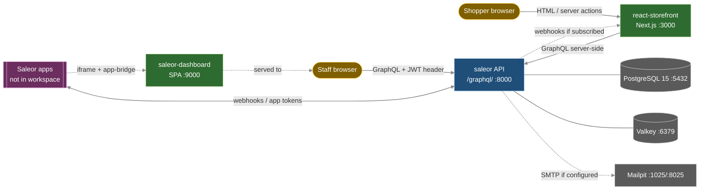

# ARCHITECTURE (workspace registry)

Purpose: cross-service architecture only: how `saleor-dashboard` and `react-storefront` talk to the `saleor` API, what couples them, how the stack runs locally.
Content: integration edges, contracts, coupling and local runtime. Repo internals live in each repo's `docs/ARCHITECTURE.md` (+ per-area files); not copied here. Business view: `CONTEXT.md`. Layout and root items: `CODEMAP.md`. Versions: `TECHSTACK.md`.
Style: terse bullets, grep by `##`, paths workspace-relative (`<repo>/...`), links relative to `docs/`. Facts verified against code 2026-10-21; unverified items in `ASSUMPTIONS.md`.

## Topology

- One backend, two clients, no shared code or packages between repos. The only runtime contract is the Saleor GraphQL API (+ webhooks back to the storefront).
- Ports above are the local run (`## Local runtime`), not defaults of any repo. Dashed api edges = not verified locally (WA-05, WA-07, WA-08).

## API contract
- Single endpoint `/graphql/` (Graphene 2, code-first). Lifecycle, limits, cost, errors: [saleor GRAPHQL-ARCHITECTURE](../saleor/docs/GRAPHQL-ARCHITECTURE.md).
- Dashboard calls it from the browser (Apollo, multipart uploads, `credentials: include`). Needs core CORS to allow the dashboard origin: `ALLOWED_GRAPHQL_ORIGINS`, default `*` (`saleor/saleor/settings.py`).
- Storefront calls it only from the Next.js server (kernel `react-storefront/src/lib/saleor`); browsers never hold Saleor tokens. CORS does not apply to it.
- Limits that bite clients: pagination max 100, mutation count 4 per request, batching max 1, query cost 50000 (core settings). Storefront page size 12, dashboard 20.
- Storefront traffic guard (core, ADR-0006/0007): when the shop disables storefront traffic, only staff and apps may call the API; the storefront then fails while the dashboard keeps working.

## Auth per client
- Core accepts `Authorization: Bearer|JWT <t>` and `Authorization-Bearer: <t>` (`saleor/saleor/core/auth.py`); staff/customer JWT RS256, JWKS at `/.well-known/jwks.json`; app tokens are separate.
- Dashboard: staff `tokenCreate`, access token in memory sent as `authorization-bearer`, refresh token + auth plugin id in browser localStorage (`saleor-dashboard/src/auth/tokenStorage.ts`). Non-staff accounts rejected. Details: [dashboard ARCHITECTURE](../saleor-dashboard/docs/ARCHITECTURE.md) `## Data layer`.
- Storefront: customer auth via `@saleor/auth-sdk` behind its own BFF routes (`src/app/api/auth/*`), tokens in httpOnly cookies on the storefront domain. Details: [storefront ARCHITECTURE](../react-storefront/docs/ARCHITECTURE.md) `## Auth (BFF)`.
- Storefront app token `SALEOR_APP_TOKEN` (an App created in core) is used for exactly two operations: channel list and order lookup by number ([storefront DATA-ARCHITECTURE](../react-storefront/docs/DATA-ARCHITECTURE.md) `## Kernel`). The App's permissions are granted in core/dashboard.
- Email links (confirm account, reset password): core builds them from a client-supplied `redirectUrl`, checked against core `ALLOWED_CLIENT_HOSTS`; storefront also allowlists (`react-storefront/src/lib/auth/validate-redirect-url.ts`).

## Schema and codegen coupling
| Repo | Schema source | Codegen output | Refresh |
|---|---|---|---|
| `saleor` | generated from code: `saleor/saleor/graphql/schema.graphql` | n/a | `uv run poe build-schema`; pre-commit `gql-schema-check` |
| `saleor-dashboard` | committed `schema-main.graphql` (release line `config.saleor.schemaVersion` = 3.23) + `schema-staging.graphql` (core `main`) | committed `src/graphql/*.generated.ts` | `pnpm run fetch-schema` (GitHub), `fetch-local-schema` (live `API_URL`), then `pnpm run generate` |
| `react-storefront` | none committed: live introspection of `NEXT_PUBLIC_SALEOR_API_URL` | git-ignored `src/gql/`, `src/checkout/graphql/generated/` | every `predev`/`prebuild`/`pretypecheck` (`generate:all`) |
- Observed 2026-10-21: core 3.23.41 and dashboard `schema-main.graphql` declare the same type/input/enum set (raw diff is `@doc` directive printing only); dashboard 3.23.39 is patch skew in the same 3.23 line. `schema-staging.graphql` (core `main`, fetch date unknown) lacks 20 of those declarations (e.g. `OrderAddNote`, `ExportGiftCards`) and adds 3 (`ProductType{Created,Updated,Deleted}` events).
- Dashboard `schema.graphql` is a tracked symlink to `schema-main.graphql`: `fetch-local-schema` overwrites the stable pin with whatever local API runs.
- Storefront is coupled to the running API, not a version: lint/typecheck/codegen fail without a reachable API. Its CI (`update_types.yml`) pulls the latest Saleor release schema, which can be ahead of local core 3.23.x.
- Dashboard multi-schema rules: [dashboard multi-schema](../saleor-dashboard/docs/multi-schema.md); core breaking-change rules: [saleor GRAPHQL-ARCHITECTURE](../saleor/docs/GRAPHQL-ARCHITECTURE.md) `## Schema change rules`.

## Webhooks and apps
- Core emits async/sync webhooks to apps or plain URLs; delivery, retries, circuit breaker: [saleor INTEGRATION-ARCHITECTURE](../saleor/docs/INTEGRATION-ARCHITECTURE.md).
- Storefront consumer: `POST /api/revalidate` busts cache tags per event ([storefront DATA-ARCHITECTURE](../react-storefront/docs/DATA-ARCHITECTURE.md) `## Invalidation`). Subscription is configured in core (Paper app on Saleor Cloud, or a manual webhook), not in storefront code.
- Signature: core sends `Saleor-Signature` (+ deprecated `X-Saleor-Signature`); value is HMAC-SHA256 hex only when the webhook has the deprecated `secretKey`, else a JWS (`saleor/saleor/webhook/transport/__init__.py`). Storefront verifies HMAC hex only (`react-storefront/src/lib/api-auth.ts`), else falls back to a Bearer/`x-revalidate-secret` = `REVALIDATE_SECRET` (core webhook custom headers). JWS is not verified (`ASSUMPTIONS.md` WA-01).
- Dashboard extensions: apps render in iframes via `@saleor/app-sdk/app-bridge`; dashboard pushes refreshed tokens to them; extension permissions must be a subset of the app's core permissions ([dashboard ARCHITECTURE](../saleor-dashboard/docs/ARCHITECTURE.md) `## Cross-cutting building blocks`).
- Storefront payments (Stripe, Dummy) are core transactions (`transactionInitialize` -> `transactionProcess`) handled by payment apps installed in core; Stripe.js in the browser only confirms the payment ([storefront CHECKOUT-ARCHITECTURE](../react-storefront/docs/CHECKOUT-ARCHITECTURE.md)). Gateway ids must match installed app identifiers.

## Permissions
- Enforcement is core-only (`saleor/saleor/permission/`, mutation/field permissions). Dashboard gates routes/UI by the same permission enum names but only hides; storefront has no staff permissions.
- UI vs API parity is not proven: `../saleor-dashboard/docs/ASSUMPTIONS.md` "UI permission gates mirror the API's enforcement".

## Local runtime
- Core stack: `saleor/.devcontainer/docker-compose.yml` (compose project `saleor-benchmark`). Observed running 2026-10-21 (`docker ps` + listeners, read-only): `saleor-benchmark-api` :8000, `db` postgres 15 :5432, `cache` valkey :6379, `mailpit` SMTP :1025 / UI :8025; plus `saleor-benchmark-saleor-1` with no published ports (role unknown; compose defines a `saleor` dev-container service, mapping unverified). API start command and mounts: unverified (WA-06).
- Compose also defines `dashboard` (`ghcr.io/saleor/saleor-dashboard:3.23` on :9000); it is NOT running. The local dashboard dev server (Vite) owns :9000; starting both collides.
- Dashboard dev server :9000 and storefront `next dev` :3000 are Node processes observed on the host; output in `logs/*.log`, PIDs in `logs/*.pid` (process artifacts, see `CODEMAP.md`). Storefront log shows calls to `http://localhost:8000/graphql/`.
- Env files hold secrets and are not documented here: `saleor/.devcontainer/*.env`, repo `.env*`, `saleor/.jwt_key.pem`. Read variable names from code/templates (`saleor/saleor/settings.py`, `saleor-dashboard/.env.template`, `react-storefront/.env.example`), never values. `saleor/.jwt_key.pem`: local dev only; untracked; never read or commit.
- `seed.dump` = sample data, reference only; no restore rule. `envs/` = tooling state, not a service.
- No separate Celery worker/beat container observed; broker setting unverified, so whether tasks run inline is unknown (see saleor ARCHITECTURE `## Process model`; `ASSUMPTIONS.md` WA-05).

## Cross-repo change rules
1. API change in core: model -> migration; then `uv run poe build-schema`; check GraphQL Inspector breaking-change policy.
2. Dashboard consuming it: refresh schema (`fetch-local-schema` for unreleased local API, otherwise `fetch-schema`), `pnpm run generate`, gate staging-only fields with `@lockSchema`.
3. Storefront consuming it: restart dev or run `generate:all` against the running API; keep `react-storefront` data-layer locks green (`data:lock`, `core:lock`).
4. Permission or webhook-event change: verify in core first; dashboard gates and storefront webhook handling follow.
5. Never assume a field exists in a client because it exists in core `main`: dashboard targets 3.23, storefront targets the connected API.

## Per-repo architecture index
- saleor: [ARCHITECTURE](../saleor/docs/ARCHITECTURE.md), [GRAPHQL-ARCHITECTURE](../saleor/docs/GRAPHQL-ARCHITECTURE.md), [INTEGRATION-ARCHITECTURE](../saleor/docs/INTEGRATION-ARCHITECTURE.md).
- saleor-dashboard: [ARCHITECTURE](../saleor-dashboard/docs/ARCHITECTURE.md), [multi-schema](../saleor-dashboard/docs/multi-schema.md), [configuration](../saleor-dashboard/docs/configuration.md).
- react-storefront: [ARCHITECTURE](../react-storefront/docs/ARCHITECTURE.md), [DATA-ARCHITECTURE](../react-storefront/docs/DATA-ARCHITECTURE.md), [CHECKOUT-ARCHITECTURE](../react-storefront/docs/CHECKOUT-ARCHITECTURE.md).
- Workspace layout: [CODEMAP](CODEMAP.md). Stacks: [TECHSTACK](TECHSTACK.md). Manifests: [DEPENDENCIES](DEPENDENCIES.md).
