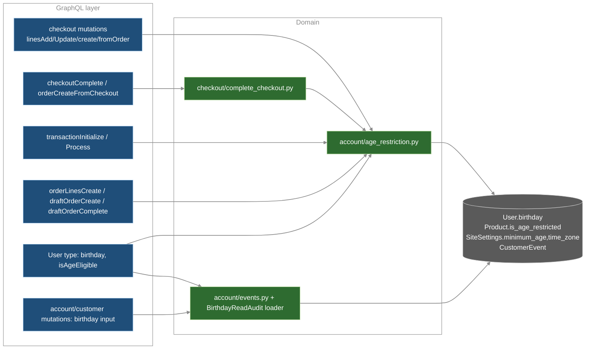
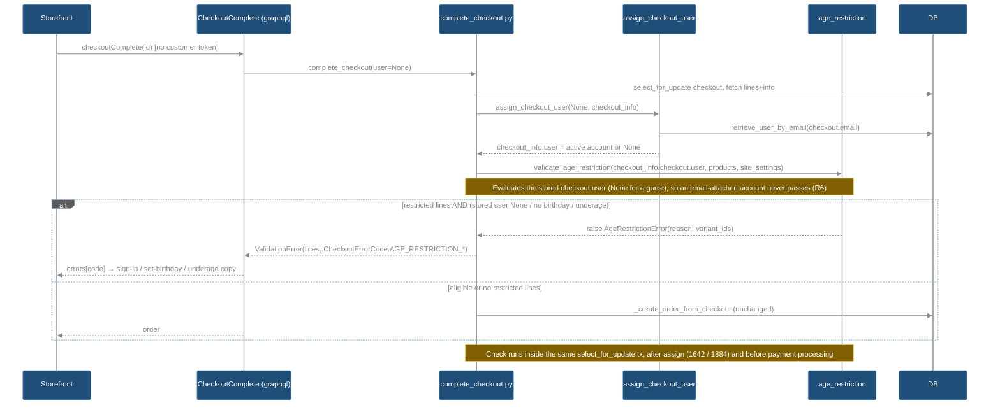

# AGE-RESTRICTION — Tech Specs

Status: **Approved** (user, 2026-10-23, with corrections C1–C3 applied). Scope: WHAT (target state). HOW lives in the companion plan (not written yet). Date: 2026-10-23.
Refs are workspace-relative; core paths are `saleor/saleor/...`. Decisions D1–D7 = approved user decisions (authoritative).

## TLDR
- `Product.is_age_restricted` (bool, public, MANAGE_PRODUCTS) + `SiteSettings.age_restriction_minimum_age` (int, default 18, public read) + `SiteSettings.time_zone` (IANA, default UTC), both editable with MANAGE_SETTINGS, read at check time.
- Restricted products stay visible to everyone, guests included; only buying is restricted. Storefront shows a `"{N}+"` label in listings and on the PDP.
- `User.birthday` (nullable DateField, PII, no backfill). Date readable only by owner and `is_superuser`; `isAgeEligible` (nullable bool) by owner + MANAGE_USERS; `isSuperuser` owner-only. Apps, anon and other staff get `null` on every route.
- One pure domain module `account/age_restriction.py`: eligible ⇔ signed-in ∧ birthday set ∧ shop-today ≥ birthday + N years (Feb 29 → Mar 1).
- Enforced at line add/update/create/create-from-order (UX guard) and at every completion path (authority), plus transactionInitialize/Process, orderLinesCreate, draftOrderCreate/Complete (no-customer drafts allowed). Checkouts are judged on the stored `checkout.user`, so a guest always gets LOGIN_REQUIRED even if `assign_checkout_user` matches the email to an account.
- New codes `AGE_RESTRICTION_{LOGIN_REQUIRED,BIRTHDAY_REQUIRED,UNDERAGE}` on checkout-facing enums; `AGE_RESTRICTION_NOT_ELIGIBLE` on staff/app enums.
- Audit: `CustomerEvent(user=customer)` `BIRTHDAY_CHANGED`/`BIRTHDAY_READ`, `parameters={customer_id, actor_user_id}`, one read per customer per request via a DataLoader. A custom `on_delete` keeps birthday events (FK set to NULL) when a user is deleted; all other event types still cascade.
- Schema is additive (no breaking label expected). Dashboard: product toggle, age settings, customer age card. Storefront: sign-in CTA, birthday fields, age error copy.
- Approved with C1–C3. Risks RK-1..4 in §16; FU-1 legal review of ToS/Privacy Policy in §17.

## TOC
1. Overview & Scope
2. NFR / ASR
3. Architecture & Components
4. Domain Service Contract
5. Enforcement Matrix
6. API Contract (GraphQL schema diff)
7. Permissions Matrix
8. Data Model & Migrations
9. Audit Log
10. Error Handling
11. Security (STRIDE)
12. Clients: Dashboard & Storefront
13. Test Cases
14. Affected Files
15. Dependencies
16. Assumptions & Open Questions
17. Non-code Follow-ups

## 1. Overview & Scope
- Goal: products flagged age-restricted can be bought only by signed-in customers whose self-declared birthday makes them ≥ shop minimum age "today" in shop time zone.
- REQ-VIS (C1): restricted products stay visible everywhere: catalog, search, listings, PDP, storefront, dashboard and API, for every requestor including guests and underage customers. Only buying is restricted (§5). No queryset, filter, channel listing or `isAvailableForPurchase` logic changes. Storefront shows an age label `"{N}+"` on restricted products in listings and on the PDP, where N = public `Shop.ageRestrictionMinimumAge` (§12). Spec audit: the only exclusions here are purchase-side (#4 `checkoutCreateFromOrder` lines, #10/#11 line detection). The only "hidden" UI element is the dashboard eligibility value when null. Nothing hides a product.
- In scope: core (model, API, enforcement, audit, leak-proofing), dashboard (product toggle, shop settings, customer age card), storefront (sign-in prompt, birthday input, age error copy), schema regen, migrations, CHANGELOG, dashboard changeset, tests per repo.
- Out of scope: identity/document verification (D5, self-declared), per-channel/region ages (D1), data backfill (D5), product CSV export column, staff (`staffCreate/Update`) birthday input, customer-create page birthday in dashboard, `orderConfirm`/`draftOrderUpdate` re-checks (completion is authority, see §5).
- Current state (verified): no birthday/age fields anywhere in core (`grep birth` → only gift-card `usage_restriction_reason`). `User` `account/models.py:169`; `Product` `product/models.py:179`; `SiteSettings` `site/models.py:38`; `CustomerEvent` `account/models.py:392`, enum `account/__init__.py:1`.

## 2. NFR / ASR
| ID | Requirement | Target / verification |
|---|---|---|
| NFR-1 | No N+1 for eligibility in checkout | 0 extra queries: `CheckoutLineInfo.product` (`checkout/fetch.py:54`) + `checkout_info.user` already loaded; site settings via `get_site_promise`/`Site.objects.get_current()` (cached). Benchmark test asserts unchanged count for `checkoutLinesAdd`/`checkoutComplete`. |
| NFR-2 | No N+1 on `User.isAgeEligible`/`birthday` in lists | Computed from row + one site-settings load per request; audit writes batched: ≤1 `INSERT` per request (DataLoader batch, §9). Benchmark: `customers(first:100){isAgeEligible}` ≤ baseline + 2 queries (site settings, audit insert). |
| NFR-3 | Draft order check | `lines__variant__product` prefetched; +≤1 query (email→user lookup only when `order.user` null and `user_email` set). |
| NFR-4 | Rule changes apply immediately | `age_restriction_minimum_age`/`time_zone` read at check time, never cached beyond request (D1). |
| NFR-5 | Backward compat | Additive schema only: new nullable/optional fields + new enum values. `Product.isAgeRestricted: Boolean!` is a new non-null output (non-breaking). New enum values = GraphQL Inspector "dangerous", not "breaking" → `approved-breaking-change` label NOT expected (verify on PR). Existing products default `false` → no behaviour change. |
| NFR-6 | Zero-downtime migrations | `AddField` with `default` + `db_default` (precedent `allow_storefront_traffic`, `site/models.py:77`); nullable `birthday`; no backfill, no data migration (D5). |
| NFR-7 | Privacy | Birthday is PII; never in logs, error messages/params, webhooks, search vector, filters, sorters, audit params (D5/D6). |
| NFR-8 | Determinism | Eligibility pure function of (birthday, min_age, today); `today` injectable for tests. |

## 3. Architecture & Components
- One domain module owns the rule: `saleor/saleor/account/age_restriction.py` (pure, no GraphQL). All enforcement points call it (DRY, SRP); each GraphQL mutation maps the domain exception to its own error enum (existing pattern: `NotApplicable`/`InsufficientStock` mapping in `order_create_from_checkout.py`, `complete_checkout.py:1793`).
- Read-side privacy is enforced once, on `User` GraphQL type field resolvers (`graphql/account/types.py:449`) → covers every route returning `User` (`me`, `user`, `customers`, `staffUsers`, `order.user`, `checkout.user`, `CustomerEvent.user`, subscription `UserBase.user` `graphql/webhook/subscription_types.py:1598`, federation).
- Legacy webhook payloads use explicit field lists (`webhook/payloads.py:602` `generate_customer_payload`) → birthday never added; leak test guards it.



Sequence: `checkoutComplete`, guest checkout whose email matches an account (D3 + OQ-3 decision):


## 4. Domain Service Contract — `saleor/saleor/account/age_restriction.py` (new)
```
class AgeRestrictionReason(StrEnum): LOGIN_REQUIRED; BIRTHDAY_REQUIRED; UNDERAGE
class AgeRestrictionError(Exception): reason: AgeRestrictionReason; variant_ids: list[int]   # no birthday/age in message
def get_shop_today(site_settings: SiteSettings, now: datetime | None = None) -> date
def get_eligibility_date(birthday: date, minimum_age: int) -> date
def get_age_ineligibility_reason(user: User | None, site_settings: SiteSettings, today: date | None = None) -> AgeRestrictionReason | None
def is_user_age_eligible(user: User | None, site_settings: SiteSettings, today: date | None = None) -> bool
def validate_age_restriction(user: User | None, variants_with_products: Iterable[tuple[ProductVariant, Product]], site_settings: SiteSettings, *, allow_anonymous: bool = False) -> None  # raises AgeRestrictionError
def resolve_order_customer(order: Order) -> User | None
def validate_birthday(birthday: date, site_settings: SiteSettings) -> None   # raises ValidationError(code=AccountErrorCode.INVALID)
```
Rules:
- R1 `get_shop_today` = `(now or timezone.now()).astimezone(ZoneInfo(site_settings.time_zone)).date()` (D2). Dates only.
- R2 `get_eligibility_date` = same month/day in `birthday.year + minimum_age`; Feb 29 → Mar 1 when target year not leap (D2).
- R3 eligible ⇔ `user` not None ∧ `user.birthday` not None ∧ `today ≥ get_eligibility_date(...)` (turning age today = eligible).
- R4 reason precedence: no user → `LOGIN_REQUIRED`; no birthday → `BIRTHDAY_REQUIRED`; else `UNDERAGE`.
- R5 `validate_age_restriction`: no-op if no product has `is_age_restricted`; `allow_anonymous=True` (staff drafts/orders only, D4) → `user is None` passes; otherwise raise with variant ids of restricted lines only.
- R6 Checkout customer = `checkout.user` as stored (decided OQ-3). `assign_checkout_user` (`checkout/complete_checkout.py:1704`) sets only `checkout_info.user`, not `checkout.user`. So at completion the check runs after assign (D3 placement) but evaluates `checkout_info.checkout.user`. A guest whose email matches an account (even an adult one) gets `LOGIN_REQUIRED`; an email attach never makes a checkout pass. A logged-in requestor completing a checkout with no user also gets `LOGIN_REQUIRED` (assign skips it).
- R7 `resolve_order_customer` mirrors `DraftOrderComplete.update_user_fields` (`graphql/order/mutations/draft_order_complete.py:73`): `order.user` or `User` by `order.user_email` (same lookup), else None.
- R8 `validate_birthday`: not in future vs `get_shop_today`; not older than `MAX_AGE_YEARS = 120` (assumption A3). Message generic ("Invalid birthday."), no value echo.
- R9 `age_restriction_minimum_age` and `time_zone` read from the `SiteSettings` passed in at call time (D1).

## 5. Enforcement Matrix
Codes: `LR`=`AGE_RESTRICTION_LOGIN_REQUIRED`, `BR`=`AGE_RESTRICTION_BIRTHDAY_REQUIRED`, `UA`=`AGE_RESTRICTION_UNDERAGE`, `NE`=`AGE_RESTRICTION_NOT_ELIGIBLE` (BR∪UA collapsed on staff/app surfaces, §11 I-2). Error `field="lines"`, `variants=[restricted variant global ids]`. Completion (#5–#9, #13) is the authority (D4); line-time checks are UX guards.

| # | Path | Hook point (verified) | Customer evaluated | anon allowed | Error |
|---|---|---|---|---|---|
| 1 | `checkoutLinesAdd` | `graphql/checkout/mutations/checkout_lines_add.py:156` `clean_input` (after `validate_checkout_lines` :87) | `checkout.user` | no | `CheckoutErrorCode` LR/BR/UA |
| 2 | `checkoutLinesUpdate` | `checkout_lines_update.py:146` `clean_input`; only input lines with `quantity>0` on restricted products (removal always allowed) | `checkout.user` | no | `CheckoutErrorCode` LR/BR/UA |
| 3 | `checkoutCreate` with `lines` | `checkout_create.py:258` `clean_checkout_lines` | `info.context.user` (becomes `checkout.user`, :532) | no | `CheckoutErrorCode` LR/BR/UA |
| 4 | `checkoutCreateFromOrder` | `checkout_create_from_order.py:287` `clean_order_lines` → restricted lines excluded (existing exclusion semantics) | `info.context.user` (:371-377) | no | `unavailableVariants[].code` ∈ `CheckoutCreateFromOrderUnavailableVariantErrorCode` LR/BR/UA |
| 5 | `checkoutComplete` → transaction flow | `checkout/complete_checkout.py:1642` after `assign_checkout_user`, in `create_order_from_checkout` tx; mapped in `complete_checkout_with_transaction` :1793 | `checkout_info.checkout.user` (stored, pre-attach; R6) | no | `CheckoutErrorCode` LR/BR/UA |
| 6 | `checkoutComplete` → legacy payment flow | `complete_checkout.py:1884` after assign, before `complete_checkout_pre_payment_part` (no payment processed); handled as other pre-payment `ValidationError` (`_complete_checkout_fail_handler`) | same | no | `CheckoutErrorCode` LR/BR/UA |
| 7 | `orderCreateFromCheckout` (app, HANDLE_CHECKOUTS) | via #5 `create_order_from_checkout` (`order_create_from_checkout.py:240`); mutation maps `AgeRestrictionError` | same | no | `OrderCreateFromCheckoutErrorCode` LR/NE |
| 8 | Auto-completion task | `checkout/tasks.py:287` → `complete_checkout` → #5/#6; `ValidationError` already caught + logged (code only) | same | no | logged, checkout kept |
| 9 | Stripe legacy plugin webhook | `payment/gateways/stripe/webhooks.py:211` → `complete_checkout` | same (`user=checkout.user`) | no | logged (existing `except ValidationError`) |
| 10 | `transactionInitialize` (checkout source) | `graphql/payment/mutations/transaction/transaction_initialize.py:179` `validate_checkout` (:229) extended | `checkout.user` (R6) | no | `TransactionInitializeErrorCode` LR/BR/UA |
| 11 | `transactionProcess` (checkout source) | `transaction_process.py:193` `validate_checkout` (:231) extended | same as #10 | no | `TransactionProcessErrorCode` LR/BR/UA |
| 12 | `orderLinesCreate` (draft + editable unconfirmed orders; no-customer allowed per D4, extended to unconfirmed — A6) | `graphql/order/mutations/order_lines_create.py:197` after `validate_variants` | `resolve_order_customer(order)` | yes | `OrderErrorCode` NE |
| 13 | `draftOrderComplete` | `draft_order_complete.py:168` after `validate_draft_order`, before status change/`update_user_fields` | `resolve_order_customer(order)` | yes | `OrderErrorCode` NE |
| 14 | `draftOrderCreate` with `lines` | `draft_order_create.py:321` `clean_lines` | cleaned `user` (`user` or active email match, :235) | yes | `OrderErrorCode` NE |

- No-customer drafts (C3, D4): for #12–#14, `resolve_order_customer(order) is None` ⇒ `validate_age_restriction(..., allow_anonymous=True)` passes. A draft with restricted lines and no linked customer is accepted at `draftOrderCreate` and `orderLinesCreate` and completes at `draftOrderComplete`. Linked customer without birthday or underage ⇒ `NE` until the birthday is set or the customer is unlinked.
- Not checked (completion catches): `checkoutCustomerAttach/Detach`, `checkoutEmailUpdate`, `draftOrderUpdate` (user change), `orderLineUpdate`, `orderConfirm` (A6).
- #10/#11 restricted-line detection: one query `checkout.lines.filter(variant__product__is_age_restricted=True)` (variant ids), no full `fetch_checkout_lines`.
- #1/#2 line-time validation matches variants to input lines by variant id, never by position (review 21 M-1, fixed 2026-10-23). Force-new and zero-quantity duplicates of a restricted variant are validated through their positive total.
- Scope decision (review 21 M-2, decided 2026-10-23): `orderBulkCreate` is exempt from the age rule. It imports historical or external orders for staff with the import permission, so neither its customer nor its lines are checked. Documented by `test_order_bulk_create_age_restricted_line_imported_without_age_check`. Completion-style checks are not added there.

## 6. API Contract — GraphQL schema diff (`saleor/saleor/graphql/schema.graphql`, regen `uv run poe build-schema`)
No name collisions (verified: `timeZone|minimumAge|isAgeRestricted|birthday` absent). All descriptions suffixed `ADDED_IN_324` (new constant in `graphql/core/descriptions.py`, A1).
```graphql
type Product { isAgeRestricted: Boolean! }                      # public read
input ProductInput { isAgeRestricted: Boolean }                 # inherited by ProductCreateInput, ProductBulkCreateInput; MANAGE_PRODUCTS (existing)
type Shop { ageRestrictionMinimumAge: Int!                      # public read (A4)
            timeZone: String! }                                 # PermissionsField [MANAGE_SETTINGS]
input ShopSettingsInput { ageRestrictionMinimumAge: Int         # 1..120, null ignored; MANAGE_SETTINGS (existing)
                          timeZone: String }                    # IANA name ∈ zoneinfo.available_timezones()
type User { birthday: Date                                      # owner | is_superuser user; else null (§7)
            isAgeEligible: Boolean                              # owner | user with MANAGE_USERS; else null; apps null
            isSuperuser: Boolean }                              # decided OQ-1: owner only (requestor == U, not app), else null; dashboard UI gate
input AccountInput { birthday: Date }                           # accountUpdate; owner only; null = clear
input AccountRegisterInput { birthday: Date }                   # accountRegister; optional
input CustomerInput { birthday: Date }                          # customerUpdate, customerBulkUpdate, customerCreate (UserCreateInput ⊂ CustomerInput); is_superuser only
enum CustomerEventsEnum { BIRTHDAY_CHANGED BIRTHDAY_READ }
enum CheckoutErrorCode | TransactionInitializeErrorCode | TransactionProcessErrorCode | CheckoutCreateFromOrderUnavailableVariantErrorCode
  { AGE_RESTRICTION_LOGIN_REQUIRED AGE_RESTRICTION_BIRTHDAY_REQUIRED AGE_RESTRICTION_UNDERAGE }
enum OrderCreateFromCheckoutErrorCode { AGE_RESTRICTION_LOGIN_REQUIRED AGE_RESTRICTION_NOT_ELIGIBLE }
enum OrderErrorCode { AGE_RESTRICTION_NOT_ELIGIBLE }
```
Contract notes:
- `birthday` is NOT added to `UserInput` (`graphql/account/mutations/base.py:177`) → `staffCreate/staffUpdate` (`StaffInput(UserInput)`, `staff/staff_create.py:32`) unaffected.
- Write gate: key `birthday` present ∧ requestor not allowed → `PermissionDenied` (top-level `PERMISSION_DENIED`), mutation not applied. Allowed: `accountUpdate`/`accountRegister` = authenticated user acting on self (app impersonation via `AppImpersonateMixin`, `account_update.py:47`, is rejected); `Customer*` = `user.is_superuser` (app tokens rejected even with MANAGE_USERS).
- Read gate: unauthorized → `null`, no error (keeps list queries clean, does not reveal set/unset). Implemented as plain resolvers, not `PermissionsField` (which raises).
- Requestor resolution uses `get_user_or_app_from_context` (`graphql/utils/__init__.py:204`, app first) → any app context (incl. webhook subscriptions, `subscription_payload.py:26` sets `request.app`; `request.requestor` is ignored) yields `null`.
- No `birthday`/`isAgeEligible` in any `where`/`filter`/`sortBy` input; not added to user search vector (`account/search.py:38`).
- Error enums: domain codes in `checkout/error_codes.py:4,40,65`, `order/error_codes.py:4`, `payment/error_codes.py:87,95`; graphene enums auto-derived (`graphql/core/enums.py:228,389`).

## 7. Permissions Matrix (D5; perms verified `permission/enums.py:16-19,89-90`)
| Requestor (vs target user U) | `U.birthday` read | `U.isAgeEligible` read | write `birthday` | audit |
|---|---|---|---|---|
| Owner (requestor == U, incl. staff/superuser on self) | value | value | ✓ `accountUpdate`; `accountRegister` only when anonymous (A14) | change logged; reads not logged (A5) |
| `is_superuser` user (≠ U) | value | value | ✓ `customerCreate/Update/BulkUpdate` | change + read logged |
| Staff with `MANAGE_USERS` (not superuser) | null | value | ✗ PermissionDenied | flag read logged as birthday read (D6) |
| Other staff (incl. `MANAGE_STAFF`, `MANAGE_ORDERS`) | null | null | ✗ | — |
| App (any perms incl. `MANAGE_USERS`, `IMPERSONATE_USER`; webhooks/subscriptions) | null | null | ✗ (incl. impersonated `accountUpdate`) | — |
| Anonymous | null | null | ✓ only `accountRegister` input | change logged (actor = new user) |
- Settings: `ageRestrictionMinimumAge`/`timeZone` write = `MANAGE_SETTINGS` (`shop_settings_update.py:177`). Product flag write = `MANAGE_PRODUCTS` (`product_create.py:138`, `product_update.py:41`).
- `User.isSuperuser` read: owner only (value); everyone else including apps → null; output-only (TC-SEC-11).
- "superuser" = `User.is_superuser` (no permission enum exists for it; `has_perm` grants all perms to active superusers, `account/models.py:355`).

## 8. Data Model & Migrations (schema only, no backfill — D5)
| Model (file:line) | Field | Type | Migration (next after verified leaf) |
|---|---|---|---|
| `account.User` (`account/models.py:169`) | `birthday` | `DateField(null=True, blank=True)` | `account/migrations/0106_user_birthday.py` (leaf `0105_add_manage_customer_types_and_attributes_perm`) |
| `account.CustomerEvent.type` choices (`account/models.py:396`, from `CustomerEvents` `account/__init__.py:1`) | + `BIRTHDAY_CHANGED="birthday_changed"`, `BIRTHDAY_READ="birthday_read"` | choices only | same `0106` (`AlterField`, state-only) |
| `account.CustomerEvent.user` (`account/models.py:404-405`, today `on_delete=CASCADE, null=True`) | `user` | `ForeignKey(User, related_name="events", null=True, on_delete=cascade_except_retained_customer_events)` (§9) | same `0106` (`AlterField`). State-only on Django 5.2.18 (`uv.lock`): `on_delete` is enforced by the ORM, not the DB. Verify `sqlmigrate account 0106` emits no FK SQL. |
| `product.Product` (`product/models.py:179`) | `is_age_restricted` | `BooleanField(default=False, db_default=False)` | `product/migrations/0211_product_is_age_restricted.py` (leaf `0210_collection_external_reference_unique_constraint`) |
| `site.SiteSettings` (`site/models.py:38`) | `age_restriction_minimum_age` | `PositiveSmallIntegerField(default=18, db_default=18, validators=[Min(1), Max(120)])` | `site/migrations/0053_sitesettings_age_restriction.py` (leaf `0052_sitesettings_allow_storefront_traffic`) |
| `site.SiteSettings` | `time_zone` | `CharField(max_length=64, default="UTC", db_default="UTC")` | same `0053` |
- No index on `is_age_restricted` (read via already-joined line info). No index on `birthday` (no filters by design).
- Rollback: all fields additive; reverse migrations drop columns (birthday data loss accepted; document in CHANGELOG).
- Leaf numbers must be re-verified with `makemigrations --check` at implementation time (parallel branches).

## 9. Audit Log (D6) — reuse `CustomerEvent`
- Row (decided OQ-2): `CustomerEvent(user=<subject U>, type=BIRTHDAY_CHANGED|BIRTHDAY_READ, date=now, parameters={"customer_id": U.pk, "actor_user_id": <int>}, app=None, order=None)`. NEVER old/new values, never `message` (so `CustomerEvent.message` resolves null, `graphql/account/types.py:254`). `customer_id` duplicates `user_id` on purpose: it is the only link left after the customer is deleted.
- Subject in `user` so the trail is listed by `U.events` (`CustomerEventsByUserLoader` filters `user_id`, `graphql/account/dataloaders.py:120`). This deliberately differs from existing staff-action events, which store the actor in `user` (`account/events.py:11-112`); those events stay unchanged.
- Helpers (`saleor/saleor/account/events.py`):
```
def customer_birthday_changed_event(*, user: User, actor: User) -> CustomerEvent
def customer_birthday_read_events(*, user_ids: Iterable[int], actor: User) -> list[CustomerEvent]   # bulk_create, writer DB
```
- CHANGE: emitted once per user per mutation iff stored value changed (set, change, clear) in `accountRegister` (non-null input), `accountUpdate`, `customerCreate` (non-null input), `customerUpdate`, `customerBulkUpdate`. Actor = owner or superuser.
- READ: emitted from field resolvers only when a value is actually returned to a non-owner (superuser → `birthday`/`isAgeEligible`; `MANAGE_USERS` staff → `isAgeEligible`). Intentional asymmetry (review 21 N-1): `isAgeEligible` is audited even when the birthday is null, because its `false` value already reveals that the birthday is missing; `birthday` is not audited when null. Mechanism: `BirthdayReadAuditLoader(DataLoader[int, None])` in `graphql/account/dataloaders.py`; key = subject user id; DataLoader per-request cache ⇒ exactly one READ event per customer per request across both fields and all routes; `batch_load` = one `bulk_create` under `allow_writer()` (`core/db/connection.py:33`) on default (writer) connection even for replica-served queries. Resolver returns `loader.load(root.id).then(lambda _: value)`.
- Not logged: owner reads (A5), null resolutions, app contexts (always null). Mutation payloads that resolve the field (e.g. `customerUpdate{user{birthday}}`) count as reads.

### 9.1 Retention across user deletion (decided OQ-6: reuse `CustomerEvent`; birthday events survive)
- `RETAINED_CUSTOMER_EVENT_TYPES = frozenset({BIRTHDAY_CHANGED, BIRTHDAY_READ})` in `account/__init__.py`.
- Deletion hook = a custom `on_delete` callable on `CustomerEvent.user`, in new `saleor/saleor/account/deletion.py`:
```
def cascade_except_retained_customer_events(collector, field, sub_objs, using) -> None
    # CASCADE(collector, field, sub_objs.exclude(type__in=RETAINED), using); collector.add_field_update(field, None, sub_objs.filter(type__in=RETAINED))
```
- Why not a `pre_delete` signal or per-path code: Django's deletion `Collector` (`django/db/models/deletion.py:305-345`, Django 5.2.18) calls `on_delete(collector, field, sub_objs, using)` for every ORM delete, whether `instance.delete()` or `QuerySet.delete()`, inside the same transaction. One hook therefore covers every path, with no per-mutation code (DRY). `sub_objs` is a lazy `QuerySet`, so `filter`/`exclude` stay SQL-side.
- Paths covered (verified): `customerDelete`/`staffDelete` via `ModelDeleteMutation.perform_mutation` (`graphql/core/mutations.py:962`); `staff/staff_delete.py:54`; `customerBulkDelete` (`bulk_mutations/customer_bulk_delete.py:61`); `staffBulkDelete` (`staff_bulk_delete.py:76`); `accountDelete` (`account/account_delete.py:94`); `cleardb` (`core/management/commands/cleardb.py:105`). No raw-SQL user delete or `_raw_delete` on `User` found. The only `CustomerEvent._raw_delete` (`account/migrations/tasks/saleor3_23.py:56`) targets `digital_link_downloaded` only.
- Behaviour: other event types are deleted exactly as today, including staff-actor events (`user=staff`) when that staff member is deleted. Birthday events get `user_id=NULL` and keep `parameters.customer_id`/`actor_user_id`, both of which can then point to deleted users. `User.events` no longer lists them, and no API reads orphaned events (DB-only, R-2).
- Cost: +1 `UPDATE` per delete batch (`field_updates`). Remaining events are still fast-deleted (`CustomerEvent` has no signals and no reverse FKs).

## 10. Error Handling
| Condition | Surface | Code | Message (generic, no PII) |
|---|---|---|---|
| Restricted line, no customer | checkout/tx enums | `AGE_RESTRICTION_LOGIN_REQUIRED` | "Sign in to buy age-restricted products." |
| Restricted line, customer w/o birthday | checkout/tx enums | `AGE_RESTRICTION_BIRTHDAY_REQUIRED` | "Set your birthday to buy age-restricted products." |
| Restricted line, under age | checkout/tx enums | `AGE_RESTRICTION_UNDERAGE` | "You do not meet the minimum age for these products." |
| Staff draft/order, linked customer BR∪UA | `OrderErrorCode` | `AGE_RESTRICTION_NOT_ELIGIBLE` | "The customer is not eligible to buy age-restricted products." |
| App `orderCreateFromCheckout` | `OrderCreateFromCheckoutErrorCode` | `…LOGIN_REQUIRED` / `…NOT_ELIGIBLE` | as above |
| Birthday in future / > 120 y | `AccountError` | `INVALID` (existing), `field="birthday"` | "Invalid birthday." |
| Min age ∉ [1,120] / unknown tz | `ShopError` | `INVALID` (existing), field `ageRestrictionMinimumAge`/`timeZone` | precedent `shop_settings_update.py:230` |
| Birthday write not allowed | top-level GraphQL error | `PERMISSION_DENIED` | standard |
- Domain raises `AgeRestrictionError`; mapping per caller (§5). `params` carry only `variants` (global ids). Never include birthday, age or min age in message/params/logs (task logs at `checkout/tasks.py:297` print `str(error)` → only generic text).
- Failure at completion after funds authorized (rule/birthday/flag changed between #10/#11 and #5) → checkout not completed, funds remain on the checkout transaction; existing release/refund paths apply (A7). Legacy flow (#6) fails before `_process_payment` → no charge.
- Storefront/dashboard map codes to copy; unknown codes fall back to `message` (§12).

## 11. Security (STRIDE) — PII: `User.birthday`
| ID | Threat | Mitigation | Residual / test |
|---|---|---|---|
| S-1 | Minor self-declares false birthday | none (no identity verification, D5) | Known limitation; documented in CHANGELOG + docs |
| S-2 | Guest checkout uses an adult account's email so `assign_checkout_user` attaches it at completion | Check evaluates the stored `checkout.user` (R6, decided OQ-3), so guests always get `LOGIN_REQUIRED` | closed; TC-H-03, TC-E-11 |
| S-3 | App impersonation (`IMPERSONATE_USER`) sets birthday via `accountUpdate` | app context rejected for birthday input | TC-SEC-06 |
| T-1 | Non-superuser staff / app writes birthday | `PermissionDenied` on `CustomerInput.birthday` | TC-SEC-05 |
| T-2 | Client skips line-time guard | completion is authority (#5–#9, #13) | TC-E-05 |
| T-3 | Birthday/flag/min-age change between add and pay | re-check in completion `select_for_update` tx | TC-B-08 |
| T-4 | `MANAGE_SETTINGS` staff shifts `timeZone` to move "today" ±1 day | IANA validation only | accepted |
| R-1 | Staff denies reading/changing a birthday | `BIRTHDAY_READ`/`BIRTHDAY_CHANGED` with actor id | owner reads unlogged (A5) |
| R-2 | Audit lost when the customer is deleted | custom `on_delete` keeps birthday events (§9.1) | orphans are DB-only, not exposed in the API; TC-R-01..05 |
| R-3 | Future code deletes users with raw SQL/`_raw_delete`, or Django ≥6.1 `db_on_delete` changes FK semantics | migration test + TC-R-04 guard; note in code docstring | Django upgrade risk (RK-1) |
| I-5 | Retained events keep `customer_id` after erasure (GDPR Art. 17 vs accountability) | event holds only ids, type and time; no birthday value | legal sign-off (RK-2) |
| I-1 | Birthday leak via nested `User` (order/checkout/event/gift card/staff), subscriptions, apps, anon, other staff | single resolver gate, app-first requestor, `request.requestor` ignored, legacy payload explicit fields, no search/filter/sort, no export column | TC-SEC-01..08 |
| I-2 | Eligibility inferred from errors by `MANAGE_ORDERS` staff, apps or checkout-token holders | staff/app enums collapse BR∪UA to `NOT_ELIGIBLE`; messages generic | accepted (OQ-4) |
| I-3 | Birthday reconstructed by repeated `isAgeEligible` reads while varying min age (`MANAGE_USERS`+`MANAGE_SETTINGS`) | every flag read audited | accepted (OQ-5) |
| I-4 | Birthday in logs / Sentry / error params | generic messages, `params` = variant ids only | code review + TC-E-06 |
| D-1 | Audit write amplification (`customers(first:100){isAgeEligible}`) | one `bulk_create` per request, pagination cap 100; dashboard list never selects the flag | TC-P-02 |
| E-1 | Escalation to read birthday with `MANAGE_USERS`/`MANAGE_STAFF` | date gated on `is_superuser` only; `isAgeEligible` output-only | TC-SEC-04 |
- Compliance: GDPR data minimisation (date visible to owner + superuser only), records of access (D6), erasure (user delete removes the birthday; birthday audit events are kept pseudonymised, §9.1). No backfill, no defaults → no inferred ages.
- Storefront must not place `birthday` in shared/tagged caches (`me` data uncached, per-user BFF cookies).

## 12. Clients: Dashboard & Storefront
Dashboard (`saleor-dashboard`, targets 3.23 schema pin; see A8):
- Product flag: `ProductUpdateFormData.isAgeRestricted: boolean` (`src/products/components/ProductUpdatePage/types.ts:39`); init in `src/products/utils/data.ts` (~:209); submit in `src/products/views/ProductUpdate/handlers/utils.ts`; toggle in `src/products/components/ProductOrganization/ProductOrganization.tsx`; fragment `src/fragments/products.ts:215`. Create flow is minimal (`src/products/views/ProductList/createMinimalProduct.ts`) → flag defaults false, edited on update page.
- Shop settings: `src/fragments/shop.ts` (+`ageRestrictionMinimumAge`, `timeZone`); `src/siteSettings/mutations.ts:4`; new "Age restriction" `SettingsSection` in `src/siteSettings/components/SiteSettingsPage/SiteSettingsPage.tsx` (int 1..120; time-zone select, server is source of validity).
- Customer page: `CustomerDetails` fragment `src/fragments/customers.ts:151` (+`birthday`, `isAgeEligible`); `me` fragment `src/fragments/auth.ts:24` (+`isSuperuser`, decided OQ-1); new `src/customers/components/CustomerAgeCard/CustomerAgeCard.tsx` in `CustomerDetailsPage.tsx`: flag Yes/No when non-null (hidden when null); birthday shown + date input only if `me.isSuperuser`; `UpdateCustomer` (`src/customers/mutations.ts:4`) sends `birthday` key ONLY when a superuser changed it (others would get `PERMISSION_DENIED`). `CustomerListDatagrid` never selects the flag (audit noise, D-1).
- Errors: `src/utils/errors/order.ts` (+`AGE_RESTRICTION_NOT_ELIGIBLE` → "Customer is not eligible to buy age-restricted products"); birthday/shop `INVALID` use existing mappers (`account.ts`, `shop.ts`).
- Tooling: `pnpm run fetch-local-schema` + `pnpm run generate` (commit `*.generated.ts`), `pnpm run extract-messages`, `.changeset/*.md` (minor).

Storefront (`react-storefront`, coupled to running API):
- `src/graphql/ProductDetails.graphql` and `src/graphql/ProductListItem.graphql` (+`isAgeRestricted`) → `pnpm run data:lock` / `core:lock` as required.
- Age label (C1): new `src/graphql/ShopAgeRestriction.graphql` (`shop { ageRestrictionMinimumAge }`, public, cacheable; no storefront `shop` query exists today). New `src/ui/components/age-restriction-badge.tsx` renders `"{N}+"` only when `product.isAgeRestricted`. Used in the listing cards `src/ui/components/plp/{product-card-link,product-card-with-quick-add}.tsx`, in `src/ui/components/search-results.tsx` and on the PDP. Listing/PDP data and visibility are otherwise unchanged. Quick-add on a restricted card follows the PDP add-to-cart rules (sign-in CTA / error copy).
- `src/graphql/CheckoutAddLine.graphql` errors (+`field code`); `src/graphql/CheckoutLinesUpdate.graphql` same.
- `src/app/actions.ts:101` → `addVariantToCart(input): Promise<AddToCartResult>`; `type AddToCartResult = { ok: true } | { ok: false; code: string; message: string }`; no longer silent (still logs, no PII).
- PDP `src/ui/components/pdp/variant-section-dynamic.tsx:118` action returns result; `add-to-cart.tsx`/`sticky-bar.tsx` render it (`useActionState`). Restricted product + no session → "Sign in to buy" CTA (login with return URL) instead of add (D3). Signed in + `me.birthday == null` → "Set your birthday" link to account settings.
- Checkout: `src/checkout/lib/payment/format-checkout-complete-error.ts:7` + `gateway-messages.ts` map LR → sign-in (`src/checkout/components/contact/sign-in-form.tsx`), BR → set-birthday link, UA → underage copy.
- Sign-up: `src/ui/components/sign-up-form.tsx` optional date; `src/app/api/auth/register/route.ts:82` forwards `birthday`.
- Account: `src/graphql/CurrentUserProfile.graphql` (+`birthday isAgeEligible`; not in shared `UserDetailsFragment.graphql`); new `src/ui/components/account/edit-birthday-form.tsx` in `settings-page.tsx`; server action in `src/app/(storefront)/[locale]/[channel]/(main)/account/actions.ts` via `AccountUpdate.graphql`.
- Copy: `messages/en.json` keys (other locales fall back to base, `src/i18n/merge-messages.ts:9`).

## 13. Test Cases
Fixtures: `min_age=18`, `time_zone="UTC"`, frozen `now` (freezegun), `restricted_product` (`is_age_restricted=True`), `adult` (born 2000-01-01), `minor` (born 2012-06-01), `no_bday` customer. Core under `saleor/saleor/**/tests/` (clients per `saleor/docs/GRAPHQL-ARCHITECTURE.md:55`).

Core — unit (`account/tests/test_age_restriction.py`, new)
| ID | Input | Expected |
|---|---|---|
| TC-B-01 | born 2008-10-23, today 2026-10-23 | eligible (turns 18 today) |
| TC-B-02 | born 2008-10-24, today 2026-10-23 | `UNDERAGE` |
| TC-B-03 | born 2008-02-29; today 2026-02-28 / 2026-03-01 | `UNDERAGE` / eligible |
| TC-B-04 | born 2004-02-29, min 20, today 2024-02-29 (leap) | eligible |
| TC-B-05 | now 2026-10-22T10:00Z, born 2008-10-23; tz `Pacific/Kiritimati` (UTC+14) / `UTC` | eligible / `UNDERAGE` |
| TC-B-06 | now 2026-10-23T05:00Z, born 2008-10-23; tz `Pacific/Pago_Pago` (UTC−11) | `UNDERAGE` (shop today 10-22) |
| TC-B-07 | DST day `Europe/Warsaw` 2026-10-25 00:30 local | today = 2026-10-25 |
| TC-B-09 | `validate_birthday`: shop today ✓; shop tomorrow ✗; today−120y ✓; today−120y−1d ✗ | per R8 |
| TC-B-12 | reason precedence: None user / no birthday / minor | `LOGIN_REQUIRED` / `BIRTHDAY_REQUIRED` / `UNDERAGE` |
| TC-B-10 | `shopSettingsUpdate{ageRestrictionMinimumAge}` at the bounds 1 and 120 | accepted (inside the TC-E-09 range); `test_shop_settings_update_accepts_minimum_age_bounds` |
| TC-B-11 | `checkoutLinesUpdate(qty 0)` on a restricted line, see TC-E-03 | removal always allowed, also in a mixed request; `test_minor_update_quantity_zero_removes_restricted_line` |

Core — API/integration
| ID | Scenario | Expected |
|---|---|---|
| TC-H-01 | `adult` checkout: linesAdd restricted → transactionInitialize → checkoutComplete | order created |
| TC-H-02 | guest, non-restricted products, all completion paths | unchanged behaviour |
| TC-H-03 | guest checkout (lines via fixture), email = `adult` account: `checkoutComplete` (both flows), `orderCreateFromCheckout`, auto-completion | `AGE_RESTRICTION_LOGIN_REQUIRED`; no order; no attach-based pass (OQ-3) |
| TC-H-04 | draft, no customer, no `user_email` match (C3): `draftOrderCreate(lines=[restricted])`, `orderLinesCreate(restricted)`, `draftOrderComplete` | all succeed; order created with restricted line (D4) |
| TC-V-01 | anon, `minor`, `no_bday`: `products`, `products(search:)`, `product(slug)`, `category/collection.products`, `products(where:)` with a restricted product | restricted product returned, same as unrestricted (REQ-VIS); no new filter |
| TC-V-02 | dashboard-scope staff `products` list / `product` detail | restricted product visible, `isAgeRestricted` true |
| TC-H-05 | `accountUpdate{birthday}` owner; `accountRegister{birthday}` | stored; `me.birthday` returns; 1 `BIRTHDAY_CHANGED`, actor=self |
| TC-H-06 | superuser `customerUpdate/customerCreate/customerBulkUpdate{birthday}` | stored; event actor=superuser; unchanged value → no event |
| TC-H-07 | `shopSettingsUpdate{ageRestrictionMinimumAge:21,timeZone:"Europe/Warsaw"}` | saved; next check uses 21 (TC-B-10 accepts 1,120) |
| TC-H-08 | `productUpdate{isAgeRestricted:true}`; anon `product{isAgeRestricted}` | true; public read |
| TC-E-01 | guest `checkoutLinesAdd` / `checkoutCreate(lines)` restricted | `AGE_RESTRICTION_LOGIN_REQUIRED`, `variants`=[restricted] |
| TC-E-02 | `no_bday` / `minor` `checkoutLinesAdd`, `checkoutLinesUpdate(qty 2)` | `…BIRTHDAY_REQUIRED` / `…UNDERAGE` |
| TC-E-03 | `minor` `checkoutLinesUpdate(qty 0)` on restricted line (TC-B-11) | allowed (removal) |
| TC-E-04 | `minor` `checkoutCreateFromOrder` | checkout w/o restricted lines; `unavailableVariants[].code=…UNDERAGE` |
| TC-E-05 | restricted line injected (fixture) for `minor`: `checkoutComplete` (transaction + legacy payment), `orderCreateFromCheckout`, `automatic_checkout_completion_task`, Stripe webhook, `transactionInitialize`, `transactionProcess` | blocked with §5 codes; task: no order, warning logged; legacy: no `_process_payment` call |
| TC-E-06 | any age error | message/params/logs contain no birthday, age, min age |
| TC-E-07 | draft linked to `no_bday`: `orderLinesCreate`, `draftOrderComplete` | `OrderErrorCode.AGE_RESTRICTION_NOT_ELIGIBLE`; after customer unlinked or superuser sets adult birthday → completes |
| TC-E-08 | draft `user_email` = `minor` email, no `user` | `draftOrderComplete` blocked (A6) |
| TC-E-09 | `shopSettingsUpdate` min age 0 / 121 / tz `Mars/Base` | `ShopError INVALID` |
| TC-E-10 | birthday future / >120y | `AccountError INVALID`, field `birthday` |
| TC-E-11 | logged-in `adult` completes a checkout whose `user` is null; `transactionInitialize` on a guest checkout with an adult's email | `AGE_RESTRICTION_LOGIN_REQUIRED` (R6) |
| TC-B-08 | flag set / min age raised / birthday cleared after line add | completion blocks |
| TC-R-01 | customer with `BIRTHDAY_CHANGED` + `BIRTHDAY_READ` + `PLACED_ORDER` + `EMAIL_CHANGED` events → `customerDelete`, `customerBulkDelete`, `accountDelete` (each a separate case) | birthday events kept with `user_id=NULL` and `parameters.customer_id`/`actor_user_id` intact; all other events of that user deleted |
| TC-R-02 | staff with own events (`user=staff`, e.g. `ACCOUNT_ACTIVATED`) and own birthday events → `staffDelete`, `staffBulkDelete` | staff-actor events deleted (as today); birthday events where staff is the subject kept; birthday events where staff was only the actor stay linked to their customer |
| TC-R-03 | `User.objects.filter(...).delete()` and `instance.delete()` directly (model-level, no mutation) | same as TC-R-01 |
| TC-R-04 | regression guard: `CustomerEvent._meta.get_field("user").remote_field.on_delete is cascade_except_retained_customer_events`; `sqlmigrate account 0106` has no FK DDL | pass |
| TC-R-05 | delete query count (`customerBulkDelete` benchmark) | baseline + 1 UPDATE per batch |
| TC-SEC-01 | anonymous: `accountRegister{user{birthday isAgeEligible}}`, public queries | null |
| TC-SEC-02 | `MANAGE_ORDERS` staff: `order.user`, `checkout.user`, `CustomerEvent.user` | birthday null, flag null |
| TC-SEC-03 | `MANAGE_USERS` staff: `customers{birthday isAgeEligible}`, alias + `order.user` same customer | birthday null; flag value; exactly 1 `BIRTHDAY_READ` per customer per request |
| TC-SEC-04 | `MANAGE_USERS`+`MANAGE_STAFF` non-superuser | birthday null |
| TC-SEC-05 | non-superuser staff `customerCreate/Update/BulkUpdate{birthday}` | `PERMISSION_DENIED`; value unchanged; no event |
| TC-SEC-06 | app (`MANAGE_USERS`,`IMPERSONATE_USER`): `user{birthday isAgeEligible}`; `customerUpdate{birthday}`; impersonated `accountUpdate{birthday}` | null, null; denied; denied |
| TC-SEC-07 | `CUSTOMER_CREATED/UPDATED`, `STAFF_UPDATED` subscription querying `user{birthday isAgeEligible}`, triggered by superuser; legacy `generate_customer_payload` | null / key absent |
| TC-SEC-08 | `customers(search:"2000")` / schema introspection | no birthday match; `birthday` only in the 4 inputs of §6, in no filter/sort input |
| TC-SEC-10 | superuser reads other customer → event; owner reads self → none; event `parameters == {"customer_id": U.pk, "actor_user_id": id}` | per §9 |
| TC-SEC-11 | `isSuperuser`: superuser on `me` → true; staff on `me` → false; superuser reading another user, staff, app, anon → null | per §6 |
| TC-P-01 | `graphql/checkout/tests/benchmark/test_checkout_age_restriction_query_counts.py` (asserts exact counts): complete checkout guest 200 and customer 213 (S00 rows `test_complete_checkout`, `test_customer_complete_checkout`); `checkoutLinesAdd` unrestricted guest 83, customer 86 (pinned on this code) | query counts unchanged for unrestricted carts |
| TC-P-02 | `graphql/account/tests/benchmark/test_customers_birthday_query_count.py`: `customers(first:100){isAgeEligible}` | ≤ baseline + 2 (NFR-2). Measured 5 → 6: the baseline already loads site and settings, so only the audit INSERT is added |

Dashboard (Jest/RTL): product toggle ↔ `productUpdate` input (`handlers/utils.test.ts`); `SiteSettingsPage.test.tsx` age section validation + submit; `CustomerAgeCard` per role (superuser: date+edit; `MANAGE_USERS`: flag only; null: hidden); `saveComposition.test.ts` omits `birthday` unless changed; `src/utils/errors` order code message.
Storefront (Vitest), C1: TC-V-03 restricted product renders in PLP/search/PDP for guests (no filtering); TC-V-04 badge shown for `isAgeRestricted=true`, absent for false; TC-V-05 badge text uses the configured age (`ageRestrictionMinimumAge=21` → "21+", default → "18+").
Storefront (Vitest): `addVariantToCart` returns `{ok:false, code}` for each age code; PDP renders sign-in CTA for guest on restricted product; `formatCheckoutCompleteError` maps 3 codes; register route forwards `birthday`; birthday form action success + `INVALID` error.

## 14. Affected Files
`saleor` (core, paths under `saleor/saleor/`; N = new):
- Models/migrations: `account/models.py` (`User.birthday`, `CustomerEvent.user.on_delete`), `account/__init__.py` (`CustomerEvents`, `RETAINED_CUSTOMER_EVENT_TYPES`), `account/deletion.py` N, `product/models.py`, `site/models.py`, `account/migrations/0106_*` N, `product/migrations/0211_*` N, `site/migrations/0053_*` N.
- Domain: `account/age_restriction.py` N, `account/events.py`, `checkout/complete_checkout.py` (`assign_checkout_user`, `create_order_from_checkout`, `complete_checkout_with_transaction`, `complete_checkout_with_payment`), `checkout/error_codes.py`, `order/error_codes.py`, `payment/error_codes.py`.
- GraphQL: `graphql/account/types.py` (`User`), `graphql/account/dataloaders.py`, `graphql/account/mutations/base.py` (`CustomerInput`, `BaseCustomerCreate`), `graphql/account/mutations/account/{account_register,account_update}.py`, `graphql/account/mutations/staff/{customer_create,customer_update}.py`, `graphql/account/bulk_mutations/customer_bulk_update.py`, `graphql/product/types/products.py` (`Product` :941), `graphql/product/mutations/product/product_create.py` (`ProductInput`), `graphql/product/bulk_mutations/product_bulk_create.py` (verify field passthrough), `graphql/shop/types.py` (`Shop` :228), `graphql/shop/mutations/shop_settings_update.py`, `graphql/checkout/mutations/{checkout_lines_add,checkout_lines_update,checkout_create,checkout_create_from_order,checkout_complete,order_create_from_checkout}.py`, `graphql/payment/mutations/transaction/{transaction_initialize,transaction_process}.py`, `graphql/order/mutations/{order_lines_create,draft_order_create,draft_order_complete}.py`, `graphql/core/descriptions.py` (`ADDED_IN_324`), `graphql/schema.graphql` (generated).
- Unchanged but leak-tested: `webhook/payloads.py`, `graphql/webhook/subscription_types.py`, `account/search.py`.
- Repo root: `CHANGELOG.md` (new section, A1). Tests per §13.

`saleor-dashboard`: `schema-main.graphql` (+symlinked `schema.graphql`), `src/graphql/*.generated.ts`, `src/fragments/{products,shop,customers,auth}.ts`, `src/products/components/ProductUpdatePage/types.ts`, `src/products/components/ProductOrganization/ProductOrganization.tsx`, `src/products/utils/data.ts`, `src/products/views/ProductUpdate/handlers/utils.ts`, `src/siteSettings/{mutations.ts,components/SiteSettingsPage/SiteSettingsPage.tsx,components/SiteSettingsPage/messages.ts,views/index.tsx}`, `src/customers/{mutations.ts,components/CustomerDetailsPage/*,components/CustomerAgeCard/*}` N, `src/utils/errors/order.ts`, `locale/defaultMessages.json`, `.changeset/*.md` N, tests per §13.

`react-storefront`: `src/graphql/{ProductDetails,ProductListItem,CheckoutAddLine,CheckoutLinesUpdate,CurrentUserProfile,AccountUpdate}.graphql`, `src/graphql/ShopAgeRestriction.graphql` (N), `src/ui/components/age-restriction-badge.tsx` (N), `src/ui/components/plp/{product-card-link,product-card-with-quick-add}.tsx`, `src/ui/components/search-results.tsx`, `src/app/actions.ts`, `src/app/(checkout)/actions.ts`, `src/ui/components/pdp/{variant-section-dynamic,add-to-cart,sticky-bar}.tsx`, `src/checkout/lib/payment/{format-checkout-complete-error,gateway-messages}.ts`, `src/checkout/components/contact/sign-in-form.tsx`, `src/ui/components/sign-up-form.tsx`, `src/app/api/auth/register/route.ts`, `src/ui/components/account/{settings-page,edit-birthday-form}.tsx` (N), `src/app/(storefront)/[locale]/[channel]/(main)/account/actions.ts`, `messages/en.json`, data/core lock files if touched, tests per §13.

## 15. Dependencies
- No new packages. `zoneinfo` (stdlib) + `tzdata` (present in `uv.lock` transitively, platform marker varies — A2). Dashboard/storefront: native `Intl` for time-zone list / date input.
- Order: core (model → migrations → API → `build-schema`) → dashboard (fetch-local-schema, generate) ∥ storefront (`generate:all` against running core). Clients require the new core API (`docs/ARCHITECTURE.md` "Cross-repo change rules").

## 16. Assumptions & Open Questions
Assumptions (proceed unless rejected):
- A1 Release line: version is 3.23.41 (`saleor/__init__.py:4`); `CHANGELOG.md` top section is `# 3.23.0`. Spec adds `ADDED_IN_324` + a new `# 3.24.0` CHANGELOG section. Unverified which line this branch targets.
- A2 IANA data at runtime: stdlib `zoneinfo`; `tzdata` in `uv.lock` (some entries win32-only). Linux image must ship system tzdata, else add `tzdata` explicitly.
- A3 Birthday max age 120 years (D2 asked for a proposal).
- A4 `Shop.ageRestrictionMinimumAge` public: now required by C1 (storefront age label); `Shop.timeZone` `MANAGE_SETTINGS`.
- A5 Owner reads of own birthday/flag not audited (D6 permits).
- A6 Orders: customer = `order.user` or `user_email` match (mirrors `update_user_fields`, which does not filter `is_active`). Verified 2026-10-23 (review 21 N-9): `draftOrderCreate`'s email lookup filters `is_active=True` (pre-existing), so an inactive account with a matching email is not linked at create. Completion (`resolve_order_customer`) does not filter, so the age check at completion covers that account. Completion is the authority, so no change. `draftOrderUpdate`, `orderLineUpdate`, `orderConfirm` not re-checked (completion is authority).
- A7 Funds authorized before a blocked completion follow existing release/refund paths (not verified for this case).
- A8 Dashboard regenerates `schema-main.graphql` from local core (`fetch-local-schema`, overwrites 3.23 pin); no `@lockSchema` gating.
- A9 Non-English storefront locales fall back to English copy.
- A10 Unauthorized reads return `null` silently (not `PermissionsField` error convention).
- A11 Checkout-facing enums expose the 3-way reason to any holder of the checkout id / app calling checkout mutations.
- A12 No customer export exists (core `saleor/csv/tasks.py` exports products, gift cards, voucher codes only; none found in dashboard `src/customers`) → D7 "export" leak test = assert no export path serializes `birthday`.
- A13 Dashboard `ProductCreatePage` has only `form.tsx` (no page component found) → toggle on update page only.
- A14 `accountRegister` accepts optional `birthday` only from anonymous requests (decided 2026-10-23, review 21 m-3, closes S02-I1). An authenticated register with `birthday` (customer, staff or app) returns `PERMISSION_DENIED`; the new account is created by an anonymous request, so the "owner" in S§7 means the new account, not the requestor. Actor = new user.
- A15 Storefront PDP (`products/[slug]/page.tsx`, cached data) can detect signed-in state for the CTA without making product data per-user; if not, CTA is chosen from the add-to-cart `LR` result instead (unverified).

A1–A15 were accepted by the user as proposed (the spec itself is not yet approved).

Decided (user, 2026-10-23):
- OQ-1 Add `User.isSuperuser: Boolean`, owner-only (null otherwise); dashboard gates birthday UI on `me.isSuperuser` (§6, §12).
- OQ-2 `CustomerEvent.user` = customer (subject); actor in `parameters.actor_user_id` (+`customer_id`, §9).
- OQ-3 A guest checkout (stored `checkout.user` null) with restricted lines always gets `AGE_RESTRICTION_LOGIN_REQUIRED`, even if its email matches an adult account (R6).
- OQ-4 Collapsed `NOT_ELIGIBLE` on staff/app surfaces: accepted. OQ-5 I-3 residual: accepted. OQ-7 No eligibility snapshot on orders: accepted.
- OQ-6 Reuse `CustomerEvent`; birthday events survive user deletion; all other types keep today's cascade (§9.1).

Risks raised by the OQ-6 design (feasible, verified against Django 5.2.18 `deletion.py`):
- RK-1 The custom `on_delete` callable relies on `Collector.add_field_update`/`CASCADE`. These are used by Django's built-in handlers but are not a formally documented extension API. Re-verify on Django upgrades, especially if `db_on_delete` (DB-level FK actions) is adopted. TC-R-04 is the guard.
- RK-2 (→ FU-1c) GDPR: retained events keep `customer_id` and `actor_user_id` after erasure. They are pseudonymous ids only, with no birthday value. Needs legal/DPO confirmation of the accountability basis and of a retention period (none is specified; no purge task in scope).
- RK-3 Orphaned birthday events (`user_id NULL`) are not readable through any API. Audit review after deletion is DB-only. Exposing them would need a new query (out of scope).
- RK-4 Any future raw-SQL or `_raw_delete` of users would bypass the hook and fall back to the DB FK. That FK is `DEFERRABLE` with no `ON DELETE`, so the delete would fail on the FK rather than silently lose events. Acceptable, but call it out in the docstring.

## 17. Non-code Follow-ups (C2; no code or doc-site edits in this feature)
- FU-1 LEGAL REVIEW of the Terms of Service and Privacy Policy, owned by the merchant/legal team, before release:
  - (a) age restriction of products and the self-declared (unverified) birthday, S-1;
  - (b) collecting and processing birthday (personal data): lawful basis, purpose, who can see it (owner + super-admin), no sharing with apps/webhooks;
  - (c) retention of birthday audit events after account deletion (pseudonymous `customer_id`/`actor_user_id`) and the retention period, tied to RK-2;
  - (d) logging of staff access to birthday/eligibility (D6).
