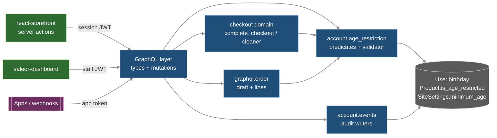
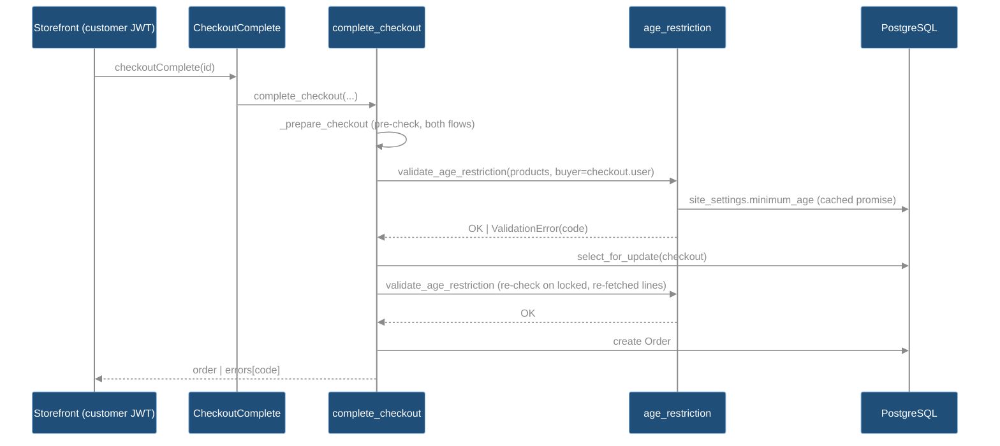

<CRITICAL ATTRIBUTION="DO NOT COMPACT/OPTIMIZE/SUMMARIZE/REPHRASE, PASS AS-IS">

# MIN-AGE tech specs — age-restricted products. Status: Approved (2026-10-22, with D6 corrections)

## TLDR
- Core adds `Product.is_age_restricted` (default false), `SiteSettings.minimum_age` (default 18) + `SiteSettings.time_zone` (IANA, default "UTC"), both MANAGE_SETTINGS, `User.birthday` (nullable date); 3 additive migrations.
- One domain module `saleor/account/age_restriction.py`: shop "today" (date in `time_zone`), age math (29 Feb → 1 Mar), buyer check, ONE shared validator, access predicates.
- Checkout: guest → `AGE_RESTRICTED_LOGIN_REQUIRED`; no birthday → `..._BIRTHDAY_REQUIRED`; too young → `..._UNDERAGE`; non-owner requestors see `..._NOT_ELIGIBLE`.
- Enforced at checkoutCreate/LinesAdd/LinesUpdate/CreateFromOrder; completion re-checks under lock (authority) for both payment flows, orderCreateFromCheckout, auto-complete; read-side `CheckoutLineProblemAgeRestricted`.
- Drafts: only the explicit `order.user` link counts (no email match); none → allowed; ineligible → blocked at line add/update, create, complete. `orderBulkCreate` not checked.
- `User.birthday`: owner or superuser only (first-party JWT; app/thirdparty tokens excluded), null otherwise; write via `accountUpdate` (owner) and new `customerBirthdayUpdate` (superuser, any user).
- `User.isAgeEligible`: owner or MANAGE_USERS staff, null otherwise; `User.canManageBirthday` drives dashboard UI.
- Audit CustomerEvents BIRTHDAY_UPDATED/VIEWED, AGE_ELIGIBILITY_VIEWED (deduped per request); PII exit paths P1-P16 closed.
- D6: restricted products stay visible everywhere with public `Product.ageLabel` ("18+"); errors NAME the products; placed orders untouched; age audit events survive user deletion (custom `on_delete`, no PII).
- Dashboard: flag card, min-age + time-zone card, customer birthday/eligibility, "N+" chips; Storefront: birthday form, sign-in prompt, "N+" badges, mapped errors. Schema additive.

## TOC
1. Scope, decisions trace, ACs, MoSCoW
2. NFR / ASR
3. Architecture & components
4. Data model & migrations
5. GraphQL contract & access control
6. Enforcement rules & call sites
7. Birthday & age rules
8. Privacy proofs (PII exit paths)
9. Security (STRIDE)
10. Dashboard
11. Storefront
12. Test cases
13. Local verification
14. Backward compatibility
15. Files / areas affected
16. Assumptions & not verified
17. Open questions

Legend: FACT = verified in code (file:line, 2026-10-22); ASSUMPTION = not verified. Paths repo-relative per repo (`saleor/`, `saleor-dashboard/`, `react-storefront/`). Binding input: `MIN-AGE-DECISIONS.md` (D1-D4). Specs = WHAT; HOW/sequence = companion plan (not written).

## 1. Scope, decisions trace, ACs, MoSCoW
Decision → spec trace:
| Decision | Spec sections |
|---|---|
| D1 product flag + one store-wide min age (default 18, MANAGE_SETTINGS) | §4.1-4.2, §5.1-5.2, §10.1-10.2 |
| D2 guest blocked, no-birthday blocked, shop-TZ date compare | §4.2, §5.2, §6.1-6.3, §7.2-7.3, §10.2, §11.2-11.3 |
| D3 birthday self/superuser write, owner/superuser read, `isAgeEligible` yes/no, audit | §4.3-4.4, §5.3-5.6, §7.1, §8, §9, §10.3, §11.1 |
| D4 checkout add/update/create + completion authority; drafts no exemption | §6.1-6.5, §10.4 |
| D5 eligible perm MANAGE_USERS; shop TZ setting; 29 Feb → 1 Mar; drafts explicit link only; `orderBulkCreate` unchecked | §5.5, §4.2, §5.2, §7.2-7.3, §6.1, §6.4 |
| D6 PR-1..7 approved; C1 visible + "N+" label; C2 error names product, placed orders unchanged; C3 audit survives user delete | §5.1, §10, §11; §6.2-6.3; §4.5, §5.6 |

Acceptance criteria (tests in §12 reference these IDs):
- AC1 Staff with MANAGE_PRODUCTS set/clear `Product.isAgeRestricted` via productCreate/Update/BulkCreate; default false; existing rows false.
- AC2 MANAGE_SETTINGS staff set `Shop.minimumAge` (1..120, default 18) and `Shop.timeZone` (valid IANA name, default "UTC"); next check uses new values.
- AC3 Customer sets/changes/clears own birthday via `accountUpdate`; validity rules §7.1.
- AC4 Superuser sets/changes/clears any user's birthday via `customerBirthdayUpdate`; everyone else denied.
- AC5 `User.birthday` value returned only to owner or superuser (first-party JWT); null otherwise; absent from webhooks, export, logs, observability, Sentry.
- AC6 `User.isAgeEligible` value returned only to owner or staff with MANAGE_USERS (first-party JWT); null otherwise.
- AC7 Audit: CustomerEvent per birthday change; per superuser birthday read; per eligibility read (once per subject per request, only when value disclosed); these events survive deletion of actor or subject (D6-C3).
- AC8 Guest: restricted variant rejected on checkoutCreate/LinesAdd/LinesUpdate/Complete; restricted products returned by every product/listing/search query for anyone, with `ageLabel` "N+" (D6-C1).
- AC9 Logged-in no birthday → rejected; underage → rejected; eligible → allowed; unrestricted products never affected.
- AC10 Completion re-checks (authority): checkoutComplete (transaction + legacy payment flow, auto-complete), orderCreateFromCheckout; error names each blocking product (D6-C2); checkoutCreateFromOrder skips restricted lines for ineligible buyer; placed orders never re-validated.
- AC11 `Checkout.problems` / `CheckoutLine.problems` report age-restricted lines.
- AC12 Drafts (explicit `order.user` link only, D5): no link → allowed; linked ineligible → orderLinesCreate/orderLineUpdate/draftOrderCreate lines rejected, draftOrderComplete rejected, `Order.errors` lists it.
- AC13 Dashboard: product flag + "N+" chip, site settings (min age, time zone), customer birthday (superuser), eligible flag (MANAGE_USERS).
- AC14 Storefront: birthday form in account settings; "N+" badge on PDP/PLP/search/cart/checkout lines; guest sign-in prompt; product-naming messages at add-to-cart and checkout.
- AC15 All repo quality gates green locally (§13).

MoSCoW:
- Must: §4, §5 (all), §6.1-6.5, §7, §8 mitigations, §10.1-10.3, §11.1-11.4, §12, §13.
- Should: cart line-problem warning in storefront (§11.5); non-en storefront translations; dashboard rendering of new CustomerEvent types.
- Could: `isAgeRestricted` in product export (`saleor/csv`), product list column/filter in dashboard, translated product names in errors. Birthday at sign-up: out (PR-5). Gift-reward skip: follow-up task (PR-6).
- Won't (this iteration): per-channel/per-region ages or time zones, ID verification, `orderBulkCreate` enforcement (D5: historical orders, out of scope), filtering/sorting users by birthday (forbidden, §8).

## 2. NFR / ASR
- Privacy-by-default: birthday is PII; access decided in ONE predicate (§5.5); default deny; no PII in error messages, logs, events params.
- Single source of truth: ONE domain validator (§3.2) for every write path; completion is authority (re-check under checkout row lock).
- Determinism: "today" = `get_shop_today(site_settings)` in `SiteSettings.time_zone` (§7.2); one call per check.
- Perf: no N+1 — validator takes already-fetched lines (`CheckoutLineInfo.product`, FACT `saleor/checkout/fetch.py` CheckoutLineInfo has `product`); buyer is `checkout.user` / order user (1 row). Query-count benchmark tests unchanged ±1 (site settings already loaded via `get_site_promise`).
- Backward compat: additive schema only (§14); migrations metadata-only (nullable / constant `db_default`).
- Replica rule: query-side audit writes inside `allow_writer()` (FACT ARCHITECTURE.md `## Data layer`: writer guard raises in tests).

## 3. Architecture & components
### 3.1 Component view

### 3.2 Domain module `saleor/account/age_restriction.py` (new; SRP: pure rules, no GraphQL)
- `class AgeCheckResult(StrEnum)`: `OK`, `LOGIN_REQUIRED`, `BIRTHDAY_REQUIRED`, `UNDERAGE`, `NOT_ELIGIBLE` (last = public-only value, never returned by `check_buyer`).
- `def get_shop_today(site_settings: SiteSettings, now: datetime | None = None) -> datetime.date` — §7.2.
- `def validate_time_zone(name: str) -> None` — §4.2b.
- `def calculate_age(birthday: date, today: date) -> int` — §7.3.
- `def is_age_eligible(user: User, minimum_age: int, today: date) -> bool` — birthday set and age ≥ min.
- `def check_buyer(buyer: User | None, *, minimum_age: int, today: date, guest_allowed: bool = False) -> AgeCheckResult`.
- `@dataclass(frozen=True) class AgeRestrictionItem: variant_id: int; product: Product; line_id: str | None` (global line id when the line exists).
- `def validate_age_restriction(*, items: Iterable[AgeRestrictionItem], buyer: User | None, requestor: User | App | None, site_settings: SiteSettings, error_codes: type[Enum], field: str, guest_allowed: bool = False) -> None` — `items` = lines in scope; no-op if none `is_age_restricted`; else `check_buyer`; on non-OK raises `ValidationError({field: ValidationError(msg, code=..., params={"variants": [...], "lines": [...]})})` naming products per §6.2. SINGLE shared validator; every call site in §6.4 uses it.
- `def public_reason(result: AgeCheckResult, *, requestor: User | App | None, buyer: User | None) -> AgeCheckResult` — §6.2 disclosure rule; reused by validator and problems resolver.
- Access predicates (§5.5): `can_read_birthday(context, subject) -> bool`, `can_write_birthday(context, subject) -> bool`, `can_read_age_eligibility(context, subject) -> bool`.

### 3.3 Checkout completion sequence (authority)

## 4. Data model & migrations
| # | Model (FACT location) | New field | Migration (FACT latest) |
|---|---|---|---|
| 4.1 | `Product` `saleor/product/models.py:179` | `is_age_restricted = BooleanField(default=False, db_default=False)` | `product/0211_product_is_age_restricted` (after `0210_collection_external_reference_unique_constraint`) |
| 4.2 | `SiteSettings` `saleor/site/models.py:38` | `minimum_age = PositiveSmallIntegerField(default=18, db_default=18, validators=[MinValueValidator(1), MaxValueValidator(120)])` | `site/0053_sitesettings_minimum_age_time_zone` (after `0052_sitesettings_allow_storefront_traffic`) |
| 4.2b | `SiteSettings` | `time_zone = CharField(max_length=63, default="UTC", db_default="UTC", validators=[validate_time_zone])`; `validate_time_zone(name: str) -> None` (in `age_restriction.py`): name ∈ `zoneinfo.available_timezones()` else `ValidationError` | same migration |
| 4.3 | `User` `saleor/account/models.py:169` | `birthday = DateField(null=True, blank=True)` | `account/0106_user_birthday_customer_event_types` (after `0105_...`); same migration `AlterField CustomerEvent.type` (choices change, FACT choices built from `CustomerEvents.CHOICES` `models.py:396-401`) |
| 4.4 | `CustomerEvents` `saleor/account/__init__.py:1` | constants §5.6 | — |
| 4.5 | `CustomerEvent.user` FK (FACT `models.py:404-406`: `on_delete=CASCADE, null=True`) | `on_delete=cascade_except_retained_events` (new callable in `saleor/account/models.py`) | same `account/0106` (`AlterField`) |
- 4.5 design (D6-C3): `RETAINED_CUSTOMER_EVENT_TYPES = {BIRTHDAY_UPDATED, BIRTHDAY_VIEWED, AGE_ELIGIBILITY_VIEWED}`; `def cascade_except_retained_events(collector, field, sub_objs, using) -> None` → `collector.add_field_update(field, None, retained)` for retained types, `models.CASCADE(collector, field, others, using)` for the rest. Other event types keep CASCADE semantics exactly.
- Works for every ORM delete path (Django 5.2.18, FACT `uv.lock:590-591`, cascades run in the Collector): `customerDelete`/`staffDelete` `instance.delete()` (FACT `staff/staff_delete.py:54`), `customerBulkDelete`/`staffBulkDelete` `queryset.delete()` (FACT `customer_bulk_delete.py:61`, `staff_bulk_delete.py:76`), `accountDelete` (FACT `account_delete.py:94`). Dev command `clearorders` deletes all CustomerEvents (FACT `saleor/core/management/commands/clearorders.py:199`) — unchanged, dev only.
- Migration steps (`account/0106`): (1) `AddField user.birthday`; (2) `AlterField customerevent.type` (choices); (3) `AlterField customerevent.user` (on_delete). (2)-(3) are state-only: `choices`/`on_delete` are non-DB attrs (ASSUMPTION; prove with `uv run python manage.py sqlmigrate account 0106` showing only the `ADD COLUMN`). No data migration; existing events unchanged; reversible.
- Identity after deletion: retained events keep `parameters.account_id` (subject pk) and `parameters.actor_id` (actor pk) — integer snapshot ids, no email/name/birthday; `user_id` becomes NULL. GDPR erasure (account delete): personal profile rows deleted; retained audit rows hold only pseudonymous ids + type + date (legal basis: accountability, ASSUMPTION; retention period §17).
- Perf: custom callable disables fast-delete for CustomerEvent → events of the deleted user are fetched by the Collector (bounded by user's events; acceptable).
- No index on new columns (no filter/sort by them; birthday filter forbidden §8).
- Constant `db_default` / nullable → PG metadata-only `ADD COLUMN`; old code inserting without the column keeps working (migrations-compatibility CI, FACT ARCHITECTURE.md `## Quality gates`).
- No data migration. No metadata usage for any of these values.
- `User.__str__` returns uuid (FACT `models.py:289-292`) — unchanged; `birthday` never added to `search_document`/`search_vector` (`saleor/account/search.py`).

## 5. GraphQL contract & access control
Descriptions end with `ADDED_IN_323` (ASSUMPTION: no `ADDED_IN_324` exists, FACT `saleor/graphql/core/descriptions.py:15-18`). `CHANGELOG.md` entry required.
### 5.1 Product (`saleor/graphql/product/`)
- `type Product { isAgeRestricted: Boolean!, ageLabel: String }` — both public, no permission (non-PII). `ageLabel` = `f"{site.settings.minimum_age}+"` when restricted, else null (resolver via `get_site_promise`; store-wide age, D6-C1). Clients render it verbatim.
- Visibility (D6-C1): restriction affects buying only. NO filter on `is_age_restricted` in `ProductsQueryset.published`/`visible_to_user` (FACT `saleor/product/managers.py:31,76`), variant/collection/category/search resolvers, channel listings, sitemaps/feeds; tests T-P-3.
- `input ProductInput { isAgeRestricted: Boolean }` (FACT `mutations/product/product_create.py:31`) → inherited by `ProductCreateInput` (:114), `ProductUpdate` input (`product_update.py:26`), `ProductBulkCreateInput` (`bulk_mutations/product_bulk_create.py:117`). Perm unchanged: MANAGE_PRODUCTS.
- Legacy webhook `PRODUCT_FIELDS` (`saleor/webhook/payloads.py`): Could add `is_age_restricted` (non-PII).
### 5.2 Shop (`saleor/graphql/shop/`)
- `type Shop { minimumAge: Int! }` — public (storefront message needs N). Resolver `site.settings.minimum_age` (pattern FACT `types.py:691`).
- `input ShopSettingsInput { minimumAge: Int }` (FACT `mutations/shop_settings_update.py:27`); `ShopSettingsUpdate` (:166) perm MANAGE_SETTINGS (FACT :177). null/absent = unchanged; outside 1..120 → `ShopErrorCode.INVALID`, field `minimumAge`.
- `type Shop { timeZone: String! }` — public (non-PII; IANA name). `input ShopSettingsInput { timeZone: String }`; unknown name / empty → `ShopErrorCode.INVALID`, field `timeZone` (via `validate_time_zone`); case-sensitive exact IANA key ("UTC", "Europe/Warsaw").
### 5.3 User type (`saleor/graphql/account/types.py:449`)
| Field | Type | Value returned when | Else | Audit |
|---|---|---|---|---|
| `birthday` | `Date` (`saleor/graphql/core/scalars.py:190`) | `can_read_birthday` | `null` (no error) | `BIRTHDAY_VIEWED` if requestor ≠ subject (owner reads unlogged: PR-3 approved) |
| `isAgeEligible` | `Boolean` | `can_read_age_eligibility` | `null` | `AGE_ELIGIBILITY_VIEWED` (incl. owner) |
| `canManageBirthday` (PR-1 approved) | `Boolean!` | always: `can_write_birthday(context, root)` | — | none (no PII) |
- Null-not-error: fields reachable from many parents (Order.user, Checkout.user, GiftCard.createdBy, CustomerEvent.user, `_entities`); PermissionDenied would break existing queries that add the field.
- `isAgeEligible` = `is_age_eligible(root, site_settings.minimum_age, get_shop_today(site_settings))`; false when birthday null.
- Federation `User.__resolve_references` (FACT `types.py:949`) returns model rows; field resolvers above still run → same rules.
- MUST NOT add birthday to any `where`/`filter`/`sort` input (oracle).
### 5.4 Mutations
- `accountUpdate(input: AccountInput)` (FACT `account_update.py:26,47`): `AccountInput.birthday: Date` (explicit null clears). Allowed only for a first-party owner requestor (§5.5); app impersonation via `customerId` (FACT :53-61) or thirdparty token → `PermissionDenied`. Invalid date → `AccountErrorCode.INVALID`, field `birthday`. `ACCOUNT_UPDATE_FIELDS` (FACT `account/utils.py`) += `birthday`.
- NEW (PR-2 approved; target any user incl. staff, PR-4 approved) `customerBirthdayUpdate(id: ID!, birthday: Date): CustomerBirthdayUpdate` → `{ user: User, errors: [AccountError!]! }`; `doc_category` USERS; Meta.permissions `(AuthorizationFilters.AUTHENTICATED_STAFF_USER,)` + `check_permissions` override requiring `can_write_birthday` (superuser, first-party); else `PermissionDenied`. `NOT_FOUND` for bad id. Separate mutation (not `CustomerInput`) because `CustomerInput` (FACT `base.py:216`) is inherited by `customerCreate` (`UserCreateInput` :247) and `customerBulkUpdate` (FACT `bulk_mutations/customer_bulk_update.py:66`) → one write path, one audit point.
- Birthday-only change does NOT emit `CUSTOMER_UPDATED`/`CUSTOMER_METADATA_UPDATED` (no app signal); mixed changes emit as today (payload lacks birthday, §8).
- `accountRegister`, `customerCreate`, `customerUpdate`, `customerBulkUpdate`, `staffCreate/Update`: unchanged (no birthday).
### 5.5 Access predicates (`saleor/account/age_restriction.py`)
- First-party user requestor := `context.app is None` AND `context.user` active AND `decoded_auth_token.type != "thirdparty"` (FACT `saleor/core/jwt.py:22`; app-extension tokens keep `context.user` = staff with limited perms, FACT `saleor/core/auth_backend.py:134-172`).
- `can_read_birthday(ctx, subj)` = first-party AND (`user.pk == subj.pk` OR `user.is_superuser`).
- `can_write_birthday(ctx, subj)` = same as read.
- `can_read_age_eligibility(ctx, subj)` = first-party AND (`user.pk == subj.pk` OR `user.has_perm(MANAGE_USERS)`) (D5 confirmed).
- MUST NOT reuse `requestor_is_superuser` (FACT `saleor/graphql/utils/__init__.py:210-212`, ignores thirdparty tokens).
- Matrix (R = value, N = null/denied):

| Requestor | birthday R/W | isAgeEligible |
|---|---|---|
| owner (customer or staff), first-party | R/W | R |
| superuser (other user) | R/W (+audit) | R |
| staff + MANAGE_USERS | N | R |
| staff without MANAGE_USERS | N | N |
| any app token (incl. MANAGE_USERS, IMPERSONATE_USER) | N | N |
| thirdparty JWT (app extension, even of superuser) | N | N |
| anonymous / webhook subscription context (`context.app` set, FACT `saleor/graphql/webhook/subscription_payload.py:26-58`) | N | N |
### 5.6 Audit events (`saleor/account/events.py`, `CustomerEvent` FACT `models.py:392`)
Convention follows existing staff events (FACT `events.py:11-30`): `user` = actor, `parameters.account_id` = subject pk; `app` null (apps never reach these paths).
- `BIRTHDAY_UPDATED = "birthday_updated"`: `customer_birthday_updated_event(*, actor: User, subject_id: int, cleared: bool)` — written in the mutation transaction (accountUpdate, customerBirthdayUpdate) only when value changed. params `{account_id, actor_id, cleared}`; NEVER the date. All three types: params always include `account_id` + `actor_id` (survive deletion, §4.5).
- `BIRTHDAY_VIEWED = "birthday_viewed"`: `customer_birthday_viewed_event(*, actor: User, subject_id: int)` — superuser read of another user.
- `AGE_ELIGIBILITY_VIEWED = "age_eligibility_viewed"`: `customer_age_eligibility_viewed_event(*, actor: User, subject_id: int)` — any disclosed read incl. owner; params never include the result.
- `def record_access_event(info, event_type: str, subject: User) -> None` (GraphQL helper): dedupe key `(event_type, subject.pk)` in a per-request set on `info.context`; insert via `allow_writer()`; only after predicate grants access.
- `CustomerEventsEnum` auto-extends (FACT `saleor/graphql/account/enums.py:17`).
- `user=None` tolerance: GraphQL `CustomerEvent.user` is already nullable (FACT `types.py:258`); `resolve_user` (:273) returns null when `root.user_id is None` before its owner/perm check; `resolve_app` (:291) unchanged (owner None → perm check). Orphaned events are unreachable via `User.events` (loader filters `user_id__in`, FACT `dataloaders.py:120-126`). Dashboard has no `CustomerEvent` usage (FACT grep `saleor-dashboard/src`, non-generated: 0 hits).
- Shop "today" source: §7.2.

## 6. Enforcement rules & call sites
### 6.1 Buyer resolution
- Checkout: buyer = persisted `checkout.user` (`checkout.user_id`), NOT `checkout_info.user` after `assign_checkout_user` email matching (FACT `saleor/checkout/complete_checkout.py:1704-1714`) → guest stays guest (D2).
- Draft/editable order (D5): buyer = explicit user link only — `order.user` (persisted) or, in draftOrderCreate, cleaned `user`. No email lookup by this feature; `user_email` alone → None → guest_allowed (D4). Existing core auto-linking stays as is: draftOrderCreate/Update set `user` from an active account's email (FACT `draft_order_create.py:233-238`, `draft_order_update.py:119-124`) → that link IS checked; DraftOrderComplete links by email AFTER validation (FACT `draft_order_complete.py:73-84,168-183`) → not checked (D5, accepted; §9).
- Restricted line := line whose `product.is_age_restricted` and quantity > 0; includes gift-reward lines (FACT `apply_gift_reward_if_applicable_on_checkout_creation` `saleor/graphql/checkout/mutations/utils.py:570`, called after line validation `checkout_create.py:558`, `checkout_create_from_order.py:425`) → only C5/C6 catch them (PR-6).
### 6.2 Decision table & error disclosure
| buyer | checkout | draft order |
|---|---|---|
| None | `LOGIN_REQUIRED` | OK (D4) |
| birthday null | `BIRTHDAY_REQUIRED` | `NOT_ELIGIBLE` |
| age < `minimum_age` | `UNDERAGE` | `NOT_ELIGIBLE` |
| age ≥ `minimum_age` | OK | OK |
- Disclosure (`public_reason`): `BIRTHDAY_REQUIRED`/`UNDERAGE` returned only when requestor is first-party user == buyer; otherwise `NOT_ELIGIBLE` (staff, apps, token-only holders, auto-complete). `LOGIN_REQUIRED` always (no PII).
- New error codes (append; string values identical across enums because `validate_checkout` raises `OrderCreateFromCheckoutErrorCode` while `_prepare_checkout` raises `CheckoutErrorCode`, FACT `checkout_cleaner.py:150-230`, `complete_checkout.py:918-950`):

| Enum (FACT file) | Values |
|---|---|
| `CheckoutErrorCode` `saleor/checkout/error_codes.py:4` | `AGE_RESTRICTED_LOGIN_REQUIRED`, `AGE_RESTRICTED_BIRTHDAY_REQUIRED`, `AGE_RESTRICTED_UNDERAGE`, `AGE_RESTRICTED_NOT_ELIGIBLE` |
| `OrderCreateFromCheckoutErrorCode` `:40` | same 4 |
| `CheckoutCreateFromOrderUnavailableVariantErrorCode` `:65` | `AGE_RESTRICTED` |
| `OrderErrorCode` `saleor/order/error_codes.py:4` | `AGE_RESTRICTED_NOT_ELIGIBLE` |
- Product naming (D6-C2, all requestors: guest, customer, staff, app): every error NAMES the blocking products; `{products}` = `format_product_names(names: Sequence[str]) -> str` → up to 3 quoted `product.name` values + "and N more", sorted, deduped. Reason granularity rule above unchanged → birthday/age facts never disclosed to non-owners.
- Messages (en, no PII): LOGIN_REQUIRED "Sign in to buy age-restricted products: {products}."; BIRTHDAY_REQUIRED "Add your date of birth to your account to buy: {products}."; UNDERAGE "You must be at least {minimum_age} years old to buy: {products}."; NOT_ELIGIBLE "The customer is not eligible to buy age-restricted products: {products}."; AGE_RESTRICTED (createFromOrder, per variant) = NOT_ELIGIBLE text with that product.
- Error fields: `field` = `lines` (checkout ops, completion, draft create) / `variantId` (orderLinesCreate, FACT remap `order_lines_create.py:146`); `variants` = restricted variant global ids; `lines` = existing checkout line ids (`CheckoutError.lines`, `OrderCreateFromCheckoutError.lines`, FACT `common.py:308`, `order_create_from_checkout.py:53-57`) / `orderLines` for orders (FACT `OrderError.order_lines` `common.py:454`), empty when lines don't exist yet.
### 6.3 Rules
- R1 Check only restricted lines; unrestricted lines/products never blocked (AC9).
- R2 Line ops validate the variants being added or increased (same set as existing `variants_ids_to_validate`, FACT `checkout_lines_add.py:179-182`: `quantity_to_update and quantity != 0`); deletions (`checkoutLinesDelete`, `checkoutLineDelete`, quantity 0) never blocked.
- R3 Completion re-validates ALL lines (authority) using current product flag, birthday, `minimum_age`, today.
- R4 Not skippable: `skipValidation` (checkoutCreate, HANDLE_CHECKOUTS) does not bypass (FACT description `checkout_create.py:234-237`).
- R5 Customer attach/detach/email changes do not validate; completion catches.
- R6 No retroactive action (D6-C2): non-draft orders are never re-validated; flag/min-age/TZ/birthday changes do not touch existing orders (confirm, fulfill, refund, return, invoice unchanged); no order data migration. Only NEW lines on UNCONFIRMED orders are checked (C11).
### 6.4 Call sites (all call `validate_age_restriction`)
| # | Entry point | Hook (FACT) | buyer | error enum | guest_allowed |
|---|---|---|---|---|---|
| C1 | `checkoutCreate` | `CheckoutCreate.clean_checkout_lines` after `validate_variants_are_published` `checkout_create.py:284`; buyer = `info.context.user` (FACT :350) | request user | CheckoutErrorCode | no |
| C2 | `checkoutLinesAdd` | `CheckoutLinesAdd.clean_input` `checkout_lines_add.py:156-198` | checkout.user | CheckoutErrorCode | no |
| C3 | `checkoutLinesUpdate` | inherits C2 via `super().clean_input` `checkout_lines_update.py:172` | checkout.user | CheckoutErrorCode | no |
| C4 | `checkoutCreateFromOrder` | new `handle_age_restricted_variants` in `exclude_lines_unavailable_to_purchase` `checkout_create_from_order.py:229`, after `handle_variants_exceeding_quantity_limit` (:199); excluded lines → `unavailableVariants[code=AGE_RESTRICTED]` | checkout.user (= request user, :371-378) | UnavailableVariantErrorCode | no |
| C5 | `checkoutComplete` pre-check; authority for legacy payment flow | `_prepare_checkout` `complete_checkout.py:918` (shared by transaction :953 and payment :1002 paths; payment path runs it inside its `select_for_update` block before charging, `complete_checkout_with_payment` :1852-1900, and never calls `create_order_from_checkout`) | checkout.user | CheckoutErrorCode | no |
| C6 | authority for transaction flow + `orderCreateFromCheckout` | `create_order_from_checkout` `complete_checkout.py:1579` (called :1812 and by C7), inside `select_for_update` block after `fetch_checkout_lines`, before `assign_checkout_user` (:1642) | checkout.user | CheckoutErrorCode | no |
| C7 | `orderCreateFromCheckout` (app) | `validate_checkout` `checkout_cleaner.py:150` (after lines check) + C6 | checkout.user | OrderCreateFromCheckoutErrorCode | no |
| C8 | auto-complete task | `complete_checkout(is_automatic_completion=True)` → C5/C6 | checkout.user | CheckoutErrorCode | no |
| C9 | `checkout.problems` / `lines.problems` | §6.5 | checkout.user | — | no |
| C10 | `draftOrderCreate(lines)` | `DraftOrderCreate.clean_lines` `draft_order_create.py:321` | cleaned `user` (§6.1) | OrderErrorCode | yes |
| C11 | `orderLinesCreate` (DRAFT + UNCONFIRMED) | `OrderLinesCreate.validate_variants` `order_lines_create.py:137` | §6.1 | OrderErrorCode | yes |
| C12 | `orderLineUpdate` (quantity increase) | `OrderLineUpdate.clean_input` `order_line_update.py:47` | §6.1 | OrderErrorCode | yes |
| C13 | `draftOrderComplete` + `Order.errors` (draft) | `validate_draft_order` `saleor/graphql/order/utils.py:365` (used by complete `draft_order_complete.py:168` and `Order.errors` `saleor/graphql/order/types.py:2624,2898`) | §6.1 | OrderErrorCode | yes |
- Out of scope (D5, historical orders): `orderBulkCreate` (`saleor/graphql/order/bulk_mutations/order_bulk_create.py`) is NOT checked; test T-O-6 pins this. Draft re-issue from returns lands in DRAFT → C13 covers completion.
- `validate_draft_order` gets keyword `site_settings` or loads via `Site.objects.get_current()` (ASSUMPTION: signature change acceptable; it already takes `database_connection_name`).
### 6.5 Read-side problems (`saleor/checkout/problems.py`)
- `@dataclass class CheckoutLineProblemAgeRestricted: line: CheckoutLine; reason: AgeCheckResult`.
- `CHECKOUT_LINE_PROBLEM_TYPE` / `CHECKOUT_PROBLEM_TYPE` unions += it (FACT :35-43); `get_checkout_lines_problems` (:142) gains `minimum_age: int, today: date` params and appends for restricted lines when `check_buyer(checkout_info.checkout.user, ...) != OK`.
- GraphQL `type CheckoutLineProblemAgeRestricted { line: CheckoutLine!, reason: CheckoutLineProblemAgeRestrictedReasonEnum! }`; enum `LOGIN_REQUIRED | BIRTHDAY_REQUIRED | UNDERAGE | NOT_ELIGIBLE`; reason via `public_reason`. Added to `CheckoutLineProblem` union (FACT `saleor/graphql/checkout/types.py:228`) → `CheckoutProblem` (:249) inherits.
- Dataloader `saleor/graphql/checkout/dataloaders/problems.py:107` passes settings/today; user already in CheckoutInfo (FACT `fetch.py` `CheckoutInfo.user`).

## 7. Birthday & age rules
### 7.1 Validity (`validate_birthday(value: date | None, today: date) -> None`, raises `ValidationError` code INVALID)
- Full ISO date only (`Date` scalar rejects partial/`YYYY-MM`, datetime strings).
- `value > today` → "Date of birth cannot be in the future."
- `value < today - 120 years` (same month/day; Feb 29 → Mar 1) → "Date of birth is too far in the past."
- `value == today` allowed (age 0). null allowed (clear). Messages never echo the value.
### 7.2 "Today"
- `get_shop_today(site_settings, now=None)` = `timezone.localdate(now or timezone.now(), timezone=ZoneInfo(site_settings.time_zone))` (D5). Date compare only, never times. Django `settings.TIME_ZONE` ("UTC", FACT `saleor/settings.py:157`) is NOT used.
- Invalid stored value (e.g. tzdata removed a key) → fall back to UTC + `logger.warning` without PII (defensive; validation normally prevents it).
- tz database: stdlib `zoneinfo`; `tzdata` present only transitively (FACT `uv.lock:3059`, not in `pyproject.toml`) → ASSUMPTION A8: host/container tz data available; do not import `tzdata` directly (deptry).
- Every check and `isAgeEligible` calls it once per evaluation; tests freeze time.
### 7.3 Age
- `calculate_age(b, t) = t.year - b.year - ((t.month, t.day) < (b.month, b.day))`.
- Eligible iff `calculate_age >= minimum_age`. Birthday exactly N years ago today → eligible; tomorrow → not.
- Feb 29 birthday in non-leap year: becomes N on Mar 1 (D5 confirmed; follows from tuple compare).

## 8. Privacy proofs (PII exit paths for `User.birthday`)
| # | Exit path | Current behavior (FACT) | Spec / mitigation | Proof test |
|---|---|---|---|---|
| P1 | GraphQL `User.birthday` via any parent (me, user, customers, staffUsers, Order.user, Checkout.user, CustomerEvent.user, GiftCard users, `_entities`) | single `User` type `types.py:449`; federation `:447-448,949` | field resolver predicate §5.5; null otherwise | T-SEC-1..6 |
| P2 | Legacy webhook payloads | explicit allowlists: customer `payloads.py:602-617`, checkout `user_fields` `:516,555`, notifications `saleor/account/notifications.py:15-29` | do not add `birthday`; regression test asserts key absent | T-PRIV-1 |
| P3 | Subscription webhook payloads (async + sync incl. tax/payment) | context built with `app=webhook.app`, no user `subscription_payload.py:26-58,286` | predicate denies when `context.app` set | T-PRIV-2 |
| P4 | Export (`saleor/csv`) | products, gift cards, voucher codes only (`saleor/csv/utils/{export,product_headers,products_data}.py`; PLATFORM-CONTEXT `## Export and jobs`); no user export | none needed; MUST NOT add user export columns | T-PRIV-3 (grep-style unit test on headers) |
| P5 | Observability (API-call / event payload reporting) | masks whole `data` when query hits `SENSITIVE_GQL_FIELDS` `sensitive_data.py:46-62`, `obfuscation.py:182-188`; variables not serialized (`observability/payloads.py:97-128`) | add `"birthday"` to `"User"` set (:49) | T-PRIV-4 |
| P6 | Sentry | `send_default_pii=False`, PII denylist `settings.py:857-885` | append `"birthday"` to `SALEOR_PII_DENYLIST` | T-PRIV-5 (denylist contains key) |
| P7 | Logs / error messages | n/a | messages never contain the date (§6.2, §7.1); no `logger` call with birthday | review + T-PRIV-8 |
| P8 | Audit events | `CustomerEvent.parameters` JSON `models.py:403` | params `{account_id, actor_id, cleared}` only; rows retained after user delete hold no PII (§4.5) | T-AUD-1..8 |
| P9 | Metadata / JWT | JWT claims fixed `saleor/core/jwt.py:47-66` (no birthday) | MUST NOT store birthday in metadata/JWT | T-PRIV-6 (token claims) |
| P10 | Server caches | only introspection cached (GRAPHQL-ARCHITECTURE `## Request lifecycle`); dataloaders per request | none | — |
| P11 | Search / filters / sorting | `search_vector` built from explicit fields `saleor/account/search.py:17` | do not add birthday | T-PRIV-7 |
| P12 | Webhook "something changed" signal | `CUSTOMER_UPDATED` on field change `account_update.py:130-133` | birthday-only change emits nothing (§5.4) | T-A-4 |
| P13 | Dashboard | Apollo in-memory cache; Sentry adapter only with `SENTRY_DSN` (dashboard ARCHITECTURE `## Cross-cutting building blocks`) | fetch `birthday` only in `CustomerDetails`; never in list/search queries; not in localStorage | dashboard T-D-4 |
| P14 | Storefront logs | `formatVariablesForLog` logs variables ≤30 chars on HTTP error/partial data `react-storefront/src/lib/saleor/client.ts:193-202,303-319,466` | redact key `birthday` (value → `[redacted]`); kernel edit → `pnpm core:lock` | storefront T-S-5 |
| P15 | Storefront caches | session ops are live (`session()` / `mutate()` `src/lib/saleor/operations.ts:27,48,60`) | birthday only in a `session()` query; never in `cached()` ops or `"use cache"` loaders | T-S-6 (lock/registry test) |
| P16 | Inline literals in query text | observability serializes query text | clients MUST send birthday as variables (dashboard + storefront docs) | code review |

## 9. Security (STRIDE)
| Threat | Vector | Mitigation | Residual |
|---|---|---|---|
| S Spoofing | App-extension (thirdparty) token of a superuser reads/writes birthday | first-party predicate excludes `thirdparty` (§5.5) | none |
| S | App with IMPERSONATE_USER sets birthday via `accountUpdate(customerId)` | PermissionDenied for apps (§5.4) | — |
| T Tampering | Customer lies about birthday | no ID verification (D3, accepted) | business risk accepted |
| T | Bypass by attaching/detaching customer, editing email, gift reward line | completion re-check on persisted buyer under lock (C5, C6); drafts check explicit link at every line op + completion (§6.1) | gift line UX (PR-6); draft with email only of an ineligible account completes and is auto-linked after validation (D5, accepted) |
| T | Shop TZ set far east/west to shift "today" by ±1 day | only MANAGE_SETTINGS; IANA validation | ±1 day by design; shop-settings change audit not verified |
| T | Race: flag/birthday change between pre-check and order creation | C6 inside `select_for_update` block (transaction flow); C5 inside lock (payment flow) | payment flow: C5 runs in the first locked block; payment and order creation run in later atomic blocks (`complete_checkout.py` ~:1912, ~:1951) without re-check; change in that window accepted |
| R Repudiation | Staff denies reading/changing birthday | `BIRTHDAY_UPDATED/VIEWED`, `AGE_ELIGIBILITY_VIEWED` with actor + subject | retained after actor/subject deletion (§4.5, D6-C3); only DB-level/raw deletes or `clearorders` remove them |
| I Info disclosure | birthday via webhooks/export/logs/observability/Sentry | §8 P1-P16 | — |
| I | Eligibility oracle via error codes | `public_reason` → `NOT_ELIGIBLE` for non-owner (§6.2) | staff/app can still infer yes/no by attempting completion (equivalent to D3 flag; accepted) |
| I | Birthday inference by polling `isAgeEligible` around flips | audit every read (D3) | accepted; detectable |
| I | Filter/sort oracle | birthday excluded from all filters/sorts/search | — |
| D DoS | audit-event write amplification (`isAgeEligible` on lists) | dedupe per (type, subject, request); pagination max 100 (FACT GRAPHQL-ARCHITECTURE `## Request lifecycle`) | ≤100 inserts/request; dashboard queries flag on details only |
| E Elevation | non-superuser staff with MANAGE_USERS writes birthday via `customerUpdate` | field absent from `CustomerInput`; dedicated superuser mutation | — |
| E | inactive superuser / deactivated token | predicate requires `is_active`; token revocation unchanged (`jwt_token_key`) | — |
- Compliance: GDPR data minimization (optional field, clearable by owner; deleted with account), purpose limitation (age check only), access logging. Special category? No (ASSUMPTION).
- Security tests: T-SEC-*, T-PRIV-*, T-AUD-* (§12).

## 10. Dashboard (`saleor-dashboard/`)
Prereq: core schema built; `pnpm run fetch-local-schema` (overwrites `schema-main.graphql` via symlink `schema.graphql`, workspace ARCHITECTURE `## Schema and codegen coupling`) → `pnpm run generate`. New fields exist only in local core: no `@lockSchema` gate needed for main; staging schema lacks them → fields used only in main documents (PR-7 approved: commit it).
### 10.1 Product flag
- Fragment `Product` (`src/fragments/products.ts:215`) += `isAgeRestricted`.
- `ProductUpdateFormData` (`src/products/components/ProductUpdatePage/types.ts:39`) += `isAgeRestricted: boolean`; initial from product (`src/products/utils/data.ts` ~:209 pattern).
- Input mapping `src/products/views/ProductUpdate/handlers/utils.ts` (~:80 pattern) → `input.isAgeRestricted`; `saveComposition.ts` field list += `isAgeRestricted`.
- New card `src/products/components/ProductAgeRestrictionCard/ProductAgeRestrictionCard.tsx` (macaw-ui-next Checkbox; `data-test-id="product-age-restricted"`) rendered in `ProductUpdatePage.tsx` right column near `ProductOrganization` (:805). Product create is minimal (FACT `src/products/views/ProductList/createMinimalProduct.ts`) → set flag on update page only.
- Errors: existing `getProductErrorMessage`.
- "N+" display (D6-C1): fragment `Product` += `ageLabel`; chip next to the title (`ProductUpdatePage/Title.tsx`); Should: product list datagrid column, draft/order line chip via `variant.product.ageLabel` (order line fragment path ASSUMPTION).
### 10.2 Site setting
- Fragment `Shop` (`src/fragments/shop.ts:39`) += `minimumAge`; `SiteSettingsPageFormData` (`SiteSettingsPage.tsx:61`) += `minimumAge: number`; submit through existing `ShopSettingsUpdate` (`src/siteSettings/mutations.ts:3`) `shopSettingsInput.minimumAge`.
- Fragment `Shop` += `timeZone`; form data += `timeZone: string`; submit `shopSettingsInput.timeZone`.
- New card `src/siteSettings/components/SiteAgeRestrictionCard/`: number input min 1 max 120 (helper "Applies to all age-restricted products"); time-zone combobox, options `["UTC", ...Intl.supportedValuesOf("timeZone")]` deduped (browsers may omit "UTC"; ASSUMPTION list ≈ Python tzdata, server is authority), helper "Used to decide the current date for age checks". Route already gated MANAGE_SETTINGS (FACT `src/index.tsx:304-309`).
- Error mapping `src/utils/errors/shop.ts:14`: INVALID on `minimumAge` → "Minimum age must be between 1 and 120"; on `timeZone` → "Unknown time zone".
### 10.3 Customer details
- Fragment `CustomerDetails` (`src/fragments/customers.ts:151`) += `birthday canManageBirthday isAgeEligible`. NOT in `Customer`/list fragments (P13).
- New mutation doc `CustomerBirthdayUpdate($id: ID!, $birthday: Date)` in `src/customers/mutations.ts`; called from `src/customers/views/CustomerDetails.tsx` save handler only when `canManageBirthday` and field dirty (separate from `updateCustomer`, FACT :80).
- `CustomerInfo` (`src/customers/components/CustomerInfo/CustomerInfo.tsx:13`): `canManageBirthday` → date input "Date of birth" (+ clear); else, when `hasPermission(MANAGE_USERS)`: read-only "Age eligible: Yes | No"; `isAgeEligible === null` → hidden. Never render age/years.
- Errors: `src/utils/errors/account.ts:63` (INVALID on `birthday`).
### 10.4 Draft orders
- `src/utils/errors/order.ts:78` maps `AGE_RESTRICTED_NOT_ELIGIBLE` → "Customer is not eligible to buy age-restricted products (date of birth missing or under the minimum age)." Shown by existing draft error surfaces (`Order.errors`, complete/lines mutations).
### 10.5 Hygiene
- i18n: `defineMessages` co-located `messages.ts`; `pnpm run extract-messages` updates `locale/defaultMessages.json`.
- Changeset: `pnpm run change:add` (patch), FACT dashboard ARCHITECTURE `## Lint, conventions, CI`.
- New files pass `tsc-strict`; `pnpm run knip` for new exports.

## 11. Storefront (`react-storefront/`)
Prereq: core running; `pnpm run generate:all` (live introspection). Kernel files changed → `pnpm core:lock`; operation registry changed → `pnpm data:lock`.
### 11.1 Account settings birthday form
- New op `src/graphql/CurrentUserBirthday.graphql`: `query CurrentUserBirthday { me { id birthday } }` registered `session()` in `src/lib/saleor/operations.ts` (NOT `UserDetails` fragment, which is shared, FACT `src/graphql/UserDetailsFragment.graphql`). No `isAgeEligible` query (avoids owner audit noise; YAGNI).
- `AccountUpdate.graphql` unchanged doc; server action `updateBirthday(formData): Promise<AccountActionResult>` in `src/app/(storefront)/[locale]/[channel]/(main)/account/actions.ts` (pattern `updateProfile` :20) sends `variables: { input: { birthday: string | null } }`; maps `INVALID` → `errorKey: "birthdayInvalid"`.
- UI `src/ui/components/account/birthday-form.tsx` (native `<input type="date" max={today}>`, clear button) inside `settings-page.tsx`; copy: "Required to buy age-restricted products. Not shown publicly."
### 11.2 PDP / add to cart
- `src/graphql/ProductDetails.graphql` += `isAgeRestricted`; `toProductView` (`src/lib/storefront/mappers/product.ts:24`) += optional `isAgeRestricted?: boolean` (no contract bump: optional additions exempt, FACT `src/lib/storefront/contract/version.ts:1-8`).
- `src/graphql/CheckoutAddLine.graphql` errors += `code`.
- `addVariantToCart` (`src/app/actions.ts:101`) returns `AddToCartResult = { ok: true } | { ok: false; reason: "AGE_LOGIN_REQUIRED" | "AGE_BIRTHDAY_REQUIRED" | "AGE_UNDERAGE" | "AGE_NOT_ELIGIBLE" | "GENERIC"; message?: string }` (pure mapper `src/lib/age-restriction.ts` `mapAgeRestrictionError(code: string | null | undefined): AddToCartFailureReason | null`).
- `variant-section-dynamic.tsx:118-137` `addToCart` surfaces the result (currently swallowed via `console.error`, FACT :134): LOGIN_REQUIRED → "Sign in to buy this product" + link `/{locale}/{channel}/login`; BIRTHDAY_REQUIRED → link to account settings; UNDERAGE → message with `minimumAge` from error message.
- "N+" badge (D6-C1) from `ageLabel` (added to `ProductDetails.graphql`, `ProductListItem.graphql` and the checkout/cart line `variant.product` selections; view models get optional `ageLabel?: string`): PDP near title + hint "Sign-in and date of birth required to buy"; PLP/search/collection card `src/ui/components/plp/product-card.tsx`; cart line (`src/ui/components/cart`); checkout summary line (`src/checkout`). Rendered from cached product data; no session read in cached shell. Never hide restricted products.
### 11.3 Checkout
- `src/checkout/lib/checkout-availability.ts:8` `isAvailabilityFieldError` treats `AGE_RESTRICTED_*` codes as line issues; new `src/checkout/lib/age-restriction-errors.ts` `ageRestrictionMessageKey(code)`; links built as URLs only (`paper/surface-boundary`: checkout must not import storefront modules).
- `checkoutComplete` errors (`src/checkout/graphql/checkout.graphql:393-397`) already select `code` (FACT `CheckoutErrorFragment` :1-5) → map to message + link. Checkout `problems` selection (:76-83) += `CheckoutLineProblemAgeRestricted` (Should).
### 11.4 Logging / i18n
- Kernel `src/lib/saleor/client.ts:193` `formatVariablesForLog` redacts keys matching `/birthday/i` recursively (P14).
- Messages: `messages/en.json` keys (account.settings.birthday*, pdp.ageRestricted*, checkout.ageRestricted*); other locales fall back by deep merge (FACT ARCHITECTURE `## Routing and i18n`); Should: translate.
### 11.5 Cart (Should)
- Cart query requests `problems { ... on CheckoutLineProblemAgeRestricted { line { id } reason } }`; per-line warning using same mapper.

## 12. Test cases
Fixed data: `freeze_time("2026-10-22T12:00:00Z")`, `minimum_age=18`, `time_zone="UTC"` unless stated, restricted product `P_R`, plain product `P_U`. Birthdays: `B_EXACT=2008-10-22` (18 today), `B_YDAY=2008-10-21` (18 + 1 day), `B_TMRW=2008-10-23` (17), `B_LEAP=2008-02-29`.
### 12.1 Core unit — `saleor/account/tests/test_age_restriction.py` (new)
| ID | Case | Expect | AC |
|---|---|---|---|
| T-U-1 | `calculate_age(B_EXACT, today)` / `B_YDAY` / `B_TMRW` | 18 / 18 / 17 | AC9 |
| T-U-2 | `B_LEAP` on 2026-02-28 / 2026-03-01; on 2024-02-29 (born 2006-02-29) | 17 / 18 / 18 | AC9 |
| T-U-3 | TZ edge, `B_EXACT`: freeze `2026-10-22T03:30Z` with `time_zone` "UTC" / "America/New_York" (local 21st 23:30) / "Pacific/Kiritimati" UTC+14 at `2026-10-21T10:30Z` (local 22nd 00:30) | eligible / not / eligible | AC2, AC9 |
| T-U-3b | `get_shop_today` ignores `settings.TIME_ZONE` (`override_settings(TIME_ZONE="Asia/Tokyo")`, shop "UTC") | UTC date | AC9 |
| T-U-3c | DST day `Europe/Warsaw` 2026-10-25T00:30Z | local 2026-10-25 | AC9 |
| T-U-3d | `validate_time_zone`: "UTC", "Europe/Warsaw" ok; "utc", "Mars/Base", "", "+02:00" | ok ×2; INVALID ×4 | AC2 |
| T-U-3e | stored invalid `time_zone` | UTC fallback, warning logged without PII | AC9 |
| T-U-4 | `check_buyer`: None / no birthday / `B_TMRW` / `B_EXACT`; None + guest_allowed | LOGIN_REQUIRED / BIRTHDAY_REQUIRED / UNDERAGE / OK; OK | AC8, AC9, AC12 |
| T-U-5 | `validate_birthday`: 2026-10-23, 2026-10-22, 1906-10-22, 1906-10-21, None | INVALID / ok / ok / INVALID / ok; message excludes value | AC3 |
| T-U-6 | `public_reason` owner vs other user vs app vs None | specific / NOT_ELIGIBLE ×3; LOGIN_REQUIRED unchanged | AC9 |
| T-U-7 | predicates matrix §5.5 incl. thirdparty JWT of superuser, inactive superuser | per matrix | AC5, AC6 |
| T-U-8 | `minimum_age` change 18→21 with `B_YDAY` | eligible → not | AC2 |
### 12.2 Core API
| ID | Operation / file | Case | Expect | AC |
|---|---|---|---|---|
| T-P-1 | productCreate/Update/BulkCreate (`saleor/graphql/product/tests/...`) | set true/false; omit | persisted; default false | AC1 |
| T-P-2 | migration test / fixture product | pre-existing product | `isAgeRestricted=false` | AC1 |
| T-P-3 | anonymous + customer: `product(slug)`, `products(channel)`, `products(search:)`, `products(where:)`, `collection{products}`, `category{products}`, `productVariant` | restricted product returned; `isAgeRestricted` true, `ageLabel` "18+"; unrestricted `ageLabel` null | AC8 |
| T-P-4 | `minimumAge` → 21 | `ageLabel` "21+" | AC2, AC8 |
| T-SH-1 | shopSettingsUpdate (`saleor/graphql/shop/tests/mutations/`) | minimumAge 21; 0; 121; timeZone "Europe/Warsaw"; "Nope/Zone"; no MANAGE_SETTINGS | saved; INVALID; INVALID; saved; INVALID field `timeZone`; permission error | AC2 |
| T-SH-2 | `shop { minimumAge timeZone }` anonymous | defaults | 18, "UTC" | AC2 |
| T-SH-3 | checkoutLinesAdd `B_EXACT` at `2026-10-22T03:30Z` after timeZone → "America/New_York" | UNDERAGE (setting applied to next check) | AC2, AC9 |
| T-A-1 | accountUpdate (`saleor/graphql/account/tests/mutations/test_account_update.py`) | set `B_EXACT`, change, clear null, future date | saved/changed/cleared/INVALID; one BIRTHDAY_UPDATED per change; none when unchanged | AC3, AC7 |
| T-A-2 | accountUpdate by app with `customerId` + IMPERSONATE_USER, birthday | PermissionDenied | AC3 |
| T-A-3 | customerBirthdayUpdate (new test file) | superuser set/clear; staff MANAGE_USERS; staff MANAGE_STAFF; app MANAGE_USERS; thirdparty token of superuser; customer | ok+event / denied ×5 | AC4, AC7 |
| T-A-4 | birthday-only change | no `CUSTOMER_UPDATED` webhook call (mock `manager.customer_updated`) | AC5 |
| T-SEC-1 | `me { birthday isAgeEligible }` owner | values; 0 BIRTHDAY_VIEWED; 1 AGE_ELIGIBILITY_VIEWED | AC5-AC7 |
| T-SEC-2 | `user(id){birthday isAgeEligible canManageBirthday}` superuser | values, true; 1+1 events | AC5-AC7 |
| T-SEC-3 | same, staff MANAGE_USERS | null, value, false; 0+1 events | AC5, AC6 |
| T-SEC-4 | same, staff MANAGE_ORDERS via `order { user { … } }` | null, null; 0 events | AC5, AC6 |
| T-SEC-5 | same, app token (MANAGE_USERS) and `_entities` federation | null, null | AC5, AC6 |
| T-SEC-6 | `customers(first:100){ isAgeEligible }` twice same subject via aliases | 1 event per subject per request | AC7 |
| T-C-1 | checkoutCreate guest with P_R; with P_U only | AGE_RESTRICTED_LOGIN_REQUIRED, `variants=[id]`; ok | AC8, AC9 |
| T-C-2 | checkoutLinesAdd: guest / no birthday / `B_TMRW` / `B_EXACT` / `B_YDAY` | LOGIN_REQUIRED / BIRTHDAY_REQUIRED / UNDERAGE / ok / ok | AC8, AC9 |
| T-C-3 | checkoutLinesUpdate increase P_R qty underage; set qty 0; delete line | UNDERAGE; ok; ok | AC9 |
| T-C-4 | checkoutLinesAdd by staff MANAGE_CHECKOUTS on underage user's checkout | NOT_ELIGIBLE | AC9 |
| T-C-5 | checkoutCreateFromOrder underage owner, order with P_R + P_U | checkout has P_U only; `unavailableVariants[code=AGE_RESTRICTED]` | AC10 |
| T-C-6 | checkoutComplete transaction flow (owner token): eligible → ok; birthday cleared after add → BIRTHDAY_REQUIRED; `minimum_age` raised above age → UNDERAGE; `B_TMRW` buyer added P_U then P_U flagged → UNDERAGE; customer detached → LOGIN_REQUIRED | as listed | AC10 |
| T-C-7 | checkoutComplete legacy payment flow (`saleor/checkout/tests/`) ineligible | rejected before `_process_payment` (gateway mock not called) | AC10 |
| T-C-8 | C6 race: patch C5 to pass, flag set before lock | rejected in `create_order_from_checkout`; no order | AC10 |
| T-C-9 | orderCreateFromCheckout (app) ineligible | `AGE_RESTRICTED_NOT_ELIGIBLE` | AC10 |
| T-C-10 | guest checkout with email of eligible account | LOGIN_REQUIRED (no email-match bypass) | AC8 |
| T-C-11 | auto-complete task on ineligible checkout | no order; checkout kept | AC10 |
| T-C-12 | `checkout.problems` / `lines.problems` guest, underage (owner vs staff requestor) | `CheckoutLineProblemAgeRestricted` LOGIN_REQUIRED; UNDERAGE vs NOT_ELIGIBLE | AC11 |
| T-O-1 | draftOrderCreate lines P_R, no user/email | ok; draftOrderComplete ok | AC12 |
| T-O-2 | draftOrderCreate with underage `user` | `AGE_RESTRICTED_NOT_ELIGIBLE`, field `lines` | AC12 |
| T-O-3 | orderLinesCreate / orderLineUpdate (increase) on draft + UNCONFIRMED linked no-birthday | NOT_ELIGIBLE | AC12 |
| T-O-4 | draftOrderComplete: ineligible user linked after lines added; link removed; birthday set by superuser | rejected; ok; ok | AC12 |
| T-O-4b | draft with only `userEmail` of an inactive underage account (no `user` link) | completes (D5: email not considered) | AC12 |
| T-O-4c | draftOrderUpdate `userEmail` of active underage account (core auto-links `user`) then complete | rejected (link is explicit `order.user`) | AC12 |
| T-O-6 | orderBulkCreate with P_R line for underage user | succeeds (D5, not checked) | AC12 |
| T-O-5 | `order { errors }` on draft with ineligible user | contains NOT_ELIGIBLE | AC12 |
| T-PRIV-1 | `generate_customer_payload`, checkout payload | no `birthday` key | AC5 |
| T-PRIV-2 | subscription CUSTOMER_UPDATED + CHECKOUT_UPDATED querying `user { birthday isAgeEligible }` | both null; 0 audit events | AC5 |
| T-PRIV-3 | csv export headers | no birthday column | AC5 |
| T-PRIV-4 | observability `anonymize_gql_operation_response` with `me{birthday}` | data masked | AC5 |
| T-PRIV-5 | Sentry denylist | contains `birthday` | AC5 |
| T-PRIV-6 | access token claims after birthday set | no birthday | AC5 |
| T-PRIV-7 | `customers(search:"2008")` | no match by birthday | AC5 |
| T-PRIV-8 | error messages of all new codes | contain no ISO date | AC5 |
| T-AUD-1..4 | event params | only `account_id`, `actor_id`, `cleared`; `user` = actor | AC7 |
| T-AUD-5 | customerDelete / customerBulkDelete / accountDelete of a customer with BIRTHDAY_UPDATED (own), AGE_ELIGIBILITY_VIEWED, PASSWORD_CHANGED, PLACED_ORDER | retained types kept with `user_id` NULL + params intact; others deleted (CASCADE unchanged) | AC7 |
| T-AUD-6 | staffDelete / staffBulkDelete of superuser actor of BIRTHDAY_VIEWED | event kept, `user_id` NULL | AC7 |
| T-AUD-7 | `CustomerEvent.user` resolver with `user=None`; `User.events` after delete | null, no error; orphan not listed | AC7 |
| T-AUD-8 | `sqlmigrate account 0106` | only `ADD COLUMN birthday` (no FK rebuild) | AC7 |
| T-C-13 | completion with 2 restricted + 1 plain line (guest, owner underage, staff requestor) | message names both products (sorted); `lines`+`variants` = the 2; reason codes per §6.2; no date/age in text | AC10 |
| T-O-7 | order placed with P_U; then P_U flagged / min age raised / buyer birthday cleared | orderConfirm, orderFulfill, refund ok; no errors (R6) | AC10 |
| T-BM-1 | checkout benchmark query counts (`saleor/graphql/checkout/tests/benchmark/`) | unchanged or +1 documented | NFR |
### 12.3 Dashboard (jest, co-located)
- T-D-1 `ProductAgeRestrictionCard.test.tsx`: toggles `isAgeRestricted`; `handlers/utils.test.ts`: input mapping; `saveComposition.test.ts` lists field (AC1, AC13).
- T-D-2 `SiteSettingsPage.test.tsx`: minimumAge + timeZone fields, "UTC" present in options, submit payload, INVALID messages per field (AC2, AC13).
- T-D-3 CustomerInfo test: `canManageBirthday=true` → date input; false + MANAGE_USERS → "Age eligible: Yes/No"; false + no perm → nothing (AC13).
- T-D-4 `src/customers/queries` snapshot/grep test: `birthday` only in `CustomerDetails` fragment (P13).
- T-D-5 `src/utils/errors/order` maps `AGE_RESTRICTED_NOT_ELIGIBLE` (AC12, AC13). T-D-6 product title chip renders `ageLabel`, absent when null (AC8, AC13).
### 12.4 Storefront (vitest `.ts` only, FACT ARCHITECTURE `## Testing`)
- T-S-1 `src/lib/age-restriction.test.ts`: code → reason for 4 codes + unknown → null (AC14).
- T-S-2 `account/actions` `updateBirthday` with `vi.mock("@/lib/saleor")`: sends variables, maps INVALID (AC14).
- T-S-3 `addVariantToCart` returns `{ok:false, reason}` per code (AC14).
- T-S-4 `src/checkout/lib/age-restriction-errors.test.ts` + `checkout-availability.test.ts` extension (AC14).
- T-S-5 `client` `formatVariablesForLog` redacts nested `birthday` (P14).
- T-S-6 operations registry: `CurrentUserBirthday` is `session()`; no `cached()` op selects `birthday` (P15).
- T-S-7 mappers: product/listing view models carry `ageLabel`; listing provider contract (`runListingProviderContract`) passes with it (AC8, AC14).
- E2E (Could): Playwright guest PDP → sign-in prompt; logged-in no birthday → message → set birthday → add succeeds.

## 13. Local verification
- Core (`saleor/`): `uv run poe make-migrations` then `uv run python manage.py makemigrations --check --dry-run`; `uv run poe build-schema` (writes `saleor/graphql/schema.graphql`, FACT `pyproject.toml:147-150`); `uv run poe test saleor/account/tests/test_age_restriction.py -n0`; `uv run poe test saleor/graphql/account saleor/graphql/checkout saleor/graphql/order saleor/graphql/product saleor/graphql/shop saleor/checkout saleor/webhook`; `uv run pre-commit run --all-files` (ruff, mypy, semgrep, `gql-schema-check`, `makemigrations --check`).
- Dashboard (`saleor-dashboard/`, API_URL → local core): `pnpm run fetch-local-schema && pnpm run generate`; `pnpm run check-types`; `pnpm run lint:eslint`; `pnpm run format:check`; `pnpm run test:quiet src/products src/siteSettings src/customers src/utils/errors`; `pnpm run extract-messages`; `pnpm run knip`; `pnpm run change:add`.
- Storefront (`react-storefront/`, `NEXT_PUBLIC_SALEOR_API_URL` → local core): `pnpm run generate:all`; `pnpm data:lock`; `pnpm core:lock`; `pnpm verify` (docs, tokens, graphql variants, locks, typecheck, lint, `test:run`).
- Manual (local stack, workspace ARCHITECTURE `## Local runtime`): API :8000 restarted after migrate; dashboard :9000 set flag + min age; storefront :3000 guest → prompt; customer without birthday → message; set birthday → add + complete.

## 14. Backward compatibility
| Change | Inspector class | Client impact |
|---|---|---|
| New nullable output fields `User.birthday`, `User.isAgeEligible`, `Product.ageLabel`; non-null `User.canManageBirthday`, `Product.isAgeRestricted`, `Shop.minimumAge` | non-breaking (new fields) | none until selected |
| New optional input fields `ProductInput.isAgeRestricted`, `AccountInput.birthday`, `ShopSettingsInput.minimumAge` | non-breaking (optional) | none |
| New mutation `customerBirthdayUpdate`, new types/enum `CheckoutLineProblemAgeRestricted*` | non-breaking | none |
| New enum values in `CheckoutErrorCode`, `OrderCreateFromCheckoutErrorCode`, `CheckoutCreateFromOrderUnavailableVariantErrorCode`, `OrderErrorCode`, `CustomerEventsEnum` | dangerous (enum value added) | exhaustive switch clients must default; no `approved-breaking-change` label expected (ASSUMPTION on Inspector config) |
| New member in `CheckoutLineProblem` / `CheckoutProblem` unions | dangerous (union member added) | clients must tolerate unknown `__typename` (storefront selects by fragment, FACT `checkout.graphql:76-83`) |
| Behavior: restricted products now blocked for guests/ineligible | behavioral | only after staff flags a product (default false) |
| Behavior: 3 audit event types survive user deletion (`CustomerEvent.user` → NULL) | behavioral, no schema change (`user` already nullable) | consumers of `CustomerEvent.user` must accept null |
- Migrations additive; rollback = reverse migrations (drop columns; events with new types remain as strings).
- Dashboard 3.23 release line pin vs local core: new fields absent in `schema-staging.graphql`; see PR-7.

## 15. Files / areas affected
- Core new: `saleor/account/age_restriction.py`, `saleor/account/migrations/0106_*`, `saleor/product/migrations/0211_*`, `saleor/site/migrations/0053_*`, `saleor/graphql/account/mutations/staff/customer_birthday_update.py`, tests listed §12.
- Core changed: `saleor/account/{models.py,__init__.py,events.py}`, `saleor/product/models.py`, `saleor/site/models.py`, `saleor/checkout/{error_codes.py,problems.py,checkout_cleaner.py,complete_checkout.py}`, `saleor/order/error_codes.py`, `saleor/graphql/account/{types.py,schema.py,mutations/account/{account_update.py,utils.py}}`, `saleor/graphql/product/{types/products.py (Product :941),mutations/product/product_create.py}`; GraphQL error enums derive automatically (`graphene.Enum.from_enum`, FACT `saleor/graphql/core/enums.py:228,389`), `saleor/graphql/shop/{types.py,mutations/shop_settings_update.py}`, `saleor/graphql/checkout/{types.py,dataloaders/problems.py,mutations/{checkout_create.py,checkout_lines_add.py,checkout_create_from_order.py}}`, `saleor/graphql/order/{utils.py,mutations/{draft_order_create.py,order_lines_create.py,order_line_update.py}}`, `saleor/webhook/observability/sensitive_data.py`, `saleor/settings.py` (Sentry denylist), `saleor/graphql/schema.graphql` (generated), `CHANGELOG.md`.
- Dashboard: `src/fragments/{products,shop,customers}.ts`, `src/products/components/{ProductUpdatePage/* (incl. Title.tsx),ProductAgeRestrictionCard/*}`, `src/products/views/ProductUpdate/handlers/utils.ts`, `src/siteSettings/components/{SiteSettingsPage/*,SiteAgeRestrictionCard/*}`, `src/customers/{mutations.ts,views/CustomerDetails.tsx,components/CustomerInfo/*,components/CustomerDetailsPage/*}`, `src/utils/errors/{order,shop,account}.ts`, `schema-main.graphql`, `src/graphql/*.generated.ts`, `locale/defaultMessages.json`, `.changeset/*.md`.
- Storefront: `src/graphql/{ProductDetails,CheckoutAddLine,CurrentUserBirthday}.graphql`, `src/lib/saleor/{operations.ts,client.ts}`, `src/lib/storefront/mappers/product.ts` (+ view type), `src/lib/age-restriction.ts`, `src/app/actions.ts`, `src/app/(storefront)/[locale]/[channel]/(main)/account/actions.ts`, `src/ui/components/account/{settings-page.tsx,birthday-form.tsx}`, `src/ui/components/pdp/variant-section-dynamic.tsx`, `src/graphql/ProductListItem.graphql`, `src/ui/components/plp/product-card.tsx`, `src/ui/components/cart/*`, `src/checkout/lib/{checkout-availability.ts,age-restriction-errors.ts}`, `src/checkout/graphql/checkout.graphql`, `messages/en.json`, `data-layer.lock.md`, `paper-core.lock.json`.

## 16. Assumptions & not verified
- ASSUMPTION A1 `ADDED_IN_323` is the right marker (core 3.23.41, `CHANGELOG.md` top section "3.23.0").
- A2 `DeprecatedModelMutation.construct_instance` picks up `is_age_restricted` for productCreate/Update and `ProductBulkCreate` (`product_bulk_create.py:573`) without extra mapping — verify in tests T-P-1.
- A3 `context.app` is the attribute set for app requests and webhook subscription contexts (`subscription_payload.py:57` sets `request.app`); predicate also uses `get_app_promise` where available.
- A4 `Product` type (FACT `saleor/graphql/product/types/products.py:941`) resolves model attrs directly for a plain `Boolean!` field (not opened beyond the class line).
- A5 Storefront session mutations (`mutate()` default auth `"session"`, FACT `operations.ts:27`) mean logged-in checkouts carry `checkout.user`; guest-then-login attach flow (`checkoutCustomerAttach` in `src/app/(checkout)/actions.ts`) not traced end-to-end.
- A6 GraphQL Inspector treats enum/union additions as non-blocking (config not read).
- A7 Birthday is not GDPR special-category data.
- A8 tz database available at runtime (stdlib `zoneinfo`; `tzdata` only transitive, FACT `uv.lock:3059`); browser `Intl` zone list ≈ server list.
- Not verified: dashboard `CustomerDetailsPage` form wiring beyond file names; storefront cart page problem rendering; Celery auto-complete task path name; `OrderLineUpdate` quantity-increase detection field names; observability of variables beyond `payloads.py:97-128`; audit of shop-settings changes.
- Anomalies: (1) existing `requestor_is_superuser` accepts thirdparty superuser tokens (out of scope, noted); (2) storefront logs short mutation variables (P14), pre-existing for other PII too; (3) dashboard `fetch-local-schema` overwrites the stable 3.23 pin; (4) core already auto-links drafts by email: create/update to an active account (checked), complete to any account after validation (unchecked under D5, accepted D6); (5) `ageLabel` in storefront-cached product data stays stale after a `minimumAge` change until cache revalidation (no product webhook fires; backend check stays authoritative); (6) error product names are untranslated `product.name`.
- Approved (D6): PR-1 `canManageBirthday`; PR-2 `customerBirthdayUpdate`; PR-3 no own-read audit; PR-4 superuser sets staff birthdays; PR-5 no sign-up birthday; PR-6 gift-reward skip = follow-up; PR-7 commit schema.

## 17. Open questions
- Q-1 How long are retained audit events kept? Recommended: indefinitely until a retention policy exists.

</CRITICAL>
