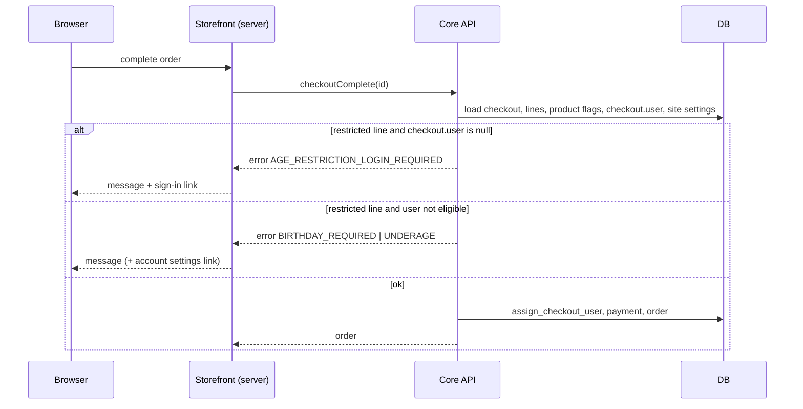

<CRITICAL ATTRIBUTION="DO NOT COMPACT/OPTIMIZE/SUMMARIZE/REPHRASE, PASS AS-IS">

# SPECS — age-restricted products (Status: Approved by user, with corrections C1 draft-line checks, C2 age label everywhere)

Source: `AGE-RESTRICTED-PRODUCTS-BRIEF.md` (approved; D1–D16, A1–A7). Specs = WHAT. Plan (HOW) is a separate file.

## TLDR
- Core: `Product.is_age_restricted`, `SiteSettings.minimum_age` (18) + `time_zone` (UTC), `User.birthday` (date).
- Check = restricted line + `checkout.user` must have birthday and be ≥ minimum age today (shop tz). Guest ⇒ blocked.
- Enforced at line add/update (UX) and completion (authority, before payment) for checkouts AND draft orders; drafts check only an explicitly linked customer (email match = no link).
- Birthday visible/writable only by owner + `is_superuser`; apps never; others get `isAgeEligible` yes/no (MANAGE_USERS).
- Audit via `CustomerEvent` (3 new types, no values), hidden from everyone but superuser.
- Errors: 3 checkout codes + 2 order codes; additive schema, 4 migrations, no backfill.
- Dashboard: product flag, site settings, customer birthday (superuser) + eligibility chip. Storefront: messages, sign-in prompt, "18+" label on every product surface (visibility never restricted), birthday in account, log redaction.
- Order: core → schema → dashboard → storefront; tests + full local gates per repo.

## TOC
1. Overview, scope
2. NFR / ASR
3. Architecture and components
4. API contracts (GraphQL)
5. Data model, migrations
6. Error handling
7. Testing strategy and cases
8. Security and privacy
9. Dependencies
10. Assumptions
11. Tech summary (files affected)

## 1. Overview and scope
- Repos: `saleor` (rules, API, data), `saleor-dashboard` (staff UI), `react-storefront` (shopper UI).
- Core owns every decision (clients display, never decide).
- In: product flag, store-wide `minimumAge`, shop `timeZone`, `User.birthday`, `isAgeEligible`, `isSuperuser`, enforcement, audit, UI in dashboard + storefront.
- Out: ID verification, regional/per-product ages, registration-form birthday in storefront (API supports it), reports.
- Enforcement points (core):
  - E1 line add/update: `checkoutCreate`, `checkoutLinesAdd`, `checkoutLinesUpdate`, `checkoutCreateFromOrder`.
  - E2 completion (authority): `checkoutComplete`, `orderCreateFromCheckout`.
  - E3 drafts: line add/update `draftOrderCreate` (with lines), `orderLinesCreate`, `orderLineUpdate` (UX); completion `draftOrderComplete` (authority).
  - Not enforced: `checkoutLinesDelete`, `checkoutCustomerAttach`, `checkoutEmailUpdate`, `draftOrderUpdate` (user relink), transaction mutations (E2 runs before payment).
  - Visibility is never restricted: restricted products stay listed/searchable/priced everywhere; only buying is gated.

## 2. NFR and ASR
- ASR-1 Privacy: birthday readable only by owner or `is_superuser`; never in webhooks (legacy+subscription), export, search, logs, errors, events.
- ASR-2 Authority: E2 cannot be bypassed by any completion path; E1 is UX only.
- ASR-3 Auditability: every birthday change and every non-owner read/eligibility read writes a `CustomerEvent`; write failure ⇒ operation fails (fail closed).
- ASR-4 Perf: E1/E2 add 0 extra queries beyond already-loaded `line_info.product` + `checkout.user`; `isAgeEligible` batches site settings via dataloader (query-count benchmark test).
- ASR-5 Compat: additive schema only; all new columns nullable or `db_default`; no backfill; zero-downtime migration.
- ASR-6 Determinism: age math on dates only, "today" = date in shop `timeZone` (injected clock for tests).

## 3. Architecture and components
### 3.1 Core — domain (new `saleor/account/age.py`, pure, no I/O)
```python
def today_in_shop_tz(time_zone: str, now: datetime | None = None) -> date
def minimum_age_date(birthday: date, years: int) -> date   # Feb 29 + non-leap target year ⇒ Mar 1
def is_age_eligible(birthday: date | None, minimum_age: int, today: date) -> bool  # None ⇒ False
def validate_birthday(birthday: date, today: date) -> None  # raises ValueError: future or < 1900-01-01
```
- Eligible iff `today >= minimum_age_date(birthday, minimum_age)` (turning age today = eligible today).

### 3.2 Core — checkout enforcement (`saleor/checkout/age_restriction.py`, new)
```python
class AgeRestrictionError(Exception): code: CheckoutErrorCode
def validate_age_restriction(lines: Iterable[CheckoutLineInfo], user: User | None, site_settings: SiteSettings) -> None
```
- No restricted line ⇒ return. `user is None` ⇒ `AGE_RESTRICTION_LOGIN_REQUIRED`. `birthday is None` ⇒ `AGE_RESTRICTION_BIRTHDAY_REQUIRED`. Not eligible ⇒ `AGE_RESTRICTION_UNDERAGE`.
- `user` = `checkout.user` only (D14). Email-match linking (`assign_checkout_user`) never counts.
- Hooks:
  - E1: after lines validated in `CheckoutCreate`, `CheckoutLinesAdd`, `CheckoutLinesUpdate`, `CheckoutCreateFromOrder`; checks only the touched lines with `quantity > 0`; user = `checkout.user` (create: `info.context.user`).
  - E2: first statement in `complete_checkout()` and `create_order_from_checkout()`, BEFORE `assign_checkout_user` and before payment/transaction logic; all lines checked.
- GraphQL layer maps `AgeRestrictionError` → `ValidationError({"lines"|None: ..., code})` → `CheckoutError`.

### 3.3 Core — draft orders (same rules as checkouts, no exemption)
```python
def validate_order_age_restriction(lines: Iterable[OrderLine | variant-product pair], explicit_user: User | None, site_settings: SiteSettings) -> None  # saleor/order/age_restriction.py
```
- Linked customer = `order.user` AND NOT `order.user_linked_by_email` (internal flag, set when `draftOrderCreate/Update` derive `user` from `userEmail`; cleared when staff sets explicit `user`). A customer set only by `userEmail` match is NOT a link (D15 reaffirmed by user at G1).
- No restricted line (variant not null) ⇒ pass. `explicit_user is None` ⇒ pass (draft without customer allowed and completable).
- Explicit user without birthday ⇒ `OrderErrorCode.AGE_RESTRICTION_BIRTHDAY_REQUIRED`; not eligible ⇒ `AGE_RESTRICTION_UNDERAGE`.
- Hooks:
  - Line add/update (UX): `OrderLinesCreate`, `OrderLineUpdate`, `DraftOrderCreate` (lines + `user` input); only the touched lines with `quantity > 0`.
  - Completion (authority): `DraftOrderComplete`, all lines, evaluated BEFORE `update_user_fields` (email auto-link) runs.
- Draft stays incomplete until the customer's birthday is set or the customer link is removed (`draftOrderUpdate` user=null).

### 3.4 Core — User fields and audit
- `saleor/account/age_audit.py`:
```python
def log_birthday_changed(*, customer: User, actor: User | App) -> CustomerEvent
def log_birthday_read(*, customer: User, actor: User, kind: Literal["birthday","eligibility"]) -> CustomerEvent
```
- Events: `user=customer`, `app=None`, `order=None`, `parameters={"actor_type": "customer|staff|app", "actor_id": int|None, "action": "change|read", "kind"?}`. NEVER key `message`, never values.
- Dedup: per request, per `(customer.pk, kind)`; set kept on `info.context` (`_age_audit_logged`). Written inside `allow_writer()` + `traced_atomic_transaction()`.
- Visibility: `User.events` resolver drops `BIRTHDAY_CHANGED|BIRTHDAY_VIEWED|AGE_ELIGIBILITY_VIEWED` unless requestor `is_superuser` (D16). Written always.
- Field resolvers (requestor via `get_user_or_app_from_context`; app ⇒ always `null`):
  - `birthday`: owner → value, no log; `is_superuser` non-owner → value + `log_birthday_read(kind="birthday")`; else `null`.
  - `isAgeEligible`: owner → value, no log; staff with `MANAGE_USERS` (incl. superuser) → value + `log_birthday_read(kind="eligibility")`; else `null`.
  - `isSuperuser`: owner → `user.is_superuser`; else `null`.

### 3.5 Dashboard
- Product update page: checkbox bound to `isAgeRestricted`; added to `PRODUCT_DETAILS_SAVE_FIELDS`, `ProductUpdateFormData`, initial data, `getProductUpdateVariables`, fragment `Product`.
- Site settings page: `minimumAge` (integer input), `timeZone` (IANA select from `Intl.supportedValuesOf("timeZone")` + `UTC`); in `handleUpdateShopSettings`; gated by existing `MANAGE_SETTINGS`.
- Customer details: `UserFragment.isSuperuser`; `CustomerDetails.birthday|isAgeEligible`; birthday date input rendered+editable only when `user.isSuperuser`; sent in `customerUpdate` only when dirty. Eligibility chip (Eligible / Not eligible) shown with `MANAGE_USERS`; never shows date/age. Customer history renders new event types for superuser (exhaustive-switch check).
- Schema: `schema-main.graphql` regenerated from local core (D12); `pnpm run generate`; changeset.

### 3.6 Storefront
- Age label (C2): `isAgeRestricted` fetched in `ProductListItem` (+ all list/collection/category/search documents that spread it), `ProductDetails`, `CheckoutLineFragment`; label text `"{minimumAge}+"` (e.g. "18+") from public `Shop.minimumAge` via one small cached query (`ShopAgePolicy`), no per-product copy.
  - One shared `AgeBadge` component (copy `BestsellerBadge` in `product-badges.tsx`), localized (8 locales), rendered wherever a product is shown: product card (`product-card-base.tsx`: product lists, category/collection pages, search results, featured-collection sections, sale/discount listings share it), PDP, cart drawer/checkout lines, and any hero/banner section that renders a product. Pure CMS banners without product data need no label.
  - Visibility unchanged: no filtering, hiding, or disabling of restricted products anywhere; only add-to-cart/checkout errors gate buying.
  - Contract/version bump if required by `templates.contract.test.ts`; `core:lock` override for contract change.
- `addVariantToCart` returns `{ok:false, errorKey}`; PDP shows message; `AGE_RESTRICTION_LOGIN_REQUIRED` ⇒ link to sign-in; `AGE_RESTRICTION_BIRTHDAY_REQUIRED` ⇒ link to account settings; `UNDERAGE` ⇒ message only.
- `CheckoutAddLine`/`CheckoutLinesUpdate` select `field code message`; checkout payment step shows `checkoutComplete` age errors (fix `use-checkout-payment.ts:177-181` array `Object.assign` defect).
- Account settings: `BirthdayForm` (client, copy `EditNameForm`) + `updateBirthday` server action → `AccountUpdate{birthday}`; `CurrentUserProfile` adds `birthday` (session mode, never cached).
- Log redaction: `formatVariablesForLog` masks `birthday` → `"[redacted]"`. `core:lock` override entry; `data:lock` regenerated.

### 3.7 Sequence — guest vs customer completion


## 4. API contracts (GraphQL, additive; tag `ADDED_IN_323`-style per repo convention)
```graphql
# Product
input ProductInput { isAgeRestricted: Boolean }             # create + update
type Product { isAgeRestricted: Boolean! }
# Shop (minimumAge/timeZone public; non-personal)
type Shop { minimumAge: Int!  timeZone: String! }
input ShopSettingsInput { minimumAge: Int  timeZone: String }   # MANAGE_SETTINGS (existing)
# User
type User { birthday: Date  isAgeEligible: Boolean  isSuperuser: Boolean }   # all nullable; see 3.4
input AccountRegisterInput { birthday: Date }
input AccountInput         { birthday: Date }                   # owner; apps (incl. IMPERSONATE_USER) rejected
input CustomerInput        { birthday: Date }                   # customerCreate/Update: is_superuser only
# Errors
enum CheckoutErrorCode { AGE_RESTRICTION_LOGIN_REQUIRED AGE_RESTRICTION_BIRTHDAY_REQUIRED AGE_RESTRICTION_UNDERAGE }
enum OrderErrorCode    { AGE_RESTRICTION_BIRTHDAY_REQUIRED AGE_RESTRICTION_UNDERAGE }
enum CustomerEventsEnum { BIRTHDAY_CHANGED BIRTHDAY_VIEWED AGE_ELIGIBILITY_VIEWED }   # events hidden except superuser
```
- Validation rules:
  - `minimumAge` ∈ [1, 120] else `ShopErrorCode.INVALID`.
  - `timeZone` must resolve via `zoneinfo.ZoneInfo` else `ShopErrorCode.INVALID`.
  - `birthday`: not after shop-today, not before 1900-01-01 else `AccountErrorCode.INVALID` (message has no date). `null` clears.
  - Birthday key present in `CustomerInput` and requestor not `is_superuser` (incl. any app) ⇒ `AccountErrorCode.PERMISSION_DENIED`, even when value unchanged.
  - `accountUpdate` with `customerId` impersonation + `birthday` ⇒ `PERMISSION_DENIED`.
- Change event: written only when value actually changes (incl. set/clear). `actor_type`: `customer` (accountUpdate/Register), `staff` (customerCreate/Update).
- Webhooks: legacy payloads unchanged (birthday absent, `isAgeRestricted` not added). Subscription `Product.isAgeRestricted` appears automatically; `User.birthday|isAgeEligible|isSuperuser` resolve `null` for app context. `CUSTOMER_UPDATED` still fires on change (no value).
- Messages (en, no PII): LOGIN_REQUIRED "Sign in to buy age-restricted products."; BIRTHDAY_REQUIRED "Add your birthday to your account to buy age-restricted products."; UNDERAGE "You are too young to buy this product."
- Schema regen: `uv run poe build-schema`; dashboard `schema-main.graphql` refreshed from it (D12); `CHANGELOG.md` entry.

## 5. Data model, migrations (all additive, no backfill)
| App | Change | Migration |
|---|---|---|
| product | `Product.is_age_restricted BooleanField(default=False, db_default=False)` | `0211_product_is_age_restricted` (dep `0210_…`) |
| site | `SiteSettings.minimum_age PositiveSmallIntegerField(default=18, db_default=18)`; `time_zone CharField(max_length=63, default="UTC", db_default="UTC")` | `0053_sitesettings_minimum_age_time_zone` (dep `0052_…`) |
| account | `User.birthday DateField(null=True, blank=True)` | `0106_user_birthday` (dep `0105_…`) |
| order | `Order.user_linked_by_email BooleanField(default=False, db_default=False)` (internal, not in GraphQL) | next order migration |
| account | `CustomerEvent.type` choices += 3 types (`CustomerEvents` consts + `CHOICES`) | `0107_alter_customerevent_type` (`AlterField`, no DDL) |
- Feature flag: none (default state = flag false everywhere ⇒ no behavior change until staff mark products).
- Not indexed, not in `search_document`, not in sorters/filters, not in `generate_customer_payload`.
- Rollback: drop columns; no data coupling elsewhere.

## 6. Error handling
- Domain raises `AgeRestrictionError`/`ValueError`; GraphQL layer converts to typed errors (4). No stack/PII in messages.
- Audit failure ⇒ resolver/mutation raises ⇒ GraphQL error, value NOT returned/saved (ASR-3).
- Lines with `variant is None` or product missing are skipped (nothing to check).
- `minimumAge` change applies on the next check; existing checkouts re-evaluated at E2 (A7).
- Storefront: unknown error code ⇒ generic existing failure message; never show raw backend text for these codes (use localized keys; 8 locales).
- Dashboard: field errors from `customerUpdate` birthday shown inline; `PERMISSION_DENIED` shown as notification.

## 7. Testing strategy and cases
Pyramid: core pytest (unit + API + benchmark), dashboard Jest, storefront Vitest. Full gates must pass locally (see 11).
### 7.1 Core unit — `saleor/account/tests/test_age.py`
| Case | Expect |
|---|---|
| born 2008-06-15, min 18, today 2026-06-15 | eligible (turns 18 today) |
| same, today 2026-06-14 | not eligible |
| born 2008-02-29, min 18, today 2026-02-28 / 2026-03-01 | no / yes (non-leap ⇒ Mar 1) |
| born 2004-02-29, min 4, today 2008-02-29 | yes (leap year anchor) |
| `None` birthday | not eligible |
| tz: `now`=2026-06-14T23:30Z, `Pacific/Kiritimati` ⇒ date 06-15 | eligible; UTC ⇒ not |
| `validate_birthday` future / 1899-12-31 / 1900-01-01 | raise / raise / ok |
### 7.2 Core API (one file per op, given/when/then)
- Product: create/update with flag (staff with `MANAGE_PRODUCTS`); default false; `ProductBulkCreate` persists flag; query returns it.
- Shop: update `minimumAge`/`timeZone` ok with `MANAGE_SETTINGS`; invalid 0, 121, "Mars/Phobos" ⇒ `INVALID`; no permission ⇒ denied; query public.
- E1: guest + restricted add ⇒ LOGIN_REQUIRED; customer no birthday ⇒ BIRTHDAY_REQUIRED; underage ⇒ UNDERAGE; eligible ⇒ ok; non-restricted ⇒ ok for guest; quantity-0 update on restricted ⇒ ok; `checkoutCreate` with lines; `checkoutCreateFromOrder`.
- E2: `checkoutComplete` and `orderCreateFromCheckout` each: guest blocked; guest whose email matches account STILL blocked (D14); customer birthday removed after add ⇒ blocked; min age raised after add ⇒ blocked; eligible completes; check runs before payment (payment mocks not called).
- E3 completion: draft no user ⇒ completes; draft `user_email` matching account, no explicit user ⇒ completes (D15); explicit user no birthday ⇒ BIRTHDAY_REQUIRED; underage ⇒ UNDERAGE; eligible ⇒ ok; non-restricted ⇒ ok; after birthday set ⇒ completes; after `draftOrderUpdate` user=null ⇒ completes; check runs before email auto-link.
- E3 lines: `orderLinesCreate`, `orderLineUpdate`, `draftOrderCreate` with restricted product: explicit user no birthday/underage ⇒ error; no user ⇒ ok; eligible ⇒ ok; quantity-0 update ⇒ ok; non-restricted ⇒ ok.
- Birthday write: `accountRegister`/`accountUpdate` set+clear own; future/1899 ⇒ INVALID; app impersonation ⇒ PERMISSION_DENIED; `customerUpdate`/`customerCreate` by superuser ok, by `MANAGE_USERS` staff ⇒ PERMISSION_DENIED, app ⇒ denied.
- Birthday read matrix (`birthday`,`isAgeEligible`,`isSuperuser`): owner, other customer, staff `MANAGE_USERS`, staff w/o perm, superuser, app (with `MANAGE_USERS`), anonymous ⇒ per 3.4.
- Audit: change event stored (actor/time/action, no values, no `message` key); read by superuser logs 1 event for N resolutions in one request; owner read/own `isAgeEligible` logs none; unchanged birthday ⇒ no event; `User.events` hides the 3 types for `MANAGE_USERS`/`MANAGE_STAFF`, shows for superuser; audit write failure ⇒ field error, no value.
- Privacy: `generate_customer_payload` has no birthday; subscription `CUSTOMER_UPDATED` as app ⇒ `birthday: null`; `search_document` unchanged.
- Benchmark: `isAgeEligible` over N customers ⇒ constant site-settings queries; E1/E2 no extra queries per line.
- Migrations: `makemigrations --check` clean; `build-schema` equals committed schema.
### 7.3 Dashboard (Jest)
- Product form: flag in initial data, save-composition triggers on flag-only change, variables include flag.
- Site settings page: renders + submits `minimumAge`/`timeZone`; validation display.
- Customer page: birthday input visible+editable only when `isSuperuser`; chip with/without `MANAGE_USERS`; save sends `birthday` only when dirty; no date shown in chip.
- Typecheck + lint + generate clean.
### 7.4 Storefront (Vitest)
- `addVariantToCart` returns `errorKey` per code; PDP maps each code to message/link; payment-step displays `checkoutComplete` age error (regression for array bug); `formatVariablesForLog` redacts `birthday`; `updateBirthday` action success/error; `AgeBadge` renders "{minimumAge}+" and only for restricted products; label present on card (list, search, featured collection, sale listing), PDP, cart line, product hero; restricted products never filtered/hidden/disabled in listings and search; mapper; contract tests; `pnpm verify` green.
### 7.5 Manual/e2e validation (validator agent, after build)
- Against local stack: staff flags product; guest blocked + sign-in prompt; customer w/o birthday prompted; underage blocked; adult buys; non-superuser staff cannot see/set birthday; superuser can; audit visible only to superuser.

## 8. Security and privacy (PII feature)
STRIDE summary:
- S Spoofing: guest typing a victim's email cannot pass E2 (D14); apps cannot impersonate birthday writes.
- T Tampering: customer can self-edit birthday (accepted risk, D5); staff non-superuser cannot; draft without customer bypass accepted (D8).
- R Repudiation: every change/read audit-logged (actor, time, action); events immutable via API.
- I Info disclosure: birthday never in webhooks/export/search/logs/errors/events; `isAgeEligible` leaks only a boolean to owner/MANAGE_USERS; storefront never caches (`session()` mode) and redacts logs; hidden audit events.
- D DoS: no new heavy queries; time zone validated by `zoneinfo` (bounded).
- E Elevation: `isSuperuser` owner-only; superuser-only write on `CustomerInput`; permission checked server-side for every field.
- Compliance: GDPR personal data; birthday deleted with user (cascade); data minimisation (date only); purpose limited. Account deletion removes events (cascade).
- Security tests: 7.2 matrix + payload checks; semgrep/ruff/mypy pre-commit must pass.

## 9. Dependencies
- None new. Python `zoneinfo` (stdlib; `tzdata` already available via OS/Django — verify in plan). Dashboard `Intl.supportedValuesOf` (runtime; fallback list). Local core must run the new code for dashboard/storefront codegen (plan: run order core → schema → dashboard → storefront).

## 10. Assumptions (open, confirm at spec review)
- AS-1 Hidden audit types include `AGE_ELIGIBILITY_VIEWED` (brief D16 names "changed, read").
- AS-2 Unauthorized `birthday|isAgeEligible|isSuperuser` return `null` (not a permission error).
- AS-3 `minimumAge` range 1–120; `timeZone` stored as IANA string.
- AS-4 Own-account reads (owner) never logged; own changes logged.
- AS-5 Legacy product webhook payload unchanged.
- AS-6 Storefront registration form unchanged (birthday via account settings only).
- AS-8 Label text is `{minimumAge}+` from `Shop.minimumAge`; dashboard staff lists unchanged (label is a shopper-facing feature).
- AS-9 `draftOrderUpdate` user relink is not checked (completion is the authority).
- AS-7 Running migrations against the local compose DB is a dangerous action ⇒ separate explicit approval at implementation (plan gate).

## 11. Tech summary (files/services affected)
- saleor: `account/{models,__init__,age.py,age_audit.py,error_codes}`, `product/models`, `site/models`, `checkout/{age_restriction.py,complete_checkout.py,error_codes.py}`, `order/{age_restriction.py,error_codes.py}`, `core/error_codes` (if needed), `graphql/account/{types,enums,mutations/account/*,mutations/base,mutations/staff/customer_*}`, `graphql/product/{types/products,mutations/product/product_create}`, `graphql/shop/{types,mutations/shop_settings_update}`, `graphql/checkout/mutations/{checkout_create,checkout_lines_add,checkout_lines_update,checkout_create_from_order,checkout_complete,order_create_from_checkout}`, `graphql/order/mutations/{draft_order_complete,draft_order_create,order_lines_create,order_line_update}`, migrations ×4, `graphql/schema.graphql` (generated), `CHANGELOG.md`, tests under each.
- saleor-dashboard: `schema-main.graphql`, `src/graphql/*.generated.ts`, `fragments/{products,shop,auth,customers}`, `products/**`, `siteSettings/**`, `customers/**`, changeset.
- react-storefront: `src/graphql/{ProductDetails,CheckoutAddLine,CheckoutLinesUpdate,CurrentUserProfile,AccountUpdate}.graphql`, `src/checkout/graphql/checkout.graphql`, `src/app/actions.ts`, `src/ui/components/{pdp,account,plp,cart}/*`, `src/ui/components/ui/product-badges.tsx`, `src/ui/sections/*` (product-showing), `src/graphql/{ProductListItem,ProductList*,ShopAgePolicy}.graphql`, `src/checkout/hooks/use-checkout-payment.ts`, `src/lib/saleor/client.ts`, `messages/*.json`, `data-layer.lock.md`, `paper-version.json`, tests.
- Services: PostgreSQL (migrations), no new services.

</CRITICAL>
