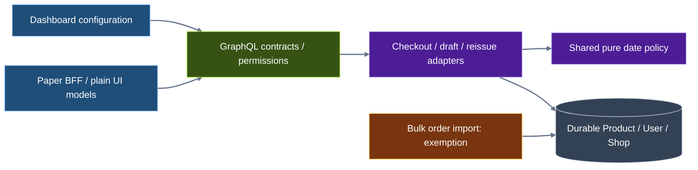

<CRITICAL ATTRIBUTION="DO NOT COMPACT/OPTIMIZE/SUMMARIZE/REPHRASE, PASS AS-IS">

# Age restrictions — technical specification

**Status:** Draft specification; architecture approval reported by the caller on 2026-11-08. Spec/plan approval is a separate gate.  
**Authority:** [Approved architecture](architecture-notes.md); its Draft banner remains untouched under the write restriction. Original request and confirmed rules are traced below.  
**Scale:** LARGE; backend + Dashboard + Paper, no new external age-verification service.

## TLDR

- Product Boolean restriction; shop minimum age 18 and validated IANA `timeZone` UTC, durably stored.
- `timeZone` is configured/displayed only in Dashboard; Paper neither queries nor displays it.
- Customer birthday is nullable stored date; only customer-self/superuser can set/read it.
- Backend date-only eligibility uses shop-local today; birthday equality qualifies; leap-day anniversary becomes 1 March in non-leap years.
- Retain guest restricted cart lines; block additions/non-removal quantity updates/completion; allow removal and browsing.
- Authenticated underage customers may decrease/remove existing restricted lines; initial adds/increases/completion remain blocked.
- Completion rechecks current policy authoritatively and names rejected products without birthday/age disclosure.
- Enforce indirect, app, automatic, legacy, draft and reissue creation; only `orderBulkCreate` exempt, customerless drafts allowed.
- Preserve historic placed orders and completion idempotency; sequence schema/codegen before claiming client compatibility.

## Contents

1. [Scope, sources and TRDL](#1-scope-sources-and-trdl)
2. [NFR and architecture-significant requirements](#2-nfr-and-architecture-significant-requirements)
3. [Components, interfaces and sequences](#3-components-interfaces-and-sequences)
4. [Data and migration contract](#4-data-and-migration-contract)
5. [GraphQL and error contracts](#5-graphql-and-error-contracts)
6. [Eligibility, identity and protected operations](#6-eligibility-identity-and-protected-operations)
7. [Transaction, current-state and recovery contract](#7-transaction-current-state-and-recovery-contract)
8. [Client and compatibility contract](#8-client-and-compatibility-contract)
9. [STRIDE, privacy and security controls](#9-stride-privacy-and-security-controls)
10. [Testing and verification contract](#10-testing-and-verification-contract)
11. [Dependencies, assumptions and affected surfaces](#11-dependencies-assumptions-and-affected-surfaces)

## 1. Scope, sources and TRDL

TRDL here is the **traceable requirements/design ledger**: AR IDs identify testable units in this spec, not pre-existing XML requirements. R1–R10 and B/D/P evidence IDs refer to the architecture note. Mandatory outcomes below derive from approved decisions; precise new API/error names, validation bounds and engineering budgets are explicit **draft technical contracts for this spec's approval**, not alleged existing behavior.

Original request source labels: **O1** mark restricted products/minimum age; **O2** prevent underage sales; **O3** birthday profile; **O4** complete E2E implementation, tests and local passes. Confirmed R1/R2 supersede O1's shorthand numeric-per-product design. No region/channel rules, identity-document verification, consent system, retrospective order cancellation or superuser Dashboard birthday editor is added.

**Review update, 2026-11-08:** User decision UD1 explicitly permits authenticated-underage decreases/removal of existing restricted lines while denying initial adds/increases/completion; guests retain the stricter removal-only rule. Independent-review F2 is remediated in this draft by explicit WCAG 2.2 AA/enabled-locale assertions in §8 and test subcases in §10. This records contract/review changes, not implementation approval or executed accessibility results. Architecture remains immutable.

| Unit | SHALL / acceptance contract | Source → evidence | Validation |
| --- | --- | --- | --- |
| AR01 | Store Product restriction Boolean; default false; creation/bulk creation/update roundtrip; explicit false clears, omission preserves. | O1; R1 → B1/B4–B7 | T01 |
| AR02 | Store shop minimum age/default 18 and IANA timeZone/default UTC; MANAGE_SETTINGS update; Dashboard-only zone UI; Paper no zone selection. | O1/O2; R2 → B2/B8/B9/D5/D6 | T02 |
| AR03 | Store optional customer birthday as date, existing users null; non-null writes real and not future relative to shop-local today; no inferred backfill. | O3; R3 → B3/B10/B12/B14 | T03 |
| AR04 | Only genuine customer-self or genuine superuser may write birthday; deny staff-self/managers, other users, apps/impersonation and guests; denied writes atomic. | O3; R3 → B10–B14 | T04 |
| AR05 | Birthday read only customer-self/superuser; other selections yield null without disclosing its presence; shared User/subscription/response paths obey. | O3; R3/R6 → B15/B34 | T05 |
| AR06 | Date-only shop-local today, birthday equality eligible, leap-day anniversary 1 March in non-leap years; no client/UTC-age decisions. | O2; R2/R4 → B8/B9/B21 | T06 |
| AR07 | Restricted shopper purchase requires authenticated customer identity; email match or foreign checkout/customer ID cannot substitute; delegated/background paths use legitimate durable linked customer. | O2; R5/R6/R7 → B11/B21/B23/B25/B26/P8 | T07 |
| AR08 | Restriction enforcement on new/positive effective checkout additions, grouped/duplicate/force-new/line and variant IDs, initial checkout lines and reorder. | O2; R5 → B16–B20 | T08 |
| AR09 | Authenticated underage customer may decrease existing restricted quantity; initial adds/increases/completion remain denied. Guest non-removal quantity updates denied even lower/unchanged positive quantities; signed-in unchanged/app metadata-only follow operation matrix. | O2; R5 + UD1 → B17/B18 | T08/T09/T11 |
| AR10 | Keep existing guest restricted lines; guest and authenticated-underage removal/quantity-zero deletion allowed by age policy; no pruning on browse/read/update rejection/completion rejection. | O2; R5/R8 + UD1 → B18/B35/P5/P13 | T10 |
| AR11 | Authoritative completion validates all current restricted lines; guest/missing birthday/underage blocked; product-named safe error, no new order on rejection. | O2; R6 → B22–B24/P9 | T11 |
| AR12 | Apply AR11 to app orderCreateFromCheckout, automatic, free/unpaid and both modern/legacy payment paths; neither actor nor payment route exempts. | O2; R7 → B23–B26 | T12 |
| AR13 | Restricted draft create/customer-association change/addition/increase and completion check linked customer; customerless drafts allowed; resolve email linkage before decision. | O2; R7 → B27–B30 | T13 |
| AR14 | Replacement/reissue creates a new protected draft using inherited customer; validate before new draft/return side effects; original order unchanged. | O2; R7/R8 → B31 | T14 |
| AR15 | orderBulkCreate alone is exempt from age policy, including linked/missing/underage customer inputs; import cannot set birthday implicitly. | O2; R7 → B32/B12 | T15 |
| AR16 | No existing cart/order rewriting or persisted eligibility snapshot; later protected decision uses current config/profile/product; existing-order retry returns same order. | O2; R8 → B18/B22/B24 | T16 |
| AR17 | Dashboard create/edit Boolean and minimumAge/timeZone site settings; errors/defaults/false values/permissions correct; Site Settings meets §8 keyboard/labels/status/enabled-locale assertions; no ordinary staff birthday UI. | O1; R9 + F2 → D1–D8 | T17 |
| AR18 | Paper customer birthday editor reads/submits self date; pending/error/success/refresh behavior and §8 keyboard/labels/status/enabled-locale assertions; no browser/backend token or date-time conversion. | O3; R9 + F2 → P1–P3/P10/P11 | T18 |
| AR19 | Paper restricted-product notice and guest sign-in/recovery meet §8 keyboard/labels/status/enabled-locale assertions; retention/removal and named backend failures; no timeZone query/display or false success analytics. | O2; R5/R6/R9 + F2 → P4–P9/P12/P13 | T19 |
| AR20 | Additive schema/optional inputs; error code/message/field/identity contracts; unknown errors safe fallback; incompatible API not treated unrestricted. | O4; R10 → B33/D8/P9/P11 | T20 |
| AR21 | Atomic protected domain writes and coherent current-state snapshot; concurrency/idempotency/fund recovery invariants in §7; no second charge recovery. | O2/O4; R6/R8 → B18/B22/B24/B26 | T21 |
| AR22 | Backend schema/migration drift, both Dashboard schemas/generated clients and both Paper codegens validated with matching API; local suites/gates complete before DoD. | O4; R10 → D8/P11 | T22 |
| AR23 | No birthday in errors, payloads, exports, search, metadata, traces, telemetry, shared caches or request diagnostics; synthetic tests and STRIDE controls. | O3/O4; R3/R6 → B34/P12 | T23 |
| AR24 | Reuse shared backend policy, GraphQL boundary adapters and existing UI/transport boundaries; no model/signal bypass flags/external age dependency. | O2/O4; approved option B → B16–B32/P7/P10 | T24 |

Every AR is Must and planned, not implemented. Each table clause is independently asserted in its T group; test reports must enumerate subcases, not merely mark the group passed. Full forward trace: source → AR → § contracts → T → plan batch completion evidence; reverse trace uses the same IDs.

## 2. NFR and architecture-significant requirements

| ASR/NFR | Target and measurable acceptance | AR |
| --- | --- | --- |
| ASR01 Policy integrity | Every §6 entry has a direct API/domain regression; no client-only decision; bulk exemption tested explicitly. | AR08–AR15/AR24 |
| ASR02 Authorization/privacy | Zero unauthorized raw birthday disclosures or mutations in T04/T05/T23; field presence/null does not alter deny rule; scalar coercion/errors redact inputs. | AR03–AR05/AR23 |
| ASR03 Current state | One coherent writer snapshot at final decision L; updates committed before L observed; no request-cache/replica policy decisions. | AR06/AR16/AR21 |
| ASR04 Reliability | Parallel completion retries yield at most one new order per existing idempotency key; rejection has no age-caused partial domain writes; zero extra charge attempts for recovery. | AR11/AR12/AR21 |
| NFR01 Complexity/performance | Pure evaluator O(n) in relevant products; batch product reads, no per-line policy query. Proposed budget: ≤3 additional SQL statements per decision excluding existing aggregate locks; same count at n=1 and n=50. No external policy call. | AR21/AR24 |
| NFR02 Testability | Clock and local date injectable; evaluator 100% decision-branch coverage; changed backend policy/adapters ≥90% branch coverage, with each operation/actor case tested. Client target behaviors all covered by unit/contract/E2E evidence. | AR06/AR22 |
| NFR03 UI/accessibility | All four §8 surfaces pass explicit WCAG 2.2 AA keyboard, focus, programmatic-label/error-association and pending/error/status assertions. Every enabled locale passes the per-surface text/announcement matrix; zero missing-key/unannounced-error failures. | AR17–AR19; F2; T17/T18/T19 subcases |
| NFR04 Observability | Record outcome/error code and safe opaque operation IDs only; no birthday/derived age/input values/session secrets. Existing ledger remains variable-free. | AR23 |
| NFR05 Compatibility | Old omitted inputs keep unrestricted behavior; migrations support old-code inserts; generation stable on second pass; no hand-edited schema/clients. | AR01–AR03/AR20/AR22 |
| NFR06 Maintainability | One date algorithm and birthday permission helper reused; API error mapping at boundaries, UI uses plain view models, no cross-surface imports. | AR24 |

Budgets are acceptance proposals, not measured baselines or inferred production SLAs. No production throughput/latency claim is made. GDPR data minimization/access control and OWASP authorization principles guide AR23; this feature does not claim certification or legally verified age.

## 3. Components, interfaces and sequences

Responsibilities (SRP/DRY/KISS): durable models own values/defaults; policy owns dates/decisions; adapters own authenticated actor/context + coherent snapshot + mutation boundary; GraphQL owns validation/projection; clients own configuration/display/recovery.

Internal identifiers below are **recommendations**, not evidenced symbols: `AgePolicySnapshot`, `AgeDecision`, `AgeOperationContext`, `load_age_policy_snapshot`, `shop_local_today`, `evaluate_age_eligibility`, `authorize_birthday_write`, `enforce_age_restrictions`. Recommended new module: `saleor/core/age_restrictions.py` (repo-relative).

| Recommended interface | Contract |
| --- | --- |
| `shop_local_today(now: datetime, time_zone: str) -> date` | Aware instant required; validated IANA zone; convert then take date once; never browser/server-default zone. |
| `evaluate_age_eligibility(birthday: date \| None, minimum_age: int, today: date) -> bool` | Pure §6 decision; missing/corrupt/future date fails closed; no DB/GraphQL/logging. |
| `authorize_birthday_write(actor, target, field_present: bool) -> None` | §5 actor/object guard; returns or rejects without target-date access. |
| `load_age_policy_snapshot(aggregate, actor_context, product_ids) -> AgePolicySnapshot` | Coherent writer-state values at L; snapshot not persisted/shared cached; trace/privacy rules apply. |
| `enforce_age_restrictions(snapshot, operation, before_lines, proposed_lines) -> None` | §6 operation classification; result void or safe domain rejection with product/line/variant identities; no raw birthday in result/repr. |

Existing evidenced adapter symbols: CheckoutLinesAdd/Update (B16/B17), `add_variants_to_checkout` (B18), `create_order_from_checkout`/legacy `_create_order` (B22/B24), DraftOrderComplete (B29), `create_replace_order` (B31). No generic model-save invariant replaces operation enforcement.

```mermaid
%% Explicit dark/light-readable tiles, text and message lines.
%%{init: {"theme":"base","themeVariables":{"background":"#F8FAFC","primaryColor":"#1F4E79","primaryTextColor":"#FFFFFF","primaryBorderColor":"#93C5FD","lineColor":"#64748B","textColor":"#111827","actorBkg":"#1F4E79","actorTextColor":"#FFFFFF","actorBorder":"#93C5FD","actorLineColor":"#64748B","signalColor":"#64748B","signalTextColor":"#111827","noteBkgColor":"#FFF3CD","noteTextColor":"#111827","noteBorderColor":"#9A6700","activationBkgColor":"#DBEAFE","activationBorderColor":"#1F4E79","labelBoxBkgColor":"#E2E8F0","labelTextColor":"#111827","loopTextColor":"#111827"}}}%%
sequenceDiagram
    actor Staff
    participant Dashboard
    participant Backend as Saleor backend / policy
    actor Customer as Customer or guest
    participant Paper as Paper storefront BFF
    participant Commerce as Checkout / Order domain
    Staff->>Dashboard: Set product flag, minimumAge, timeZone
    Dashboard->>Backend: productCreate/Update; shopSettingsUpdate
    Backend->>Backend: Existing permissions; validate and store defaults/config
    Backend-->>Dashboard: Product / Shop fields or safe field errors
    Customer->>Paper: Browse restricted product / retained guest cart
    Paper->>Backend: Product/public minimumAge; session read (no timeZone)
    Backend-->>Paper: Public restriction + self-only profile
    Paper-->>Customer: Notice; guest sign-in prompt; removal available
    Customer->>Paper: Signed-in birthday profile submission
    Paper->>Backend: accountUpdate birthday Date variable
    Backend->>Backend: Self/superuser guard; real date <= shop-local today
    Backend-->>Paper: Self profile or safe errors
    Customer->>Paper: Add/update/remove or complete checkout
    Paper->>Backend: Existing checkout mutation
    Backend->>Commerce: Authorized operation context + proposed changes
    Commerce->>Backend: Fresh policy/profile/products at final decision L
    Backend-->>Commerce: Date-only decision incl. leap-day rule
    alt Guest restricted non-removal update or ineligible completion
        Commerce-->>Backend: Safe domain rejection, unchanged cart
        Backend-->>Paper: AGE_RESTRICTED; completion names product
        Paper-->>Customer: Keep cart; sign in / profile / removal recovery
    else Removal or eligible purchase
        Commerce->>Commerce: Apply permitted write; completion creates one order
        Commerce-->>Backend: Checkout / existing-or-new order
        Backend-->>Paper: Existing GraphQL success payload
        Paper-->>Customer: Updated cart / order confirmation
    end
    Staff->>Dashboard: Create/edit/complete draft
    Dashboard->>Backend: Draft/order line mutations
    Backend->>Commerce: Resolve customer; validate protected draft operation
    Note over Backend,Commerce: Customerless draft allowed; linked restricted customer checked; bulk import exempt
```



## 4. Data and migration contract

Database column names below are recommended implementation identifiers. API names in §5 are draft contractual names, except `timeZone`, which is confirmed.

| Owner | Stored value | Defaults / constraints |
| --- | --- | --- |
| Product | `is_age_restricted`: Boolean, nonnullable | ORM + DB default false. No variant/channel override. |
| SiteSettings | `minimum_age`: integer, nonnullable | ORM + DB default 18; representable GraphQL Int range **1..2147483647**. This upper bound is transport/storage, not a legal policy cap. |
| SiteSettings | `time_zone`: IANA zone string, nonnullable | ORM + DB default `"UTC"`; nonempty resolvable member of installed IANA zone set, not a numeric UTC offset, path or arbitrary environment value. |
| User | `birthday`: date, nullable | Existing/new omitted null; Gregorian real date, write date <= current shop-local today. No DB clock-dependent CHECK. |

- New additive migrations in product/site/account, based on then-current migration leaves; no guessed migration numbers. Scalar defaults populate existing Product/Shop fields only. User birthdays stay null.
- No cart/checkout/order/line backfill, deletion, metadata snapshot or inferred birthday. Enabling restriction later affects only subsequent protected decisions.
- DB defaults support old application inserts; minimum range enforced at DB and API/model boundaries. Time-zone semantic validation at write boundaries; corrupt durable config fails closed on restricted decisions, never silently switches to UTC.
- Birthday null is absence, not eligibility. **Draft input contract:** omission preserves current date; explicit null rejected as INVALID. This provides no birthday-clearing operation; deletion remains existing account lifecycle, not a new feature.
- Product null rejected INVALID; explicit false persisted. Shop minimumAge/timeZone null rejected INVALID; omission preserves existing settings (defaults apply on initialization, not every update).
- A rejected birthday write rejects the entire submitted mutation, including name/address/metadata fields; birthday permissions precede birthday validation. No raw input in errors.
- Persistence respects existing tracked partial updates (B10/B13/B14); birthday added to account/customer tracked fields. Product bulk construction retains flag.
- No new field in order/customer export/search/webhook payloads. Existing account deletion removes the primary birthday with User; no new retention copies.
- Schema rollback never drops birthday/config columns as part of application rollback. Old application without enforcement cannot safely serve enabled restricted sales; retain enforcement or disable sales via existing merchant controls.

## 5. GraphQL and error contracts

Endpoint remains existing Saleor GraphQL. Additive code-first schema; no new HTTP routes, tokens or per-channel policy fields.

| Type/input | New field contract | Access/omission |
| --- | --- | --- |
| Product | `isAgeRestricted: Boolean!` | Public catalog projection; Product ChannelContext resolver convention (B6). |
| ProductInput | `isAgeRestricted: Boolean` | Optional create/update; MANAGE_PRODUCTS; false supported; null INVALID. |
| ProductCreateInput / ProductBulkCreateInput | Inherited `isAgeRestricted` | Same semantics, no extra permission beyond existing operation. |
| Shop | `minimumAge: Int!`, `timeZone: String!` | minimumAge public for notices; timeZone settings projection available to existing Dashboard query permissions. Paper must not select it. |
| ShopSettingsInput | `minimumAge: Int`, **`timeZone: String`** | Existing shopSettingsUpdate/MANAGE_SETTINGS; real IANA zone, explicit null INVALID; no raw zone/path in unexpected failures. |
| User | `birthday: Date` | ISO date only for genuine customer-self/superuser; all others null, including nested subscription/mutation payloads. |
| AccountInput | `birthday: Date` | Existing accountUpdate; customer-self only, or superuser when target is a customer under existing routing; no staff/app inheritance of authority. |
| CustomerInput / inherited UserCreateInput | `birthday: Date` | Existing customerCreate/customerUpdate permissions still apply **and** birthday write requires genuine superuser; no birthday input on unrestricted staff UserInput. |
| AccountRegisterInput | No new birthday field | Profile entry after authentication; registration flow remains unchanged. |

Birthday access actor matrix; active/authenticated actors only. “Superuser” means actual backend User flag, never a client permission string or app claim. Target must be a customer; no staff birthday editor is introduced.

| Actor | Self customer birthday read/write | Other customer read/write | Staff target |
| --- | --- | --- | --- |
| Authenticated non-staff customer | Allowed | Read null / write denied | Denied |
| Genuine superuser | Allowed if customer target | Allowed within existing mutation routing | Denied by feature scope |
| Ordinary staff, any permission incl. staff-self | Null / denied | Null / denied | Null / denied |
| App MANAGE_USERS / IMPERSONATE_USER / HANDLE_CHECKOUTS | Null / denied | Null / denied | Null / denied |
| Guest / unavailable or expired session | Null / denied | Null / denied | Null / denied |

Root operation authorization/resolution remains existing behavior. When root access succeeds but birthday is unauthorized, return nullable birthday null; do not return different null/error behavior depending on stored presence. For an explicitly submitted unauthorized birthday, typed AccountError **FORBIDDEN** on field `birthday`; add this enum member if absent. This is a draft new field-error contract, not a claim about current enum values. No partial update or target birthday disclosure. Root auth/ownership failures retain existing standardized responses.

Errors: internal lower-snake values map to external uppercase enum names through established enum conventions. Domain rejection carries no birthday; all messages safe regardless of requester.

| Boundary | Code / field | Required semantics |
| --- | --- | --- |
| Product null | ProductError `INVALID`, `isAgeRestricted` | No flag update. |
| Minimum/zone invalid/null | ShopError `INVALID`, `minimumAge` or `timeZone` | Entire supplied settings mutation unchanged; missing zone database/package is deployment failure, not input normalization. |
| Birthday malformed/null/future | AccountError `INVALID`, `birthday` | “Enter a valid birthday no later than the shop's current date.” Never echo date, age, current date or target's record. |
| Birthday actor denied | AccountError `FORBIDDEN`, `birthday` | “Birthday cannot be updated with this account.” Same outcome whether birthday absent/present. |
| Checkout create/add/update/complete | CheckoutErrorCode **AGE_RESTRICTED**, field `lines` | Existing variants/lines identity fields populated where applicable; no exact-age or account-existence subcode. |
| Draft/reissue protected mutations | OrderErrorCode **AGE_RESTRICTED**, existing mapped input/line field | Same safe product-bearing rejection, order_lines/variants populated where available. |
| orderCreateFromCheckout | OrderCreateFromCheckoutErrorCode **AGE_RESTRICTED**, `lines` | Do not leak an unmapped internal checkout enum as an unknown GraphQL error. |
| checkoutCreateFromOrder | Corresponding top-level and unavailable-variant error enums **AGE_RESTRICTED** | Preserve existing partial reorder/error semantics: reject restricted-ineligible entries with per-variant reason; no restricted line silently copied. |
| Invalid durable policy | Existing applicable `INVALID` family, safe policy-unavailable message | Restricted write fails closed; no stack/config/file paths/birthday in response; unrestricted operations not age-gated. |

- Mutation validation error is not transport success of the requested operation: no new order/line change on aggregate rejection. Reorder's existing per-variant partial success is the explicit exception.
- Completion emits one deterministic product-named error per distinct rejected product (stable product-ID order). Message contains catalog name (bounded to stored product name), e.g. “Cannot complete checkout: Sample Product is age-restricted.” IDs refer only to products/lines already in the caller's authorized operation.
- Guest/missing-birthday/underage share AGE_RESTRICTED and safe wording; frontend chooses sign-in/profile guidance using its own authorized session state, not hidden target data.
- GraphQL Date variables/literals accept valid ISO date-only values; malformed coercion must produce sanitized field/GraphQL error text without echoing submitted birthday or query/variables. No raw request logging. Existing Date client scalar stays string.
- Existing success payload shapes and stock/shipping/auth/gift errors retain their contracts. New unknown enum values receive a safe client fallback, not “eligible,” crash, dropped error or false success.

## 6. Eligibility, identity and protected operations

**Common precondition:** Existing auth, checkout ownership, line membership, gift-line immutability, publication/channel, stock and payment rules still apply. Age policy is an additional necessary condition, not a waiver. When no relevant restricted product exists, age policy imposes no birthday/sign-in requirement.

Eligibility for a valid birthday B and today T:

1. Anniversary A uses T's year and B's month/day; for 29 February in a non-leap T year, A is 1 March.
2. Completed years = T.year − B.year − (1 if T < A else 0); eligible iff completed years ≥ minimumAge.
3. Missing/invalid/future B is ineligible. This formulation avoids year overflow at the GraphQL Int maximum; compare dates, not time intervals. Gregorian century leap rules apply.

“Birthday on today qualifies” means the threshold-age birthday equals T; a younger birthday today still fails the configured age. Zone selection is backend-only, applies identically to birthday validation and eligibility, and is never overridden by channel/region/browser/server-default zone.

Identity: shopper actor must be the genuine authenticated customer. If checkout.user is null, self can act before attach; if set, it must match the legitimate shopper owner under existing checkout access. Staff/app delegated operations evaluate the legitimate persisted/prospective linked customer, never staff/app's own birthday. A shopper guest cannot borrow checkout.user's birthday or authenticate by email matching. Background completion uses persisted customer linkage; a customer acquired solely by automatic guest-email matching is not purchase authentication.

| Operation / condition | Required result | AR / evidence |
| --- | --- | --- |
| Browse/read restricted product or retained guest cart | Allowed subject to normal catalog access; no line mutation or automatic age check rejection. | AR10/AR19; P5/P6 |
| New restricted add, initial checkout lines, reorder positive lines | Eligible authenticated shopper or legitimate linked delegated customer required; else AGE_RESTRICTED. No restricted guest initial-line shortcut. | AR07/AR08; B16/B19/B20 |
| Guest restricted non-removal quantity update | Deny any positive resulting quantity, including increase, decrease and unchanged quantity; preserve all lines. | AR09/AR10; B17/B18 |
| Signed-in restricted increase/new/force-new line | Check eligibility using effective quantities after duplicate grouping and locked reconciliation. Same variant in multiple lines is not a loophole. | AR08/AR09; B16–B18 |
| Signed-in decrease/unchanged restricted quantity | Age policy allows; completion still rechecks. Do not require eligibility for corrective decrease or metadata-only edit that is not an addition. | AR09; B17/B18 |
| Authenticated underage customer with existing restricted lines | Allow decreases and removal under existing ownership/line rules; do not require eligibility for these corrections. Block initial adds, increases and completion; completion re-evaluates all remaining restricted lines authoritatively. Unlike guests, authenticated-underage customers retain decrease controls. | AR08–AR11; UD1 |
| Delete restricted line / quantity-zero removal | Age policy allows guest/customer removal; retain existing membership/gift-line constraints. Negative quantities remain invalid under existing validation, not a new removal shortcut. | AR10; B18/B35/P13 |
| App metadata-only checkout update | Existing app permissions apply; no age check if it changes no restricted quantity/identity. Adding/increasing requires linked customer's eligibility. | AR07/AR09; B17/B25 |
| Mixed unrestricted + rejected restricted add/update | Reject requested aggregate write without partially updating permitted lines; original checkout retained. Reorder retains its existing per-variant partial-result contract. | AR08/AR10/AR20 |
| Explicit shopper checkoutComplete | Validate all current restricted lines after auth/final snapshot; guest, no birthday or underage denied; every rejected product named; no order or line removal. | AR11/AR16; B22–B24 |
| Zero-total/unpaid/fully-authorized/legacy paid completion | Same AR11; payment amount/state is not an age exemption. | AR12; B23/B24 |
| App orderCreateFromCheckout | Same all-line policy using durable legitimate customer; customerless restricted checkout denied, even removeCheckout=false. | AR12; B25 |
| Automatic/background completion | Same policy using durable customer identity, no requestor/app birthday fallback; failed attempt keeps checkout and safe failure record. | AR12; B26 |
| Draft create with restricted products, no effective customer | Allowed by age policy. Email resolving to a customer means it is not customerless. | AR13; B27 |
| Draft create/customer reassignment with restricted products and linked customer | Reject missing birthday/underage; validate prospective customer and all relevant existing/prospective restricted lines. Explicitly clearing customer is judged after existing association resolution, not transient input null. | AR13; B27/B28 |
| Draft restricted line new/increase | Evaluate linked customer if any; customerless allowed. Generic order-lines mutations enforce in draft branch only. | AR13; B30 |
| Draft decrease/remove/other non-protected edit | Existing editable-order rules; no retrospective age rejection; completion still checks all restricted products. | AR13/AR16 |
| Draft complete | Resolve final customer first; all restricted lines checked when linked; customerless remains allowed; reject before status/voucher/stock effects. | AR13; B29 |
| Replacement/reissue new draft | Evaluate effective inherited customer and replacement products before new draft/return effects; customerless allowed; later completion checks again. | AR14; B31 |
| orderBulkCreate | Explicitly exempt, even restricted products/underage/missing birthday; no exemption propagates to later new reissue/draft operations. | AR15; B32 |
| Existing placed order read/confirm/fulfill/update | No new retrospective age rule, rewriting/cancellation or birthday snapshot. Future reissue is a new protected creation. | AR16; R8 |
| Idempotent completion returning prior order | Return identical existing order before fresh restriction rejection; do not create another or revoke previous result. | AR16/AR21; B22/B24 |

Do not add an API `skipAgeRestriction` option, model bypass flag or trusted client eligibility value. Direct domain entry points require explicit authenticated operation context; missing context fails closed on restricted non-exempt writes. Private helper names are recommendations; operation outcomes above are normative.

## 7. Transaction, current-state and recovery contract

**Decision point L:** After locking/reconciling the checkout/order aggregate, take a coherent snapshot of current stored shop policy, effective customer and relevant Product flags on the writer. The snapshot read is the policy decision's linearization point, not the time a PDP/cart was rendered.

- Changes committed before L must be observed. Changes after L apply at the next protected decision and do not cancel a valid already-placed order. This explicitly defines concurrent configuration semantics; no guarantee of external-payment atomicity is implied.
- Use one consistent SQL snapshot (recommended single joined/batched snapshot statement) or an equivalent transaction snapshot established after aggregate lock acquisition. Separate stale ORM/dataloader objects from before a lock wait are not equivalent. The helper's clock is sampled once for that decision.
- Existing checkout-before-lines lock order stays (B18). Recommended order for new aggregate row locks: checkout/order before associated lines, ordered primary keys; read policy/customer/product snapshot without new global row locks. Any broader lock graph must be reviewed before modification; no deadlock-prone mixed ordering.
- All lines in a single API mutation use one snapshot/date. Line grouping reconciles against locked current quantities. An absolute update overtaken by another request is evaluated against actual locked values, not stale payload expectations.
- Age failure rolls back proposed line/customer/status/stock/voucher/order/event changes caused by that operation. It does not delete prior cart state, already-existing orders or unrelated existing fund records. Existing recalculation/task-attempt timestamps may remain under established flow semantics.
- Final modern conversion validates before order insertion/allocation/voucher consumption; if existing voucher reservation precedes L, age rejection releases/reconciles it under the existing failure path. There is no leaked reservation after rejected conversion.
- Legacy flow checks before initiating payment and again at the final create-order boundary after payment returns. Fresh customer/product/shop inputs required; prepared order_data is not eligibility evidence. Existing-order idempotency check precedes new-order policy evaluation.
- If final legacy rejection follows authorization/charge, preserve transaction truth and invoke existing failure/fund-release handling; no synthetic successful order, lost payment reference or additional payment attempt. Automatic fund reconciliation may remain asynchronous; no refund-success assertion until confirmed by existing machinery.
- Paper must show policy recovery while keeping the already-authorized payment recovery state; sign-in/profile/remove-and-retry completion may use existing authorization if normal payment/amount checks permit. Neither client nor backend issues a second charge merely to recover from age failure.
- Reissue validation occurs before initiating new replacement creation/return/refund side effects; transaction rollback protects source and new objects if validation fails.
- Concurrency tests coordinate transactions with barriers, not timing sleeps, and assert actual persisted state and payment calls. Policy snapshots are in-memory/request-only; no persisted eligibility certification or birthday copy on orders.

## 8. Client and compatibility contract

### Dashboard

- Product create/edit shows one Boolean toggle with minimum-age explanation; no per-product numeric field. Initialization reflects saved false/true, changed-field serializer sends explicit false, and server failures retain edits.
- Site Settings displays minimumAge and editable IANA `timeZone`, UTC on initialized settings. Shop fragment/query/response/form/save all roundtrip actual settings; errors bind to matching fields. Existing MANAGE_SETTINGS gate remains authoritative at API, and UI follows it.
- Ordinary staff customer details/forms/fragments request no birthday. Superuser API access does not require a new superuser Dashboard editor.
- New labels use existing macaw/react-intl controls, enabled locale fallbacks, disabled/pending/error states. API errors are mapped with unknown-code fallback.

### Paper

- Self CurrentUserProfile selection includes birthday only where profile editing needs it; keep broad UserDetails/order/cart fragments birthday-free. The date input uses ISO date-only strings and backend validation, not `new Date(birthday)` or a browser-local future-date maximum.
- Profile action submits only fields edited; birthday omission is not null/clear. Valid save refreshes self profile; denied/invalid/transient errors announce without leaking submitted or existing date into logs. Failure preserves input locally for correction.
- ProductDetails/cart checkout line projections carry public Boolean restriction; ProductView uses a plain Boolean, never birthday/derived-age eligibility or personalized cache state. No Product.variants query expansion.
- Guest sees notice + locale/channel-safe sign-in link on restricted product/cart/checkout; product remains browsable. Retained restricted lines remain visible, positive quantity controls disabled and removal enabled.
- Authenticated-underage customer with retained restricted lines can decrease quantities or remove lines; initial add/increase remain blocked. Remaining restricted lines still block authoritative completion. UI must not apply the guest's removal-only disabled-control state to this customer.
- Add/update actions return structured `{success, errors}`-style results (recommended shape), with safe code/field/message/line/variant identity. Display domain rejections; no analytics or optimistic “added” success on rejected mutation. Unrestricted flow remains usable.
- After sign-in, preserve current channel cart/cookie and existing customer-attach rules (P8); do not migrate/merge/prune carts as a new feature. A foreign/expired checkout stays subject to existing recovery and access rules.
- Checkout contact/payment surfaces explain sign-in/profile recovery. Completion field errors display product names as text, not HTML. Removal remains available; authorized-payment/free-order paths use existing recovery state.
- Session unavailable is not guest: use existing unavailable state, safe retry, no cached assumption of eligibility. Time zone is never selected, displayed or edited by Paper. Public minimumAge reads use live policy for notices without exporting timeZone.

### Schema/codegen/rollout

- API fields/defaults and all error enum additions land before new-client document compilation. API deployment with old clients preserves omitted-input unrestricted flows but intentionally rejects unsupported restricted purchases.
- No runtime fallback treats missing isAgeRestricted/minimumAge/schema support as false/unrestricted. New client on incompatible API fails visibly and does not claim checkout success.
- Dashboard targets both its stable and staging schema contracts. Use corresponding reviewed backend schemas or existing field locks plus matching UI/input gating when one supported schema genuinely lacks a field. Never overwrite staging with stable schema blindly or rely on build locks for arbitrary runtime API versions.
- Backend schema generated from code; Dashboard both pins/client outputs refreshed; Paper storefront + checkout outputs regenerated from the matching API schema. Generated code is never manually edited.
- Generation is single-owned and sequenced per PLAN. Second generation with unchanged inputs produces no additional tracked diff; ignored Paper output still typechecks and agrees with source documents.
- Preserve Paper kernel/session/checkout/template boundaries, data/core locks, GraphQL Date-as-string scalar, existing auth cookie/BFF behavior and query limits. No birthday in shared cache keys, URLs, localStorage, analytics or commerce metadata.

### WCAG 2.2 AA and enabled-locale acceptance (F2)

These are target assertions, not a general accessibility checklist or a claim of certification. Apply to Dashboard Site Settings, Paper birthday editor, restricted-product notice, and guest sign-in/recovery, including rendered server errors and asynchronous states.

- **Keyboard/focus:** Every interactive control/link reachable in logical Tab/Shift+Tab order; Enter activates links/submits and Space activates applicable buttons/toggles; no keyboard trap. Focus is visible, not obscured by sticky UI, and preserved or moved to a meaningful error/recovery target after submissions/navigation (SC 2.1.1/2.1.2/2.4.3/2.4.7/2.4.11). Disabled controls do not prevent reaching sign-in/removal alternatives.
- **Names/labels/errors:** Inputs have programmatic labels; actions have descriptive accessible names; visible label included in accessible name (SC 2.5.3/3.3.2/4.1.2). Errors identify affected fields/text and are programmatically associated with invalid input (SC 3.3.1); no color-only or placeholder-only indication. Notice conveys restriction text to assistive technology.
- **Announcements:** Async pending/busy, success, rejection and recovery errors exposed as appropriate status/live-region changes without forcing focus or duplicate announcements (SC 4.1.3). A simulated pending→failure/success transition produces the intended accessible status text; birthday is never copied into announcements/diagnostics.
- **AA presentation:** New text/UI meet contrast (SC 1.4.3/1.4.11), 200% resize and 320-CSS-pixel reflow without lost controls/text (SC 1.4.4/1.4.10), and target-size requirements or applicable exception (SC 2.5.8). Keep keyboard focus/error indication discernible in supported themes.
- **Enabled locales:** Execution enumerates each client's actually enabled locales; every surface/locale combination must render its expected labels, help/notice, errors, pending/success and recovery strings with meaningful accessible names/status text. No raw translation key, empty string, missing interpolation, inaccessible action or date value transformed through a local timestamp. Existing declared translation fallback may be used only when the expected fallback is explicitly asserted; it cannot silently skip a locale. Sign-in/recovery links preserve the selected locale/channel.
- **Evidence:** Per-surface cases below require rendered UI/DOM and keyboard interaction evidence, not string-key existence checks alone. Cover both Dashboard schema modes. Focused verification and final local acceptance both require the complete surface×enabled-locale matrix; skipped combinations remain failures/outstanding work.

| Surface | Required rendered assertions | Test IDs |
| --- | --- | --- |
| Dashboard Site Settings | minimumAge/timeZone labels/control names; keyboard edit/save; invalid age/zone associated error; pending/busy and save/error announcement; focus/AA presentation; every enabled Dashboard locale in both schema modes. | T17.A11Y, T17.LOCALE |
| Paper birthday editor | Date input label/help/error association; keyboard edit/submit; pending/error/success accessible status without DOB; focus/AA presentation; canonical date unchanged and every enabled Paper locale. | T18.A11Y, T18.LOCALE |
| Restricted-product notice | Notice text perceivable/readable at resize/reflow; sign-in/profile action descriptive and keyboard-operable; dynamic rejection announcement where applicable, static notice accessible without needless live repetition; every enabled Paper locale. | T19.NOTICE.A11Y, T19.NOTICE.LOCALE |
| Guest sign-in/recovery | Sign-in/removal and post-error recovery reachable despite disabled quantity/add controls; keyboard activation, visible/unobscured focus, pending/error accessible status; retained cart not lost; every enabled Paper locale/channel-safe return. | T19.RECOVERY.A11Y, T19.RECOVERY.LOCALE |

## 9. STRIDE, privacy and security controls

Trust boundaries: browser→Paper BFF, Dashboard/browser→GraphQL, app token→GraphQL, GraphQL→domain/write transaction, User→webhook/export/observability. Birthday is personal data; product restriction and configured minimum age are public business policy. timeZone is configuration, intentionally not a Paper projection.

| Threat | Concrete failure | Required controls / validation |
| --- | --- | --- |
| S — Spoofing | Guest matches an older customer's email; app impersonates target; client supplies “eligible” flag. | Genuine actor/object binding; no guest email authentication; deny birthday apps; ignore client age; T04/T07/T12. |
| T — Tampering | Direct initial/reorder/draft/reissue call bypasses UI; duplicate inputs disguise increase; client timeZone/clock. | Domain adapters at §6 paths; writer snapshot/locked deltas; server clock + durable IANA zone; no bypass input; T08/T09/T13/T14/T21. |
| R — Repudiation | Failed purchase marked success; birthday change has no attributable operation outcome; logs expose date while auditing. | Existing safe operation correlation/outcome; no raw date/age in audit payload; no false analytics; retained transaction references; T19/T21/T23. |
| I — Information disclosure | Staff/User fragments/apps/subscriptions expose birthday; malformed scalar echoes DOB; shared cache cross-user leak. | Nullable actor-specific resolver; authorization before validation; safe error formatting; no raw variables/query traces; self-only uncached reads; T05/T20/T23. |
| D — Denial of service | Per-line queries, invalid zone lookup, huge minimum-age overflow, deadlock or infinite payment retry. | Batch O(n) reads, bounded GraphQL Int validation, completed-years algorithm, no global lock over payment, existing limits/recovery; T02/T06/T21/T24. |
| E — Elevation of privilege | MANAGE_USERS/IMPERSONATE_USER/HANDLE_CHECKOUTS becomes birthday or age exemption; bulk exemption used in ordinary flow. | Explicit genuine-superuser/self guard; scoped operation enum; bulk exemption only at import entry, not persisted provenance bypass; T04/T12/T15. |

- Feature writes/transmits birthday only for its permitted primary profile/API purpose. Never add birthday to existing arbitrary metadata, exports, search or customer/order payloads.
- Permission helper does not read birthday to decide whether actor may edit it. Null/present state cannot change unauthorized behavior. Unauthorized mutation cannot partially save unrelated input.
- No date/age in exception repr, GraphQL coercion/error text, debug request/variables, structured log extra, task failure text, frontend console or telemetry. Add a synthetic sentinel-date assertion across these boundaries, including aliases/nested literals.
- Customers can edit their own self-declared date by approved rule; no verification badge, verified-age JWT or legal claim. GDPR/CCPA retention/consent changes are outside this feature; do not silently introduce them.
- API/UI render catalog names as data; normal GraphQL/HTML sanitization still applies. Sign-in links use existing allowlisted routing, never embed birthday/session secrets or external return destinations.
- Tests use only constructed synthetic accounts/dates and no real customer artifacts. No production fixtures, seed dump, private keys or logs are needed for validation design.

## 10. Testing and verification contract

Each T group below enumerates independently asserted acceptance cases; combine actor × operation × restriction where relevant, rather than testing only happy paths. Tests are deterministic, isolated and idempotent. Mock only external payment/plugin boundaries; use real domain helpers and test database for transaction cases.

| Test | Minimum cases / proof | AR |
| --- | --- | --- |
| T01 | Product old/new row false defaults, true create/update/bulk create, false clear, omission unchanged, null rejected. | AR01 |
| T02 | Shop default 18/UTC, minimum 1/2147483647 accepted, 0/negative/out-of-Int rejected; valid UTC/Europe/Berlin zones; invalid offset/path/empty/null denied; settings permissions and roundtrip. | AR02 |
| T03 | Null existing birthdays; valid synthetic date, today accepted, tomorrow/invalid date/null denied; omission unchanged; tracked persistence and full-mutation rollback. | AR03 |
| T04 | Customer-self + superuser allowed; other customer, staff-self/full staff permissions, all app permission combinations, guest denied; same denial for target null/present date and submitted null. | AR04 |
| T05 | me/customer/nested mutation/User subscription selection privacy; unauthorized nullable field null regardless presence; permitted self/superuser date only; no whole-object leak. | AR05 |
| T06 | Date algorithm table below, century leap boundaries, minimum Int max no overflow, corrupt/future birthday fails closed, DST and both sides of UTC-local midnight. | AR06 |
| T07 | Guest older-account email cannot buy; guest with known customer-linked cart denied; legitimate self pre-attach works; foreign checkout uses normal deny; app/staff own birthdays ignored. | AR07 |
| T08 | Direct add/initial create/reorder; eligible allowed and guest/missing/underage denied; grouped duplicate/force-new/same variant multiple-line paths; reorder per-variant partial errors. | AR08 |
| T09 | Guest restricted q=2→3/1/2 denied, unchanged rows; **authenticated underage** q=2→1 allowed, then q=1→2 denied; signed-in unchanged allowed; app metadata-only vs quantity edits distinct. T09.UNDERAGE requires persisted quantities and backend/API result proof, not UI-only disabling. | AR09; UD1 |
| T10 | Guest and **authenticated underage** explicit delete/q=0 removal succeed subject to existing line/gift rules (T10.UNDERAGE); retained guest cart readable, negative qty invalid, no pruning after denied update/complete/read. | AR10; UD1 |
| T11 | Full completion matrix guest/missing/underage/eligible/multiple products; each offending name and IDs, safe deterministic errors, no new order/stock allocation. | AR11 |
| T12 | App conversion with/without customer and removeCheckout=false, automatic requestor-none, free/unpaid, fully authorized transactions, legacy payment and post-payment config/profile change. | AR12 |
| T13 | Draft no customer allowed; resolved-email/linked missing/underage denied; prospective reassignment and line additions enforced; completion after customer resolution; unrelated non-protected edits unaffected. | AR13 |
| T14 | Replacement inherited linked customer denied/allowed by eligibility; customerless draft allowed; no source return/refund/new draft side effects on failure; later completion recheck. | AR14 |
| T15 | Bulk restricted imports with no/missing/underage customer succeed under existing import rules; no birthday mutation; later reissue not exempt. | AR15 |
| T16 | Snapshot changes product flag/minimum/timeZone/birthday observed next decision; original cart/order rows untouched by config write; already-completed retry returns identical order after policy change. | AR16 |
| T17 | Dashboard flag payload/Site Settings roundtrip/errors/permissions and no ordinary birthday selection; both schema modes. T17.A11Y and T17.LOCALE assert §8 Site Settings keyboard/labels/announcements/AA presentation for every enabled locale. | AR17; F2 |
| T18 | Paper ISO profile edit pending/error/success/refresh, omission not clear, no Date(timestamp), unavailable session. T18.A11Y and T18.LOCALE assert §8 editor keyboard/labels/announcements/AA presentation for every enabled locale. | AR18; F2 |
| T19 | Guest browsing/sign-in, cart retained/update controls blocked/removal enabled; authenticated-underage decrease/removal controls enabled; safe named completion failures/no false analytics/no timeZone. T19.NOTICE.A11Y/LOCALE and T19.RECOVERY.A11Y/LOCALE assert §8 notice/recovery across every enabled locale. | AR19; UD1/F2 |
| T20 | Int/Date/Boolean null/coercion/error messages; all new enum projections including app/reorder; unknown-code fallback; incompatible schema not “unrestricted.” | AR20 |
| T21 | Two concurrent line operations, two completions, policy/profile/product change before vs after L; voucher/fund/stock/event state rollback; final legacy failure no duplicate charge or lost payment references. | AR21 |
| T22 | Migrations drift/old-code inserts, generated backend schema check, Dashboard dual schema docs/types/hooks, Paper both outputs, second-pass no generated drift; all local required gates. | AR22 |
| T23 | Synthetic sentinel birthday absent from raw responses to unauthorized actors, error/coercion text, captured logs/task extras, telemetry, cache keys/values, URLs/metadata, export/search/webhook payloads. | AR23 |
| T24 | Pure helper reused, missing context fails closed for restricted writes, no public/model bypass; n=1/n=50 policy query budget invariant; template/BFF/data/core/PPR locks. | AR24 |

Synthetic date examples; dates are constructed test data, not customer records. Clock fixtures supply aware instants; public fixtures contain no credentials.

| Birthday | Today / zone or age | Expected |
| --- | --- | --- |
| 2008-11-08 | 2026-11-07, minimum 18 | Ineligible, day before threshold. |
| 2008-11-08 | 2026-11-08, minimum 18 | Eligible, birthday equality. |
| 2008-11-08 | 2026-11-09, minimum 18 | Eligible, day after. |
| 2008-02-29 | 2026-02-28 then 2026-03-01, minimum 18 | False then true; no 28 February shortcut. |
| 2004-02-29 | 2024-02-28 then 2024-02-29, minimum 20 | False then true, leap year. |
| 2008-11-08 | Instant 2026-11-07T23:30:00Z; UTC vs Europe/Berlin, minimum 18 | UTC false; Berlin true (today differs). |
| 2008-11-08 | Instant 2026-11-08T00:30:00Z; America/New_York, minimum 18 | False; local date still previous day. |
| 2008-11-08 | 2026-11-08, minimum 2147483647 | False without overflow or invalid date construction. |

Additional boundaries: 1900/2000/2100 leap rules, month/year rollover, minimum=1, year 0001, malformed dates/offsets, wrong scalar types, q=0/negative, mixed products, auth expiry, two synthetic users with identical display names, catalog name containing markup rendered as text.

Suite evidence locations are in [architecture validation matrix](architecture-notes.md#L223-L240): backend account/shop/product queries/mutations; checkout utils/task/domain + legacy/transaction completion; draft/reissue/import tests; co-located Dashboard tests; Paper action/mapper/contract tests plus Playwright for actual UI (current Vitest excludes TSX per loaded project context).

Required verification: backend relevant suites + full applicable local suite/linters/migration/schema checks; Dashboard dual generation/typecheck/tests/lint/i18n/story checks; Paper both generation/typecheck/lint/unit tests/data/core/template/PPR checks + synthetic end-to-end journeys. Skips/failures are outstanding work, not green DoD. Do not disable guards, weaken tests or substitute snapshots alone for behavior.

Required named subcases (definitions; references elsewhere do not create additional test groups):

| Subcase ID | Acceptance proof / trace |
| --- | --- |
| T08.UNDERAGE | Authenticated-underage initial restricted add denied with no new line, including direct initial-line entry; AR08/UD1. |
| T09.UNDERAGE | Existing restricted line decrease allowed but subsequent increase denied for the same authenticated-underage customer; AR09/UD1. |
| T10.UNDERAGE | Same customer may remove retained restricted line explicitly or with quantity zero; AR10/UD1. |
| T11.UNDERAGE | After an allowed decrease, remaining restricted line still blocks authoritative completion with product-named error and unchanged cart; AR11/UD1. |
| T17.A11Y | Rendered Site Settings keyboard/name/error/status/focus/AA assertions in §8; AR17/F2. |
| T17.LOCALE | Full enabled Dashboard locale×both-schema-mode matrix with resolved expected text/accessibility statuses; AR17/F2. |
| T18.A11Y | Rendered birthday editor keyboard/name/error/status/focus/AA assertions without announcing DOB; AR18/F2. |
| T18.LOCALE | Full enabled Paper locale matrix for birthday form/text/status and date preservation; AR18/F2. |
| T19.NOTICE.A11Y | Restricted-product notice and action keyboard/name/status/AA assertions; AR19/F2. |
| T19.NOTICE.LOCALE | Full enabled Paper locale matrix for notice/actions/rejections; AR19/F2. |
| T19.RECOVERY.A11Y | Guest sign-in/removal/recovery keyboard/name/status/focus/AA assertions while quantity controls are disabled; AR19/F2. |
| T19.RECOVERY.LOCALE | Full enabled Paper locale matrix for guest sign-in/recovery, errors/pending and safe locale-preserving return; AR19/F2. |

Final local-validation acceptance requires these subcases as well as T01–T24: no keyboard-only blocked recovery, missing labels, unannounced pending/errors, AA presentation failure, or omitted enabled-locale combination on any of the four surfaces. Record surface/locale/schema mode and synthetic interaction outcome without DOB/session data. Automated accessibility checks supplement, not replace, rendered keyboard/focus and status-transition assertions.

Resource-dependent tests require a separately approved disposable local database/services; never use this planning session's no-service scope as proof of execution. Record exact commands, exit status, test subcases/coverage and unresolved failures without secrets or dates in operational diagnostics.

## 11. Dependencies, assumptions and affected surfaces

Dependencies are existing Django/Graphene/PostgreSQL, Python zoneinfo/IANA database, Dashboard Apollo/codegen/macaw/react-intl, Paper server-only Saleor kernel/BFF/Next.js/next-intl and existing test/codegen tools. No new external age service or package is required by this spec; verify IANA database availability in execution environment before enabling policy.

Evidence: [architecture B1–B35](architecture-notes.md#L38-L76), [D1–D8](architecture-notes.md#L78-L90), [P1–P13](architecture-notes.md#L91-L107). Sources were previously inspected; no new repository facts are inferred from proposed function names.

Affected surfaces by owner are enumerated in [PLAN file ownership](age-restrictions-PLAN.md#file-ownership-and-collision-prevention) and [architecture surfaces](architecture-notes.md#L206-L221). Models/three migration directories, account/product/shop GraphQL, checkout/draft/reissue actions, error enums, Dashboard forms/fragments, Paper profile/cart/checkout/view-model documents, schemas/generated clients and focused tests are required.

**Assumptions:** None adopted about runtime state, data, permissions, availability, throughput or test success. Normative choices newly made in this draft (API names other than confirmed timeZone, null rejection, Int bounds, FORBIDDEN/AGE_RESTRICTED mapping, L semantics and budgets) are explicit reviewable technical proposals, not hidden assumptions.

**Gaps:** No uncovered confirmed rule or unspecified operation outcome remains in this draft. UD1 is explicitly traced; F2 is remediated at specification/plan level by named rendered accessibility/locale subcases, not marked implemented or runtime-verified. Execution remains gated on spec/plan/test approval and disposable local resource authorization; migration leaves, schema snapshots, enabled locale inventory and environment capabilities must be verified by executing agents, not guessed.

**Current work:** Specification and plan only; no application/schema/migration/tests created or run. Architecture immutable. See [HANDOFF](HANDOFF.md) for status and next-session pointer.

</CRITICAL>
