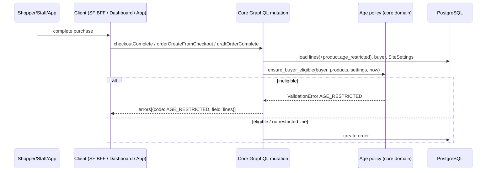

# AGE-RESTRICTIONS — Tech Specs (rev 5 · G1 approved · MEDIUM · WHAT only)

## TOC
0. TLDR · 1. Overview & Scope · 2. NFR / ASR · 3. Architecture & Components · 4. API Contracts · 5. Data Models · 6. Error Handling · 7. Testing · 8. Security & Privacy · 9. Dependencies · 10. Assumptions & Open Items · 11. Tech Summary · 12. Integrity Check

## 0. TLDR
- Staff flag products `ageRestricted`; shop sets `minimumAge` (default 18) + IANA `timeZone` (default UTC) in Dashboard (MANAGE_SETTINGS). `minimumAge` publicly readable, display-only (labels `18+`; not for client authorization; exposes no customer data); `timeZone` MANAGE_SETTINGS-only.
- Customers own a private `birthday`; only owner (self-service) and active superuser read/write it; every write + superuser read → value-free `CustomerEvent`.
- Core blocks every user-facing order path (checkout complete, app `orderCreateFromCheckout`, auto/async completion, draft complete) when a restricted product's buyer is guest, birthday-less, or under age; `orderBulkCreate` exempt.
- Error: code `AGE_RESTRICTED`, generic message, never reveals age/threshold.
- Storefront: label on card/PDP/cart/checkout, birthday form, sign-in / account-settings guidance (checkout never fetches birthday). Dashboard: flag on product update page + site settings; no birthday UI.
- **INV-1 (D1c, user-approved):** the flag affects purchase eligibility only; restricted products stay visible in every catalogue surface (cards, PDP, cart, checkout) with an age label; nothing hides them by the flag.
- Notes/rationale: `architecture-notes.md`. Plan (HOW): `AGE-RESTRICTIONS-PLAN.md`.

## 1. Overview & Scope
### 1.1 Labels
`D#` user-approved (mandatory) · `R#` architect recommendation, approved at G1 2026-11-05 (R4 revised by OQ-1) · `[E]` code fact, citations in `architecture-notes.md §1`.
### 1.2 Approved decisions (requirement IDs)
| ID | Rule |
|---|---|
| D1 | `Product.age_restricted` bool, product-wide; restricted products stay visible/browsable |
| D1c | clarification (approved 2026-11-05, "Approve, the design and specs were reviewed"): flag gates purchase eligibility only. INV-1: restricted products remain visible in every catalogue surface incl. product cards, PDP, cart, checkout, with an age label; no query, filter, `where`, visibility, publication, availability (`isAvailableForPurchase`/channel listing), listing provider, or client UI may hide or exclude them based on the flag |
| D2 | `SiteSettings.minimum_age` (default 18) + `time_zone` IANA (default `UTC`); DB-backed; Dashboard-editable by MANAGE_SETTINGS; prospective only |
| D3 | eligible ⇔ complete-years age on shop-local current date ≥ `minimum_age`; 29 Feb qualifies 1 Mar in non-leap years; dates only |
| D4 | guest / no-birthday customer may browse, cannot buy restricted; SF: guest → sign in, authenticated → account settings |
| D5 | enforce on all user-facing order paths incl. staff drafts + apps; no staff/app bypass; `orderBulkCreate` exempt; draft w/o linked customer may complete; linked customer w/o birthday cannot |
| D6 | owner reads/changes own birthday anytime (authenticated self-service); only `is_superuser` for others; no normal staff/app/webhook/export/public/anon access |
| D7 | audit every birthday write + superuser birthday read; audit data never holds the value |
| D8 | Dashboard: product flag + site settings only; no birthday UI |
| D9 | SF: label on cards, PDP, cart, checkout; account birthday form; generic failure (no age, no threshold); future birthday rejected |
| D10 | private authenticated GraphQL birthday field, owner/superuser only |
| D6c | birthday-clearing contract (user-approved 2026-11-05): omission = no change; clearing only via explicit flag (`clearBirthday: true`); ambiguous inputs rejected (§4 "Birthday write matrix") |
### 1.3 Out of scope
Per-product/per-channel thresholds; ID verification; birthday at registration; birthday in Dashboard, webhooks, exports, search index; retroactive checks on existing orders.

## 2. NFR / ASR
- N1 Correctness: single policy implementation in core; clients never decide (`docs/CONTEXT.md:13-15`).
- N2 Privacy: birthday = personal data; least privilege (D6); no value in logs, audit, webhooks, search vector, errors.
- N3 Performance: no additional SQL queries on checkout-complete path when no restricted line (lines already carry `product`, `checkout/fetch.py:54-57`); ≤1 extra query when restricted; existing `count_queries` benchmarks must not regress except documented.
- N4 Compatibility: additive, non-breaking schema; nullable/`db_default` columns (precedent `site/models.py:77`); new fields carry `ADDED_IN_*` marker.
- N5 Determinism: "today" derived from injected clock + `time_zone`; testable with frozen time.

## 3. Architecture & Components

Styling note: rendered with theme defaults; no custom fills (light/dark safe).

| Component | Responsibility | ID |
|---|---|---|
| Age policy module (core, location R1: `saleor/saleor/account/age_restriction.py`) | pure eligibility + shop-local date | D3 |
| Funnel guards (core) | call policy at every order-creation path | D5 |
| Birthday access gate (core) | resolver + mutation authorization + audit | D6, D7, D10 |
| Shop settings (core + Dashboard) | `minimum_age`, `time_zone` CRUD | D2, D8 |
| Product flag (core + Dashboard + SF) | `age_restricted` write/read/label | D1, D8, D9 |
| SF account + checkout UX | birthday form, guidance, error mapping | D4, D9 |

Policy signatures (core):
- `shop_today(time_zone: str, now: datetime | None = None) -> date`
- `age_on(birthday: date, today: date) -> int` ≡ `today.year − birthday.year − ((today.month, today.day) < (birthday.month, birthday.day))`
- `is_eligible(birthday: date | None, minimum_age: int, today: date) -> bool`
- `ensure_buyer_eligible(buyer: User | None, products: Iterable[Product], site_settings: SiteSettings, *, error_code: str, buyer_required: bool) -> None` — raises `ValidationError{"lines": [code]}`; no-op if no product `age_restricted`.

Guard points (buyer resolution):
| Path | Buyer | `buyer_required` | ID |
|---|---|---|---|
| `complete_checkout` (covers `checkoutComplete`, `automatic_checkout_completion_task`, Stripe webhook) `complete_checkout.py:1717`, before any payment processing | `CheckoutInfo.user` (NOT `user` param = requestor) | true | D5 |
| `create_order_from_checkout` (`orderCreateFromCheckout`, apps) `:1579` | `CheckoutInfo.user` | true | D5 |
| `draftOrderComplete` (`validate_draft_order` `graphql/order/utils.py:365`) | `order.user` | false (None ⇒ allow) | D5 |
| `orderLinesCreate` on non-draft editable orders | `order.user` | false | R7 |
| `transactionInitialize` / `paymentGatewayInitialize` / `checkoutPaymentCreate` when source = checkout | `checkout.user` | true | R6 |
| `orderBulkCreate` | — | not guarded | D5 |

## 4. API Contracts (GraphQL, additive)
| Element | Contract | Auth | ID |
|---|---|---|---|
| `Product.ageRestricted: Boolean!` | public, all channels; read-only signal for labelling (INV-1) | as `Product` | D1, D1c, D9 |
| `ProductInput.ageRestricted: Boolean` | create/update; inherited by `ProductBulkCreateInput` [E] | MANAGE_PRODUCTS | D1 |
| `Shop.minimumAge: Int!` | public read, display-only for restricted-product labels (`18+`); not an authorization input; reveals no birthday/eligibility/customer data | public (R4 revised, OQ-1) | D2, D1c, D9 |
| `Shop.timeZone: String!` | read | MANAGE_SETTINGS (R4) | D2 |
| `ShopSettingsInput.minimumAge: Int`, `.timeZone: String` | write via `shopSettingsUpdate` | MANAGE_SETTINGS | D2 |
| `User.birthday: Date` | value iff requestor user == root, or requestor user `is_superuser ∧ is_active` (≠ root ⇒ audit `BIRTHDAY_VIEWED`); app/other staff/anon ⇒ `PermissionDenied` | custom | D6, D7, D10 |
| `AccountInput.birthday: Date`, `AccountInput.clearBirthday: Boolean` | owner set / explicit clear per write matrix; rejected when requestor is App (impersonation) | AUTHENTICATED_USER | D6, D6c |
| `customerBirthdayUpdate(id: ID!, birthday: Date, clearBirthday: Boolean): CustomerBirthdayUpdate{user: User, errors: [AccountError!]!}` | set / explicit clear other user's birthday per write matrix; neither arg supplied ⇒ `INVALID` (no-op call is ambiguous) | `is_superuser` only (R2) | D6, D6c |
| `CustomerEventsEnum` += `BIRTHDAY_UPDATED`, `BIRTHDAY_VIEWED` | audit types; surfaced via `User.events` of the row's `user` (actor, §5) | existing `User.events` perms (MANAGE_USERS/MANAGE_STAFF, `graphql/account/types.py:553-557`) | D7 |
| `CheckoutErrorCode.AGE_RESTRICTED`, `OrderErrorCode.AGE_RESTRICTED` (+ R6 payment error enums) | §6 | — | D5, D9 |
Birthday write matrix (D6c; same for `accountUpdate` and `customerBirthdayUpdate`; "absent" = key not in input, explicit `null` ≠ absent):
| `birthday` | `clearBirthday` | Result | Audit |
|---|---|---|---|
| absent | absent or `false` | no change (accountUpdate); `INVALID` field `birthday` (customerBirthdayUpdate) | none |
| valid date ≤ shop-local today | absent or `false` | set | `BIRTHDAY_UPDATED` `operation=set` |
| absent | `true` | clear (even if already empty) | `BIRTHDAY_UPDATED` `operation=clear` |
| explicit `null` | any | `INVALID` field `birthday` (ambiguous) | none |
| any date | `true` | `INVALID` field `clearBirthday` (conflict) | none |
| any | explicit `null` | `INVALID` field `clearBirthday` (ambiguous) | none |
| future date | absent or `false` | `INVALID` field `birthday` (R8) | none |
Rejected inputs fail the whole mutation atomically (no partial update of other `AccountInput` fields). Absent-vs-null detection mechanism in graphene input = implementation discovery.
Not added: birthday on `CustomerInput`/`UserCreateInput` (leaks to create/bulk paths [E]), `AccountRegisterInput`, `generate_customer_payload` fields, CSV, filters/sort, search document.

## 5. Data Models
| Model.field | Type | Default / null | Migration | ID |
|---|---|---|---|---|
| `Product.age_restricted` | Boolean | `default=False, db_default=False` | product app, next number | D1, D1c (no index, not used in any visibility/availability queryset) |
| `SiteSettings.minimum_age` | PositiveSmallInteger | `default=18, db_default=18` | site app | D2 |
| `SiteSettings.time_zone` | CharField (IANA name) | `default="UTC", db_default="UTC"` | site app | D2 |
| `User.birthday` | DateField | `null=True, blank=True` | account app | D6 |
| `CustomerEvents` | + `BIRTHDAY_UPDATED`, `BIRTHDAY_VIEWED` | choices only | account (choices) | D7 |
Audit row shape: self write → `user=owner, parameters={"actor": "owner", "operation": "set"|"clear"}`; superuser write → `user=superuser` (actor), `parameters={"account_id": <subject pk>, "operation": "set"|"clear"}`; superuser read → `parameters={"account_id": <subject pk>}` (precedent `account/events.py:11-30`). One `BIRTHDAY_UPDATED` per accepted set/clear (incl. same-value set and clear-of-empty); none for omission or rejected input. Association: superuser rows belong to the **actor's** event history (`User.events` of the superuser); the target appears only as value-free `parameters.account_id`. No promise that superuser rows show on the customer's own `User.events` / Dashboard customer timeline. `parameters` MUST NOT contain the date or derived age. No feature flag (D2 defaults keep behavior inert until products flagged).

## 6. Error Handling
| Case | Response |
|---|---|
| ineligible buyer (guest / no birthday / under age) on guarded path | `ValidationError` field `lines`, code `AGE_RESTRICTED`, message `"Some items can't be purchased by this account."`; same code + message for all three causes; optional `variants` = offending variant IDs (R3) |
| birthday > shop-local today | `AccountError` field `birthday`, code `INVALID` (R8) |
| ambiguous birthday input (explicit `null`, date + `clearBirthday: true`, `clearBirthday: null`, empty `customerBirthdayUpdate`) | `AccountError` field `birthday`/`clearBirthday`, code `INVALID`; no write, no audit (D6c) |
| app sets `AccountInput.birthday` or `clearBirthday` / non-superuser calls `customerBirthdayUpdate` | `PermissionDenied` |
| unauthorized `User.birthday` read | field `null` + `PermissionDenied` error |
| `minimumAge` ∉ [0, 150] (R5) / `timeZone` ∉ `zoneinfo.available_timezones()` | `ShopError` field `minimumAge` / `timeZone`, code `INVALID` |
| guard on checkout path | raised before payment processing / order creation; checkout + transactions untouched |
SF mapping: `AGE_RESTRICTED` → guest: generic text + sign-in CTA; authenticated: generic text + account-settings link (D4, D9). Branch on session state only; checkout/cart never query `birthday` (owner fetch only via `CurrentUserProfile`, R10).

## 7. Testing (map → IDs)
Boundary data (minimum 18, tz UTC unless stated):
| # | birthday | shop-local today | expect |
|---|---|---|---|
| T1 | 2008-11-05 | 2026-11-05 | eligible (exact 18) |
| T2 | 2008-11-06 | 2026-11-05 | ineligible |
| T3 | 2008-02-29 | 2026-02-28 / 2026-03-01 | ineligible / eligible |
| T4 | None / guest | any | ineligible |
| T5 | 2008-11-05 | UTC 2026-11-04T23:30Z, tz `Europe/Belgrade` vs `UTC` | eligible vs ineligible |
| T6 | 2003-01-01, min changed 18→25 after checkout created | — | ineligible at completion (prospective) |
| T7 | 2026-11-06 write | 2026-11-05 | `INVALID` |
| T8 | existing 2000-01-01; `accountUpdate{firstName}` (birthday + flag absent) | — | unchanged, no audit |
| T9 | existing 2000-01-01; `clearBirthday: true` | — | null, 1 audit `operation=clear`, no date in params |
| T10 | `birthday: null` | — | `INVALID`, unchanged, no audit |
| T11 | `birthday: 2000-01-01, clearBirthday: true` | — | `INVALID` `clearBirthday`, unchanged |
| T12 | `clearBirthday: null` / `customerBirthdayUpdate(id)` only | — | `INVALID`, unchanged |
| T13 | app (IMPERSONATE_USER) `clearBirthday: true` | — | `PermissionDenied`, unchanged |
Required suites (exact existing files = discovery, plan S1/S2/T*):
- Core unit: policy T1–T7.
- Core API: product create/update/bulkCreate flag; shopSettingsUpdate valid/invalid + perms; anonymous `shop.minimumAge` readable, anonymous/customer/app-without-MANAGE_SETTINGS `shop.timeZone` denied; `me.birthday` owner; `user.birthday` as MANAGE_USERS staff (denied), superuser (value + `BIRTHDAY_VIEWED`), app (denied); `accountUpdate` owner set/clear/future + write matrix T8–T13 + rejected input leaves other fields unchanged + app-impersonation denied; `customerBirthdayUpdate` superuser set/clear ok / staff denied / matrix T10–T12; audit `parameters` value-free with `operation`.
- Core enforcement: checkoutComplete (guest, no-birthday, underage, eligible, unrestricted cart), orderCreateFromCheckout (app), automatic completion task, draftOrderComplete (no user ⇒ ok; user w/o birthday ⇒ fail; superuser staff ⇒ no bypass), orderLinesCreate (R7), payment initiation (R6), orderBulkCreate exempt.
- Core visibility (INV-1): anonymous/guest + customer `products`, `product`, search, category/collection listings and checkout/cart lines return restricted products identically to unrestricted ones; `isAvailableForPurchase` unchanged by flag; no product filter/`where` input accepts the flag.
- Core privacy: `generate_customer_payload` and customer subscription payload expose no birthday; benchmarks query counts.
- Core audit: superuser read/write rows have `user=superuser`, `parameters.account_id=target`, no date; self write row on owner.
- Dashboard (Jest): `ProductUpdatePage` form submits `ageRestricted`; `CreateProductDialog` unchanged (name + type only); site settings form maps/validates `minimumAge`, `timeZone`.
- Storefront (Vitest): restricted product passes through `toProductView`, listing providers and cart/checkout view models (not dropped, `isAvailable` unaffected) with label `"{minimumAge}+"` (e.g. `18+`, value from public `Shop.minimumAge`; no client code branches purchase/visibility on it); `toProductView` maps optional `ageRestricted`; birthday form validation (future rejected; "remove" sends `clearBirthday: true`, never `birthday: null`; profile-name `accountUpdate` omits both birthday keys); `AGE_RESTRICTED` → guest sign-in CTA vs authenticated account-settings link; checkout documents contain no `birthday` selection; failure message contains no threshold digits.
- Security: injection-shaped `timeZone` (`"../etc"`, `"UTC; DROP"`) rejected; tampered `customerId` by app rejected.

## 8. Security & Privacy (STRIDE summary)
| Threat | Mitigation |
|---|---|
| S: app impersonation writes/reads birthday | App requestor ⇒ deny on `AccountInput.birthday`/`clearBirthday` + resolver |
| T: accidental erasure via partial update or `null` | omission = no change; clear only via `clearBirthday: true`; explicit `null`/conflicts rejected (D6c) |
| T: client bypass of age check | core-only enforcement at funnels; SF label is advisory |
| R: unaudited access | `BIRTHDAY_UPDATED` / `BIRTHDAY_VIEWED` on every write / superuser read |
| I: birthday leak via staff UI, webhooks, subscriptions, CSV, search, logs, error text | resolver gate; payload field lists unchanged; no search-vector use; generic error |
| I: threshold disclosure | accepted by user (OQ-1): `Shop.minimumAge` public, display-only; carries no per-customer data; `AGE_RESTRICTED` message still has no numbers (D9); `Shop.timeZone` MANAGE_SETTINGS-only |
| E: client trusts public threshold for gating | clients MUST NOT authorize/hide/disable purchase from `minimumAge`; only core funnels decide (§3, INV-1) |
| D: per-row audit on superuser list queries | accepted; one event per (request, subject) (R9) |
| E: staff/app order bypass | no permission exempts guard (D5) |
GDPR: birthday deleted with user (row delete); data minimization: date only.

## 9. Dependencies
Python stdlib `zoneinfo`; existing graphene `Date` scalar. No new packages in any repo. Dashboard + SF depend on regenerated core schema (`docs/ARCHITECTURE.md:44-53,74-79`).

## 10. Assumptions & Open Items
No unstated assumptions. R1–R10 approved at G1 (user: "Approve, the design and specs were reviewed", 2026-11-05): R1 module path · R2 dedicated superuser mutation · R3 single code + optional `variants` · R4 (revised by OQ-1) `Shop.minimumAge` public display-only, `Shop.timeZone` MANAGE_SETTINGS-only · R5 `minimumAge` range [0,150] · R6 pre-charge guards · R7 `orderLinesCreate` guard · R8 "future" = after shop-local today · R9 audit row shape/frequency · R10 SF reads birthday only in `CurrentUserProfile` (not `UserDetails`).
Implementation-discovery (do not invent): `ADDED_IN_*` constant for current core version; exact payment error enum names (R6); `CharField` max length for IANA name; `orderLinesCreate` editable-status helper; existing test file names; card placement + form state type inside `ProductUpdatePage`; SF product-card/cart/checkout line view models and i18n keys; SF `data:lock`/`core:lock` impact of operation changes; SF fetch operation + cache tier for public `Shop.minimumAge`; graphene mechanism for absent-vs-explicit-`null` input keys (D6c).
Resolved: `ProductView.ageRestricted` is an additive optional field ⇒ no `STOREFRONT_CONTRACT_VERSION` bump (`react-storefront/src/lib/storefront/contract/version.ts:4-8`).
Resolved OQ-1 (user decision 2026-11-05): label text = `"{minimumAge}+"` (e.g. `18+`) from public `Shop.minimumAge`. Display-only: exposes no birthday, eligibility, or customer data; clients MUST NOT use it for authorization or purchase decisions (core funnels decide, §3). `Shop.timeZone` stays MANAGE_SETTINGS-only.

## 11. Tech Summary (areas affected)
| Repo | Area |
|---|---|
| `saleor` | `product/models.py`, `site/models.py`, `account/models.py`, `account/__init__.py`, `account/events.py`, new policy module, migrations ×3, `graphql/{product,shop,account}/…`, `checkout/complete_checkout.py`, `graphql/order/{utils.py,mutations/order_lines_create.py}`, payment initialize mutations (R6), error code enums, `graphql/schema.graphql` (generated), tests |
| `saleor-dashboard` | `src/products/components/ProductUpdatePage/**` + `views/ProductUpdate/**` (form, fragments, mutations; not `CreateProductDialog`), `src/siteSettings/**`, `schema-main.graphql`, `src/graphql/*.generated.ts`, `locale/defaultMessages.json`, changeset |
| `react-storefront` | `src/graphql/{CurrentUserProfile,AccountUpdate}.graphql` + product fragments, `src/lib/storefront/**` (optional `ProductView.ageRestricted`, no version bump), account settings route/actions, cart + checkout line UI, `src/checkout/**` error mapping, `messages/*.json` |

## 12. Integrity Check
- [x] Every D1–D10 appears in §1.2 and in ≥1 contract (§3–§6) and test (§7).
- [x] INV-1 (D1c) stated in TLDR, §1.2, §4 and tested in §7 (visibility tests); no filter/`where`/visibility/availability contract uses the flag.
- [x] Every R# listed in §10; R1–R10 approved at G1 (R4 revised by OQ-1).
- [x] OQ-1 resolved: public display-only `Shop.minimumAge` consistent across TLDR, §4, §7, §8, §10; `Shop.timeZone` MANAGE_SETTINGS-only; failure message still threshold-free (D9).
- [x] No HOW (sessions, order, commands) here; those live in PLAN.
- [x] Error contract consistent across §4, §6, §7, §8 (`AGE_RESTRICTED`, generic message).
- [x] Birthday never in webhook/CSV/search/audit value (§4, §5, §8).
- [x] D6c write matrix consistent across §1.2, §4, §5 (audit `operation`), §6, §7 (T8–T13, SF), §8.
- [x] Unknown framework symbols listed as discovery, not invented (§10).
