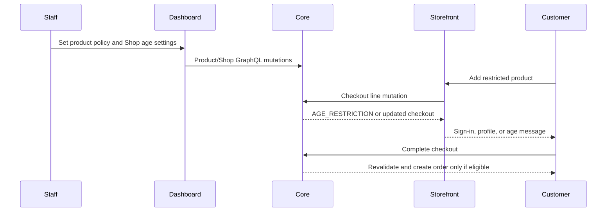

# Age Restrictions — Technical Specification

<CRITICAL ATTRIBUTION="DO NOT COMPACT/OPTIMIZE/SUMMARIZE/REPHRASE, PASS AS-IS">

## Table of Contents

1. Overview, scope, and TLDR
2. Architecture-significant requirements
3. Component design
4. GraphQL contracts
5. Data model and migrations
6. Error handling
7. Test strategy
8. Security and privacy
9. Dependencies and rollout
10. Assumptions and exclusions
11. Affected files and services

## 1. Overview, Scope, and TLDR

### TLDR

- Add an `isAgeRestricted` product flag, default `false`.
- Add Shop-wide `minimumAge` (default `18`) and IANA `timeZone` (default `UTC`).
- Store a date-only birthday that only its owner and a superuser can read or change.
- Enforce eligibility in every checkout line add/update and completion path, and staff draft-order completion; exclude historical `orderBulkCreate`.
- A guest may browse restricted products but cannot add one; the storefront directs the guest to sign in.
- Use the Shop-local calendar date. A Feb 29 birthday reaches age on Mar 1 in non-leap years.
- Expose only `isAgeEligible` on customer detail to the owner and `MANAGE_USERS`; return `null` otherwise.
- Retain metadata-only birthday read/change `CustomerEvent` records for one year, including after customer deletion; do not implement deletion automation.

### Scope

| Draft requirement | Required outcome |
| --- | --- |
| DRAFT-AGE-01 | Staff with `MANAGE_PRODUCTS` set the product restriction flag. |
| DRAFT-AGE-02 | Staff with `MANAGE_SETTINGS` configure the Shop policy and time zone. |
| DRAFT-AGE-03 | Only the customer owner and a superuser read or change a birthday. |
| DRAFT-AGE-04 | Ineligible customers and every guest cannot add, update, or complete a restricted checkout; no app or staff bypass exists. |
| DRAFT-AGE-05 | Draft orders with a linked ineligible customer cannot complete; unlinked drafts may complete. |
| DRAFT-AGE-06 | Customer detail exposes eligibility only, not birthday or age. |
| DRAFT-AGE-07 | Birthday reads by staff and birthday changes create privacy-safe, retained audit records. |
| DRAFT-AGE-08 | Every customer-facing restricted-product card displays the current Shop minimum age as `N+` without restricting visibility. |

Out of scope: identity verification, regional or channel policies, registration birthday collection, guest birthday collection, birthday exports, webhooks, public or unauthenticated birthday APIs, historical-order validation, and automated audit-retention deletion.

## 2. Architecture-Significant Requirements

### Eligibility rule

`eligible(customer, shopDate, minimumAge)` is true only when the customer has a birthday and has reached `minimumAge` on `shopDate`. `shopDate` is the current date in `ZoneInfo(shop.time_zone)`. Dates, not timestamps, are compared. For a Feb 29 birthday in a non-leap year, the anniversary is Mar 1.

### Enforcement boundary

The backend is authoritative. It validates product variants against their parent product flag before mutation side effects:

1. `checkoutLinesAdd` and inherited `checkoutLinesUpdate`: reject any restricted line for a guest, customer without a birthday, or ineligible customer.
2. `checkoutComplete` and checkout-to-order paths: revalidate all lines immediately before completion.
3. Staff draft-order completion: apply the same rule if the draft has a linked customer; permit drafts without a customer.
4. `orderBulkCreate`: intentionally remains exempt because it imports historical orders.

### Privacy boundary

- Birthday is a first-class private `User` field, never metadata.
- Birthday GraphQL access is owner or `is_superuser` only; applications, `MANAGE_USERS` staff, webhooks, exports, public profiles, and unauthenticated callers cannot read or set it.
- `isAgeEligible` is nullable and resolves only for the owner and `MANAGE_USERS`; it reveals no date or age. Resolve and audit it once per customer per request.
- Audits store the immutable target customer UUID, actor identity when present, timestamp, and action (`birthday_read` or `birthday_changed`); they never store a birthday, age, name, or email.

## 3. Component Design

| Component | Responsibility |
| --- | --- |
| `product.Product` | Persist `is_age_restricted`; expose it in the product API and product create/update inputs. |
| `site.SiteSettings` | Persist the global `minimum_age` and validated `time_zone`; expose them only to `MANAGE_SETTINGS`. |
| `account.User` | Persist nullable, date-only `birthday`; provide no general staff access. |
| `account.age_restrictions` | Single pure eligibility calculation and enforcement helpers. No GraphQL or UI dependencies. |
| Checkout and order mutations | Call the enforcement helper before line mutation and before order completion. |
| `CustomerEvent` | Persist `birthday_read` and `birthday_changed` metadata with immutable subject identity and actor. |
| Dashboard | Edit product and Shop policy; show `isAgeEligible` on customer detail only. |
| Storefront | Let authenticated customers set birthday in account settings; prevent guest PDP add-to-cart and direct to sign-in. |

The domain helper accepts a `User | None`, product variants or checkout lines, and `SiteSettings`. It returns normally only when no restricted product exists or the linked customer is eligible; otherwise it raises the caller's typed validation error. Every caller uses this one helper to preserve the rule across GraphQL, apps, staff, and draft-order flows.



## 4. GraphQL Contracts

### Product and Shop

```graphql
type Product { isAgeRestricted: Boolean! }
input ProductInput { isAgeRestricted: Boolean }
type Shop { minimumAge: Int!, timeZone: String! }
input ShopSettingsInput { minimumAge: Int, timeZone: String }
```

- `Product.isAgeRestricted` is public so the storefront can direct guests before cart mutation.
- `minimumAge` and `timeZone` fields and inputs require `MANAGE_SETTINGS`; `minimumAge` accepts `1..120`, default `18`; `timeZone` accepts only an IANA zone name, default `UTC`.
- `ProductInput.isAgeRestricted` follows existing product mutation authorization (`MANAGE_PRODUCTS`).

### Customer data

```graphql
type User {
  birthday: Date
  isAgeEligible: Boolean
}
input AccountInput { birthday: Date }
customerBirthdayUpdate(id: ID!, birthday: Date): CustomerBirthdayUpdate
```

- `User.birthday`: the owner and a superuser only. A successful staff read emits one `birthday_read` event per customer per request. It returns `null` for all other requestors without exposing whether a value exists.
- `User.isAgeEligible`: owner and `MANAGE_USERS` only. It returns `null` for all other requestors, including apps. Its resolver emits one `birthday_read` event only for staff resolution; an owner read is not logged.
- `AccountInput.birthday`: an authenticated customer may set, replace, or clear only their own birthday through `accountUpdate`. The field is rejected for app impersonation and any non-owner request.
- `customerBirthdayUpdate`: superuser-only mutation to set or clear another customer's birthday. It is not available to `MANAGE_USERS` staff or apps. Both mutation paths emit `birthday_changed`.
- `accountRegister`, `customerCreate`, and ordinary `customerUpdate` do not accept birthday. This prevents registration, support staff, app, and bulk paths from bypassing the privacy contract.

### Checkout and order errors

Add a typed checkout/order error code `AGE_RESTRICTION` with a generic, non-sensitive message. Do not return birthday, calculated age, or the specific restricted product. The storefront maps this code to:

- guest: sign-in prompt;
- authenticated customer without birthday: account-settings prompt;
- authenticated ineligible customer: age-restriction message.

The direct mutation error remains authoritative if a client is stale, bypassed, or malicious.

## 5. Data Model and Migrations

| Model | Field or record | Contract |
| --- | --- | --- |
| `product.Product` | `is_age_restricted` | `BooleanField(default=False, db_default=False)`. Existing products remain unrestricted. |
| `site.SiteSettings` | `minimum_age` | Integer, default `18`, validated `1..120` in model and mutation. |
| `site.SiteSettings` | `time_zone` | IANA name, default `"UTC"`, validated through `zoneinfo.ZoneInfo`. |
| `account.User` | `birthday` | Nullable `DateField`; reject a date after Shop-local current date. |
| `account.CustomerEvent` | birthday audit fields | New event types, immutable `customer_uuid`, nullable actor reference, and no birthday-value parameters. |

The `CustomerEvent` migration must preserve birthday audit records after customer deletion. It stores `customer_uuid` as a non-relational UUID snapshot; it must not use a cascading customer foreign key. Its actor reference uses `SET_NULL`. Existing event behavior remains unchanged. Birthday audit types are excluded from `User.events` unless the requestor is a superuser.

The migration has no backfill: `birthday = NULL`, `is_age_restricted = false`, `minimum_age = 18`, and `time_zone = "UTC"` are safe defaults. Add a TODO entry describing the one-year retention policy and the required future retention job; do not implement that job in this scope.

## 6. Error Handling

| Condition | API result | Client result |
| --- | --- | --- |
| `minimumAge` outside `1..120` | `ShopError.INVALID` on `minimumAge` | Inline site-settings validation. |
| Unknown IANA zone | `ShopError.INVALID` on `timeZone` | Inline site-settings validation. |
| Future birthday | `AccountError.INVALID` on `birthday` | Inline account-settings validation. |
| Unauthorized birthday read | `birthday: null`; no presence signal | No private UI value. |
| Unauthorized birthday update | `AccountError` permission/invalid-field response | No update control. |
| Restricted line for guest, missing birthday, or ineligible customer | `AGE_RESTRICTION` on the affected checkout/order mutation | Sign-in, profile, or age message without DOB disclosure. |
| Restricted draft with no customer | No error | Existing completion behavior. |
| Historical `orderBulkCreate` | No age validation | Existing import behavior. |

All validation is deterministic from the Shop's transaction-time local date. Do not log birthday values, calculated age, or eligibility failures at an information level.

## 7. Test Strategy

| Requirement | Required automated evidence |
| --- | --- |
| DRAFT-AGE-01 | Product model, create/update mutation, API field, dashboard form, and generated-client tests. |
| DRAFT-AGE-02 | Migration defaults; `1..120`; valid/invalid IANA zones; Shop query/mutation permission tests; dashboard settings tests. |
| DRAFT-AGE-03 | Owner, superuser, `MANAGE_USERS`, staff without permission, app, and anonymous query/mutation tests; future-date rejection. |
| DRAFT-AGE-04 | Guest, missing birthday, underage, exactly eligible, and overage cases in line add, line update, checkout completion, app, and staff callers. |
| DRAFT-AGE-05 | Draft order completion with eligible, ineligible, missing-birthday, and no-customer cases; `orderBulkCreate` regression exemption. |
| DRAFT-AGE-06 | Owner and `MANAGE_USERS` eligibility; `null` for all other requestors; customer-detail-only dashboard rendering. |
| DRAFT-AGE-07 | One event per staff field resolution per request, change events, no raw birthday data in record or response, superuser-only event visibility, and deletion retention. |

Boundary data: birthday exactly `minimumAge` years before Shop-local today; one day younger; Feb 29 on leap and non-leap years; Shop midnight in a non-UTC zone; `minimumAge` values `1`, `18`, `120`, `0`, and `121`; `UTC` and a DST-observing IANA zone.

Run focused backend pytest for models, GraphQL account/product/shop/checkout/order paths, plus migration checks and schema generation. Run dashboard unit tests, GraphQL generation, typecheck, lint, formatting, and message extraction. Run storefront unit tests, code generation, typecheck, lint, and focused account/PDP tests against the updated local schema. Add E2E coverage for guest PDP sign-in routing and authenticated eligible/ineligible purchase behavior.

## 8. Security and Privacy

| Threat | Mitigation |
| --- | --- |
| Client or app bypasses storefront UI | Backend applies the same helper to every specified checkout and draft-order path. |
| Staff reads or changes birthday through generic customer APIs | Birthday is excluded from generic inputs and resolvers; only owner and superuser paths are permitted. |
| Birthday leaks through audit, webhook, export, metadata, or logs | Store only action metadata and subject UUID; exclude birthday from all listed surfaces and error text. |
| Eligibility becomes an age oracle | Expose only to owner or `MANAGE_USERS`; return `null` otherwise; no lists or bulk surfaces. |
| Boundary-date inconsistency | Use Shop IANA time zone and date-only calculation in one domain helper. |
| Deleted customer destroys audit trail | Persist immutable customer UUID separately from a cascading relationship. |

Birthday is personal data. The implementation must preserve data minimization, purpose limitation, access control, and auditability. The stated self-declaration policy is not proof of legal age; no UI or API copy may claim verified age.

## 9. Dependencies and Rollout

- No new runtime dependency is required; Python `zoneinfo` validates and resolves IANA zones.
- Land core migration, domain enforcement, GraphQL schema, and backend tests first.
- Refresh dashboard schema and generate typed hooks before dashboard changes.
- Regenerate storefront documents against the updated local core before storefront changes.
- Existing carts and draft orders are revalidated at their next covered mutation or completion. No background cart migration is required.
- No feature flag is required. The safe defaults keep existing products unrestricted and existing customers without a birthday ineligible only for products newly marked restricted.

## 10. Assumptions and Exclusions

- The Shop uses one global policy, not channel, country, region, or product-specific age values.
- A customer may change a self-declared birthday. This is intentionally not an identity-verification control.
- The Shop time zone controls eligibility for all sales and does not change timestamps stored elsewhere.
- A guest may view a restricted product but cannot add it to a checkout; an authenticated user without a birthday has the same backend restriction.
- Staff draft orders without a linked customer remain permitted. `orderBulkCreate` remains exempt for historical imports only.
- Audit retention is one year by policy. This feature documents, but does not implement, the future purge job.
- Restricted products remain visible in lists, search, featured collections, discounted cards, and product-card banners. Text-only banners need no age label.

## 11. Affected Files and Services

| Service | Primary areas |
| --- | --- |
| `saleor` | `account/models.py`, `account/events.py`, account GraphQL types/mutations, `product/models.py`, product GraphQL type/input/update, `site/models.py`, Shop GraphQL type/mutation, checkout line/completion mutations, draft-order completion, error enums, migrations, schema, and focused tests. |
| `saleor-dashboard` | Product detail query/form/submission, Shop site-settings query/form/mutation, customer-detail fragment/view, translations, generated GraphQL artifacts, and tests. |
| `react-storefront` | Product fragments/view contract, authenticated account settings and `AccountUpdate`, PDP add-to-cart behavior, checkout error mapping, messages, generated GraphQL artifacts, unit tests, and Playwright coverage. |
| Workspace docs | `docs/CONTEXT.md`, `docs/ARCHITECTURE.md`, `agents/IMPLEMENTATION.md`, and the documented audit-retention TODO after implementation. |

### Approval status

Approved by the user on 2026-11-04: DRAFT-AGE-01 through DRAFT-AGE-07, the stated self-declaration limitation, and the intentional `orderBulkCreate` exemption. Implementation remains subject to plan approval.

</CRITICAL>
