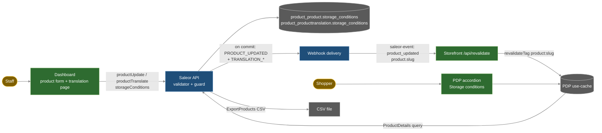

# Storage Conditions — Architecture Notes

Status: design proposal, ready for planning/specs. Author role: solution architect. Date: 2026-11-03.
Inputs: `plans/storage-conditions/discovery-notes.md`, `docs/CONTEXT.md`, `docs/ARCHITECTURE.md`, repo docs (`saleor/docs/*`, `saleor-dashboard/docs/ARCHITECTURE.md`, `react-storefront/docs/{ARCHITECTURE,DATA-ARCHITECTURE,CONTEXT}.md`), source code read 2026-11-03. Code baselines: saleor `bb00425`, saleor-dashboard `a667b12`, react-storefront `3d3c3f5`.
Labels: **F** = verified fact (path:lines), **U** = user decision, **D** = design decision (this doc), **I** = inference / unverified implementation detail.

## TLDR
- Add `storage_conditions` as a nullable `CharField(max_length=250)` on `Product` and `ProductTranslation` (one atomic, reversible migration). Expose `storageConditions: String` on `Product`, `ProductTranslation`, `ProductTranslatableContent`, `ProductInput` and the shared `TranslationInput`.
- One shared core validator: trim, empty becomes null, more than 250 code points or a NUL character gives `INVALID`. It runs for product create/update/bulk-create, `productTranslate` and `productBulkTranslate`. `categoryTranslate`/`collectionTranslate` reject any provided `storageConditions` with `INVALID` before any model is built.
- Freshness: `productTranslate` and `productBulkTranslate` also emit `PRODUCT_UPDATED`, once per product, after commit. This copies the existing `productVariantTranslate` behavior. The storefront's existing `product_updated` path then busts `product:{slug}`, so `/api/revalidate` needs no change.
- Product webhooks get the field: the legacy JSON `PRODUCT_FIELDS` and translation keys are updated, and subscription payloads pick it up through the GraphQL types. CSV export gets a new `ProductFieldEnum.STORAGE_CONDITIONS` ("storage conditions"). Search, filters, sorting, cart, checkout and email are not touched.
- Dashboard: refresh `schema-main.graphql` (3.23) from the local API and run codegen. The field is read with `@lockSchema(schema: "main")`. It is edited in the product details card and the product translation page, with a 250 code-point counter, and is added to the export dialog.
- Storefront: add the field to the `ProductDetails` query and merge it with `pickTranslatedField`. `ProductView.storageConditions?` is a new optional field (no contract bump). It renders as a labeled accordion item right after Description, as escaped plain text, and is hidden when empty.
- Selected: Alternative A (first-class field + core-emitted `PRODUCT_UPDATED`). Score 88/100 vs B 66 and C 38.

## 1. Evidence-based design constraints

### 1.1 Core (saleor)
- F1 `Product` has `name`, `description` (EditorJS JSON), `description_plaintext` and search fields, and no storage field: `saleor/saleor/product/models.py:179-189`. `ProductTranslation` (`SeoModelTranslationWithSlug`) holds nullable `name`/`description`, and `get_translated_keys` lists `name`, `description` plus SEO and slug: `saleor/saleor/product/models.py:277-311`, `saleor/saleor/seo/models.py:19-47`.
- F2 The latest product migration is `0210_collection_external_reference_unique_constraint` (non-atomic CONCURRENTLY). The precedent for a simple nullable `AddField` is `0209`: `saleor/saleor/product/migrations/0209_collection_external_reference.py:1-17`, `0210_...py:1-40`.
- F3 `TranslationInput` = `NameTranslationInput` + `SeoTranslationInput` + `description`: `saleor/saleor/graphql/translations/mutations/utils.py:189-200`. Its only consumers are `productTranslate` (`product_translate.py:24`), `productBulkTranslate` (`product_bulk_translate.py:51`), `categoryTranslate` (`category_translate.py:20`) and `collectionTranslate` (`collection_translate.py:22`). The SDL is at `saleor/saleor/graphql/schema.graphql:25145-25157`.
- F4 `BaseTranslateMutation.validate_input` → `validate_input_against_model(cls._meta.model, input)` builds the **base** model (`Product`/`Category`/`Collection`) from the truthy input values and runs `full_clean`: `utils.py:74-79,137-140`. It then calls `instance.translations.update_or_create(defaults=input)`: `utils.py:146-165`. So if `storage_conditions` reaches Category/Collection, the model constructor fails with an unexpected-kwarg error, or `update_or_create` fails on an unknown field. The guard must run **before** `validate_input`.
- F5 `ProductTranslate` overrides `perform_mutation`: validate, update_or_create inside `traced_atomic_transaction`, then only `translations_created/updated` events: `product_translate.py:36-55`. It does **not** emit `product_updated`.
- F6 Precedent: `ProductVariantTranslate` emits `product_variant_updated` and the translation events: `saleor/saleor/graphql/translations/mutations/product_variant_translate.py:38-56`.
- F7 Bulk translate validates against the **translation** model (`utils.py:371-373`). It turns `ValidationError` into errors with the raw Django `code=e.code` (`utils.py:434-441`, not passed through `get_error_code_from_error`), and persists with `bulk_update(..., cls._meta.translation_fields)` (`utils.py:466`). The product list is `["name","description","seo_description","seo_title"]`: `product_bulk_translate.py:79`. Its error enum `ProductTranslateErrorCode` has only `GRAPHQL_ERROR/INVALID/NOT_FOUND/REQUIRED`: `saleor/saleor/translations/error_codes.py:18-22`. It emits only `TRANSLATION_CREATED/UPDATED`: `utils.py:491-509`.
- F8 Single-object mutations map Django codes (`max_length`, `null_characters_not_allowed`, …) to `invalid`: `saleor/saleor/graphql/core/utils/error_codes.py:3-50`, `saleor/saleor/graphql/core/mutations.py:87-117`. The existing test expects `productTranslate` name over-length → `{"field":"name","code":"INVALID"}`: `saleor/saleor/graphql/translations/tests/test_translations.py:955-973`. The 250-limit test precedent is `test_product_media_translate.py:255-285`.
- F9 `ProductInput` (shared by `ProductCreateInput`, `ProductUpdate`, and inherited by `ProductBulkCreateInput`) has no storage field: `saleor/saleor/graphql/product/mutations/product/product_create.py:31-86,114-122`, `product_update.py:26-45`, `bulk_mutations/product_bulk_create.py:117`. Create/update run `clean_input` cleaners and then `full_clean`: `product_create.py:137-147`, `core/mutations.py:438-453`. Bulk create also calls `clean_instance`: `product_bulk_create.py:683-688`. `ProductUpdate` emits `product_updated` via `call_event`: `product_update.py:125-134`.
- F10 GraphQL `Product` type: `saleor/saleor/graphql/product/types/products.py:941-1152` (description at 946, translation at 1113-1117, default resolver `ChannelContextType.resolver_with_context`). `ProductTranslation` / `ProductTranslatableContent` types: `saleor/saleor/graphql/translations/types.py:409-524`. Translation fallback is not resolved on the server: `Product.translation` returns the translation row or null, and clients merge.
- F11 Legacy product webhook payload fields are `PRODUCT_FIELDS` (no slug): `saleor/saleor/webhook/payloads.py:666-676,715-756`. The translation payload is built from `get_translated_keys()`: `payloads.py:1186-1210`. Subscription payloads resolve GraphQL types (`ProductUpdated` root `Product`, `TranslationTypes` union): `saleor/saleor/graphql/webhook/subscription_types.py:893-899,2511-2554`. `manager.product_updated(product, webhooks=None)`: `saleor/saleor/plugins/manager.py:789-797`.
- F12 Identical-payload suppression is off by default and only applies to mutations that pass pre-save payloads: `saleor/saleor/settings.py:1176-1182`, `saleor/saleor/webhook/transport/asynchronous/transport.py:155-185`.
- F13 CSV export is header→lookup mapping `ProductExportFields.HEADERS_TO_FIELDS_MAPPING["fields"]`: `saleor/saleor/csv/utils/__init__.py:1-27`. The enum is `ProductFieldEnum`: `saleor/saleor/graphql/csv/enums.py:35-50`. Headers are resolved through the mapping (`saleor/saleor/csv/utils/product_headers.py:34-57`) and rows come from `.values(*fields)` (`saleor/saleor/csv/utils/products_data.py:49-78`). No spreadsheet-formula escaping is done (`saleor/saleor/csv/utils/export.py:258-270`).
- F14 Product search indexes only `name` and `description_plaintext` (plus variants/attributes): `saleor/saleor/product/search.py:18,77-96`.
- F15 Schema rules: any API change → `uv run poe build-schema`, `ADDED_IN_3xx` descriptions, CHANGELOG entry, GraphQL Inspector, `makemigrations --check`, migrations-compatibility CI (new schema with old code): `saleor/docs/GRAPHQL-ARCHITECTURE.md:44-48`, `saleor/docs/ARCHITECTURE.md:55-70`. Version is 3.23.41 and `ADDED_IN_323` exists: `saleor/pyproject.toml:7`, `saleor/saleor/graphql/core/descriptions.py:15-18`. Events must go through `call_event` (on commit): `saleor/docs/INTEGRATION-ARCHITECTURE.md:14-23`.
- F16 graphene 2.1.9 / graphql-core 2: `saleor/pyproject.toml:39-40`, `saleor/uv.lock:1035-1046`. (I: omitted input fields are absent from the input dict, and explicit `null` is present as `None`. Implementation must confirm this with a test.)

### 1.2 Dashboard (saleor-dashboard)
- F17 `schema.graphql` is a symlink to `schema-main.graphql`. `fetch-local-schema` introspects `API_URL` and writes `schema.graphql`, and `generate` runs main+staging codegen: `saleor-dashboard/scripts/fetch-local-schema.cjs:12-40`, `saleor-dashboard/package.json:39-47,74`, `docs/ARCHITECTURE.md` (workspace) `## Schema and codegen coupling`.
- F18 Every generated document is validated against **both** `schema-main.graphql` and `schema-staging.graphql` after `@lockSchema` resolution: `saleor-dashboard/src/graphql/lockSchema.test.ts:19-58`. Staging codegen loads only `*.staging.ts`: `saleor-dashboard/codegen-staging.ts:5-14`. There are existing `@lockSchema(schema: "main")` field precedents: `saleor-dashboard/src/fragments/attributes.ts:35-56`. Consequence: any new selection of `storageConditions` must carry `@lockSchema(schema: "main")`, or the staging validation test fails.
- F19 Product edit: the `Product` fragment is at `src/fragments/products.ts:214-225`. Form data mapping is `src/products/utils/data.ts:190-220`, form type `src/products/components/ProductUpdatePage/types.ts:39-52`, and save field list `saveComposition.ts:4-14`. The update variables builder sends only changed keys, and an empty value is an explicit clear: `src/products/views/ProductUpdate/handlers/utils.ts:31-75`. The details card is `ProductDetailsForm` (`ProductUpdatePage.tsx:707-716`). The counter precedent is `src/components/SeoForm/SeoForm.tsx:176-204` (uses `.length`, UTF-16 units). Product creation is minimal and then goes to the update page (`src/products/views/ProductList/createMinimalProduct.ts`).
- F20 Translations: `productTranslate` is used with `$input: TranslationInput!` (`src/translations/mutations.ts:4-12`). The source/translation fragment is at `src/fragments/translations.ts:78-102`. Field names come from `TranslationInputFieldName` (`src/translations/types.ts:10-17`). The input is built generically as `{[fieldName]: value}` (`src/translations/utils.ts:22-41`), bulk merges entity fields (`src/translations/bulkSubmit.ts:30-56`), and the product page builds the sections (`src/translations/components/TranslationsProductsPage/TranslationsProductsPage.tsx:130-171`). `TranslationField` has no length limit (`types.ts:36-47`), and the long editor is `TranslationFieldsLong.tsx:25-97`.
- F21 The export dialog lists `ProductFieldEnum` values explicitly, and the label map is untyped: `src/products/components/ProductExportDialog/ProductExportDialogInfo.tsx:40-45,585-600`, `messages.ts:42-104`.

### 1.3 Storefront (react-storefront)
- F22 PDP query `src/graphql/ProductDetails.graphql:1-117` (translation block 15-21). Loader `getProductData` is `"use cache"`, tagged with the primary slug, and returns `withTranslatedProductFields(product)`: `src/lib/catalog/get-product-data.ts:48-83`. The merge rule is `pickTranslatedField`: a non-blank translation wins, otherwise the fallback is used (`src/lib/saleor-translations.ts:7-17,146-165`). Codegen comes from the live API; `src/gql/` is git-ignored (`react-storefront/docs/ARCHITECTURE.md` `## GraphQL and codegen`).
- F23 Contract `ProductView` is at `src/lib/storefront/contract/product.ts:34-57`. Version rule: "Adding an optional field is not a bump" (`contract/version.ts:1-8`). Mapper `toProductView` is pure: `src/lib/storefront/mappers/product.ts:24-53`. Both files are hash-locked in `paper-core.lock.json` (lines with `contract/product.ts`, `mappers/product.ts`), refreshed by `pnpm core:lock` (`react-storefront/docs/DATA-ARCHITECTURE.md:51-55`).
- F24 PDP block: `ProductAttributes` accordion. Description is item 1 (`dangerouslySetInnerHTML` of xss-sanitized HTML), Care Instructions renders as a text node: `src/ui/components/pdp/product-attributes.tsx:20-29,67-126`. It is wired at `src/app/(storefront)/[locale]/[channel]/(main)/products/[slug]/page.tsx:212-219`. Labels live in `messages/en.json:63-72` (`pdp.attributes`), with 8 locale files.
- F25 Invalidation: `product_updated` → entity `product`, `affectsListing: true`. There is **no** `translation_*` entry, so translation events are skipped as `unhandled_event`: `src/lib/saleor/invalidation/webhook-events.ts:37-99`, `src/app/api/revalidate/route.ts:175-180`. A product slug is read from `payload.product.slug` (subscription payloads) and busts `product:{slug}`: `route.ts:78-88,314-321`. Legacy JSON product payloads (array, no slug) bust only listing tags.

### 1.4 User decisions
- U1 Dashboard targets main 3.23 schema refreshed from the local API; the tracked schema may change.
- U2 Extend the shared `TranslationInput`; Category/Collection must reject `storageConditions` with `INVALID`.
- U3 Backend Unicode count governs the 250 limit; dashboard constrains input.
- U4 Shared local DB → implementation must be reversible and validated.
- U5 Scope from the request: optional plain text, ≤250, translated with name/description fallback, PDP-only labeled block after description, hidden when empty, in Product webhooks + Product CSV export, no cart/checkout/email/search/filter, translation-only saves refresh PDP immediately when catalog notifications are connected.

## 2. Alternatives

Criteria (weight): requirement fit incl. U1–U5 (30), freshness reliability with already-connected notifications (20), compatibility/blast radius (20), complexity across 3 repos (15), reversibility on shared DB (15).

### A. First-class field + core emits `PRODUCT_UPDATED` on product translation saves — **88**
- Model columns on `Product`/`ProductTranslation`, GraphQL fields, shared validator, Category/Collection guard. `productTranslate`/`productBulkTranslate` additionally `call_event(manager.product_updated, product)` after commit (bulk: once per distinct product, prefetched webhooks).
- Pros: matches F6 precedent. Works with every existing `PRODUCT_UPDATED` subscriber (Paper app, manual webhook) with **zero** storefront route/lock changes. As a side effect it also fixes stale translated name/description on the PDP. Fully typed. Webhook and CSV support follow standard patterns.
- Cons: `PRODUCT_UPDATED` fires on translation-only saves, so apps get more deliveries (documented in CHANGELOG and `webhook_events_info`). Translation saves also bust listing tags (`affectsListing`). Legacy-JSON subscribers still get no slug (pre-existing, F25).

### B. First-class field + storefront consumes `TRANSLATION_CREATED/UPDATED` — **66**
- Same model/API. Add `translation_created/updated` to `WEBHOOK_EVENT_SCOPES` (or via `extensionWebhookScopes`). Parse `translation.__typename == "ProductTranslation"`, resolve the slug through the deprecated `translatableContent.product.slug` or a new core `ProductTranslation.product` field, or else do a live lookup by product ID.
- Pros: `PRODUCT_UPDATED` keeps its meaning. Invalidation is precise.
- Cons: needs operators **and the external Paper app** (not in the workspace) to subscribe to new events with a new subscription query, so "already connected" notifications do not work without reconfiguration. It touches core-locked storefront files (`webhook-events.ts`, `route.ts`) and has to dispatch Category/Collection/etc. translation types. Behavior can't be verified end-to-end in the workspace.

### C. Plain-text product attribute (`storage-conditions` slug, like care instructions) — **38**
- No migration. Per-product-type attribute assignment. Storefront extracts by slug like `extractCareInstructions` (`mappers/product.ts:37`).
- Pros: no schema/codegen change, no DB migration.
- Cons: contradicts U2 (TranslationInput) and the "Product field" request. The 250 limit and optional semantics are not enforceable per product, and it depends on product-type setup. Translation goes through `attributeValueTranslate`, which has the same freshness gap. CSV/webhooks expose it only as an attribute column. It would also appear as a generic attribute in other surfaces.

Pruning: C is killed (violates U2/U5 contract shape). B is dominated by A on freshness-with-existing-connections and blast radius; its only edge (event-semantics purity) is outweighed. B's live-lookup variant adds an uncached Saleor call inside the webhook route, against kernel rules (`DATA-ARCHITECTURE.md:6-13`).

## 3. Selected design (A) and rationale
- D1 Data: `Product.storage_conditions = CharField(max_length=250, blank=True, null=True)`; `ProductTranslation.storage_conditions = CharField(max_length=250, blank=True, null=True)`. Null means "not set". On a translation, null means "fall back to base". Nullable avoids a NOT NULL default and stays compatible with the old code in migrations-compatibility CI (F15). No index (no search/filter, F14).
- D2 One validator: `clean_storage_conditions(value: str | None) -> str | None`. `None` → `None`. Strip surrounding whitespace, and `""` becomes `None`. If `"\x00" in value` or `len(value) > 250` (Python `len` = Unicode code points), raise `ValidationError(code=INVALID)`. Interior newlines are kept. HTML/markup is stored verbatim (plain text, never interpreted). Constant `STORAGE_CONDITIONS_MAX_LENGTH = 250` lives with the product domain (I: e.g. `saleor/product/__init__.py` or a validators module).
- D3 Guard for Category/Collection: shared mixin/helper invoked at the start of `CategoryTranslate`/`CollectionTranslate` (override `validate_input`, call the guard before `super()`). If the key `storage_conditions` is present in the input (any value, including null), raise `ValidationError({"storage_conditions": ValidationError("Storage conditions can only be translated for products.", code=TranslationErrorCode.INVALID)})` → `{field:"storageConditions", code:INVALID}`.
- D4 Freshness: emit `PRODUCT_UPDATED` from product translation mutations (Alternative A). The legacy/plugin `product_updated` path is unchanged, and no new event type is added.
- D5 Version label: `ADDED_IN_323` on new fields (I: the workspace runs the 3.23 line, U1; the release label is subject to upstream review).
- Rationale: A meets every U-constraint, follows existing in-repo patterns (F6, F8, F9 precedents), changes the fewest locked or external components, and can be rolled back with one `migrate` plus code revert.



## 4. Component contracts

### 4.1 Data model and migration (core)
- New `saleor/saleor/product/migrations/0211_product_storage_conditions.py`, depending on `0210_collection_external_reference_unique_constraint`. Atomic, two `AddField` ops (Product, ProductTranslation), no data migration, no index. Generated by `makemigrations`; `makemigrations --check` clean.
- Reverse: `migrate product 0210` drops both columns (destroys feature data only). On PG15, a nullable add-column without a default is metadata-only (I: no table rewrite).
- `ProductTranslation.get_translated_keys()` adds `"storage_conditions"`. `ProductBulkTranslate.Meta.translation_fields` adds `"storage_conditions"` (F7, so `bulk_update` persists it).

### 4.2 GraphQL schema/API (core) — additive only
```graphql
type Product                    { storageConditions: String }  # plain text, ≤250 code points, public like description
type ProductTranslation         { storageConditions: String }  # null = not translated
type ProductTranslatableContent { storageConditions: String }  # source value for translators
input ProductInput              { storageConditions: String }  # inherited by ProductCreateInput, ProductBulkCreateInput; ProductUpdate uses ProductInput
input TranslationInput          { storageConditions: String }  # products only; Category/Collection → INVALID
enum  ProductFieldEnum          { STORAGE_CONDITIONS }          # value "storage conditions"
```
- Write semantics: omitted = unchanged. `null`/`""`/whitespace = clear (stored `NULL`). Otherwise the trimmed value is stored.
- Mutation behavior:
  | Mutation | Validation | Error type / field / code | Events (on commit) |
  |---|---|---|---|
  | `productCreate`, `productUpdate` | D2 in `clean_input` (product cleaner) | `ProductError` / `storageConditions` / `INVALID` | unchanged (`PRODUCT_CREATED`/`PRODUCT_UPDATED`) |
  | `productBulkCreate` | D2 in base-field cleaning | `ProductBulkCreateError` / path `storageConditions` / `INVALID` | unchanged |
  | `productTranslate` | D2 before `validate_input` | `TranslationError` / `storageConditions` / `INVALID` | `TRANSLATION_CREATED|UPDATED` + **new** `PRODUCT_UPDATED` |
  | `productBulkTranslate` | D2 per row in `validate_translation_fields`; append error explicitly with `ProductTranslateErrorCode.INVALID` (not raw `e.code`, F7) | `ProductBulkTranslateError` / path `storageConditions` / `INVALID`; honors `errorPolicy` | `TRANSLATION_*` + **new** `PRODUCT_UPDATED` once per distinct saved product (prefetch `get_webhooks_for_event(PRODUCT_UPDATED)`) |
  | `categoryTranslate`, `collectionTranslate` | D3 guard first | `TranslationError` / `storageConditions` / `INVALID`; nothing persisted | none |
- `webhook_events_info` of `ProductTranslate`/`ProductBulkTranslate` adds `PRODUCT_UPDATED` (SDL `@webhookEventsInfo`). CHANGELOG notes the new field and the new `PRODUCT_UPDATED` emission.
- Permissions are unchanged: writes need `MANAGE_PRODUCTS` / `MANAGE_TRANSLATIONS`. Reads follow `Product` visibility.
- Generated artifact: `saleor/saleor/graphql/schema.graphql` is regenerated with `uv run poe build-schema` (never hand-edited).

### 4.3 Webhooks and CSV (core)
- Legacy JSON: add `"storage_conditions"` to `PRODUCT_FIELDS` (`payloads.py:666`). This covers created/updated/deleted product payloads. Translation payload keys gain `storage_conditions` via `get_translated_keys` (4.1).
- Subscription payloads: the field is available through the `Product`, `ProductTranslation` and `ProductTranslatableContent` types. Subscribers must select it (no implicit change for existing queries).
- CSV: `HEADERS_TO_FIELDS_MAPPING["fields"]["storage conditions"] = "storage_conditions"` and `ProductFieldEnum.STORAGE_CONDITIONS`. It exports the base (untranslated) value, like `name` and `description`. Empty values are written as an empty cell.

### 4.4 Dashboard
- Schema: with the new core running locally, run `pnpm run fetch-local-schema` (writes `schema-main.graphql` via the symlink). Diff by declaration names (MEMORY rule): the only expected deltas are the 6 additions in 4.2 plus webhook-info directives. Then `pnpm run generate`. `schema-staging.graphql` is untouched, and no `fetch-schema` runs.
- Documents: the `Product` fragment adds `storageConditions @lockSchema(schema: "main")`. The `ProductTranslation` fragment adds `product { storageConditions @lockSchema(schema: "main") }` and `translation { storageConditions @lockSchema(schema: "main") }`.
- Product edit: `ProductUpdateFormData.storageConditions: string` (init `product.storageConditions ?? ""`), added to `PRODUCT_DETAILS_SAVE_FIELDS`. In `getProductUpdateVariables`, when the key is present, send `trimmed || null`, only when `isMainSchema()`. Show a multiline `Textarea` labeled "Storage conditions" in `ProductDetailsForm` below Description, with the counter "{n} of 250 characters". Count code points with `Array.from(value).length`, not `.length` and not native `maxLength`, because both count UTF-16 units. Over the limit: field error + save disabled. Server `ProductError` on `storageConditions` is shown through `getFormErrors([... "storageConditions"])`.
- Translations: add `TranslationInputFieldName.storageConditions = "storageConditions"`. Add a LONG field only in `TranslationsProductsPage` sections (not in the shared Category/Collection builders). Add optional `maxLength?: number` to `TranslationField`, enforced in `TranslationFieldsLong` (code-point counter + `saveDisabled`). Existing per-field and bulk submits carry the key through `{[fieldName]: value}` into `productTranslate`. An empty submit clears the translation.
- Export: add `STORAGE_CONDITIONS` to the product-information field group (`ProductExportDialogInfo.tsx:593-596`) and the label map (`messages.ts`).
- Messages via `pnpm run extract-messages`. Patch changeset. Generated `src/graphql/*.generated.ts` comes from codegen only.

### 4.5 Storefront
- `ProductDetails.graphql`: add `storageConditions` on `product` and inside `translation(languageCode:)`. No other documents change (lists, checkout, cart, orders untouched).
- `withTranslatedProductFields` adds `storageConditions: pickTranslatedField(product.translation, "storageConditions", product.storageConditions) ?? null`, the same rule as name/description (F22).
- `ProductView.storageConditions?: string | null` (optional, so no bump of `STOREFRONT_CONTRACT_VERSION`, F23). `toProductView` sets the trimmed value, or null when blank.
- `ProductAttributes` gets the prop `storageConditions?: string | null`. When it is non-empty, render `AccordionItemWithContext value="storage-conditions"` **immediately after** the description item, titled `t("storageConditions")`. The body is a React text node (`<p className="whitespace-pre-line">{storageConditions}</p>`), never `dangerouslySetInnerHTML`. The item is included in `defaultValue` so it is visible without a click (D, I: UX choice). Pass `view.storageConditions` from `page.tsx`.
- `messages/{en,pl,de,fr,fi,nb,ja,ko}.json`: `pdp.attributes.storageConditions` (en "Storage conditions").
- `/api/revalidate` and `webhook-events.ts` are unchanged (freshness comes from D4). Run `pnpm core:lock` (locked contract/mapper hashes change); `data:lock` is unchanged.

### 4.6 Cache/event flow (translation-only save)
1. Staff saves a translation → `productTranslate` commits the `ProductTranslation` row.
2. On commit: `TRANSLATION_UPDATED|CREATED` and `PRODUCT_UPDATED(product)` are queued (Celery or inline, per deployment; `ASSUMPTIONS.md` WA-05).
3. The subscriber (Paper app / manual webhook with `product { slug ... }`) POSTs to `/api/revalidate` with `saleor-event: product_updated` → scope `product`, `affectsListing: true` → `revalidateTag(product:{primarySlug})` + listing tags.
4. The next PDP request misses the cache, re-runs `ProductDetails` and renders the new translated-or-fallback value. Without notifications, the catalog TTL backstop applies (about 1h, `DATA-ARCHITECTURE.md:15-18`).

### 4.7 Security and plain-text rendering
- No server-side HTML sanitization (the value is never HTML). Storefront and dashboard render it as escaped text nodes. JSON-LD/SEO metadata do not include it.
- NUL rejected (Postgres text safety). The length cap bounds payload size.
- CSV: values starting with `=`, `+`, `-` or `@` are exported verbatim, which is the same pre-existing risk as `name` (F13). Flagged in caveats, not changed here.
- Webhook delivery uses existing signing. No new permissions or secrets.

## 5. Acceptance criteria (verifiable)
- AC1 Migration: `makemigrations --check` clean. `migrate product 0211` adds two nullable `varchar(250)` columns. `migrate product 0210` removes them. Old-code compatibility CI passes.
- AC2 `productUpdate(input:{storageConditions:"Keep refrigerated at 2–8 °C"})` persists the value, and `product{storageConditions}` returns it. `"  "` or `null` returns null. Omitting the field leaves the value unchanged.
- AC3 250 limit: 250 code points (including astral characters such as emoji) are accepted; 251 return `ProductError{field:"storageConditions",code:INVALID}` and nothing is persisted. The same applies to `productCreate`, `productBulkCreate` (path), `productTranslate` (`TranslationError`) and `productBulkTranslate` (`ProductBulkTranslateError` code `INVALID`, row rejected per `errorPolicy`). A NUL character gives `INVALID`.
- AC4 `categoryTranslate` / `collectionTranslate` with `storageConditions` (string or explicit null) return `TranslationError{field:"storageConditions",code:INVALID}`, persist nothing and emit no event. Existing calls without the key behave unchanged (existing tests green).
- AC5 `productTranslate(languageCode:PL, input:{storageConditions:"…"})` stores it on `ProductTranslation`. `product.translation(languageCode:PL){storageConditions}` returns it, and `ProductTranslatableContent.storageConditions` returns the base value.
- AC6 Events: `productTranslate` and `productBulkTranslate` call `product_updated` once per affected product after commit, in addition to the translation events (mocked manager assertions). `productBulkTranslate` with 2 rows for the same product → 1 `product_updated`.
- AC7 Webhooks: the legacy `generate_product_payload` JSON contains `storage_conditions`. The translation payload `keys` contains `storage_conditions`. A subscription `ProductUpdated { product { storageConditions } }` returns the value.
- AC8 CSV: `exportProducts(input:{exportInfo:{fields:[STORAGE_CONDITIONS]}})` produces a `storage conditions` column with base values.
- AC9 Non-goals: `products(search:"refrigerated")` does not match on storage conditions only. No `where`/`filter`/`sortBy` input gains the field. Checkout/cart/order GraphQL documents in the storefront and core email templates contain no `storageConditions` (grep).
- AC10 Schema: `uv run poe build-schema` diff is additive only (GraphQL Inspector: no breaking change).
- AC11 Dashboard: `schema-main.graphql` diff by declaration names shows only the 4.2 additions. `pnpm run generate`, `check-types`, `lint:eslint`, and `src/graphql/lockSchema.test.ts` (main + staging) pass. Form tests cover: initial value, changed-key send, clear → null, 251 code points blocks save, astral counting. The translation page shows a Storage conditions row for products only (not categories/collections). The export dialog lists Storage conditions.
- AC12 Storefront: unit tests for `withTranslatedProductFields` (translation wins, blank translation → base, both blank → null) and `toProductView`. `ProductAttributes` renders the block right after Description when non-empty, renders no block when empty, and shows `<b>x</b>` literally. `pnpm verify` passes against the updated local API, and `core:lock:check` passes after `core:lock`.
- AC13 Freshness (manual, local): with a `PRODUCT_UPDATED` subscription webhook carrying `product{slug}` to `/api/revalidate`, a translation-only save of storage conditions changes the PDP for that locale on the next request (log shows `product:{slug}` revalidated), with no TTL wait.

## 6. Risks and rollback
- R1 Dashboard `fetch-schema:main` / weekday CI `update-schema.yml` would overwrite `schema-main.graphql` with released 3.23, which lacks the field, and break codegen/types. Mitigation: do not run it on this branch, and note in the PR that the field needs a core release.
- R2 Storefront codegen depends on the connected API. Its CI `update_types.yml` uses the released schema, so typecheck fails there until core ships the field. Mitigation: run against the local API; a fork-safe fallback is out of scope (would need the `ProductDetailsExtension` route).
- R3 More `PRODUCT_UPDATED` deliveries and listing busts on translation saves. Mitigation: bulk dedupe, CHANGELOG, `webhook_events_info`.
- R4 Legacy-JSON product subscribers carry no slug, so the PDP is not busted (pre-existing). The AC13 setup must use a subscription query (the Paper app does).
- R5 Shared DB: forward migration is additive and nullable, so other checkouts running old code keep working. Rollback = revert the code first, then `migrate product 0210` (drops feature values; export them first if needed). Never run destructive steps without explicit approval (U4).
- R6 Pre-existing: bulk translate passes raw Django codes (F7). The new field avoids it with an explicit `INVALID`. Other fields are unchanged and logged as a discovery.
- Rollback order: storefront revert → dashboard revert (restore `schema-main.graphql` + generated files from git) → core revert → reverse migration.

## 7. Open questions
- None blocking. Non-blocking for the planner/user:
  - Q1 Should the storefront block be expanded by default (D: yes) or collapsed like the other items?
  - Q2 Should dashboard translation **list** completion (`src/translations/views/EntityLists/utils.ts:44-56,123-130`) count the new field? Proposal: no change (optional field). The detail-page progress counts it automatically through sections.

## 8. Confidence and caveats
- Overall confidence 0.85 (weighted). Data/API/validation 0.9. Dashboard 0.85 (form wiring details not fully traced). Storefront 0.9. Freshness 0.8 (depends on the subscriber's payload carrying `product.slug`; the Paper app config is external and not verifiable here).
- Caveats: graphene-2 key-presence semantics (F16) need a test. Celery/inline delivery locally is unverified (WA-05). The `ADDED_IN_323` label is a release-line assumption. CSV formula injection is a pre-existing risk. Code-point counting is not grapheme counting (a flag emoji counts as 2).
