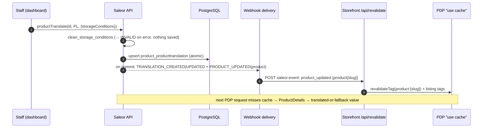

# Storage Conditions — Tech Specs (target state, WHAT)

Status: approved for implementation. Date 2026-11-03. Companion plan (HOW): `storage-conditions-PLAN.md`. Design authority: `architecture-notes.md` (Alternative A). Inputs: `discovery-notes.md`.
Baselines (verified, clean trees): saleor `bb00425`, saleor-dashboard `a667b12`, react-storefront `3d3c3f5`.
Labels: **U** = user decision · **F** = source fact (`repo/path:lines`) · **D** = approved design (`architecture-notes.md` § ref) · **I** = inferred detail, must be confirmed by a test.

<CRITICAL ATTRIBUTION="DO NOT COMPACT/OPTIMIZE/SUMMARIZE/REPHRASE, PASS AS-IS">

## TLDR
- Optional plain-text `storageConditions` (≤ 250 Unicode code points) on Product + ProductTranslation; nullable columns; one reversible additive migration.
- GraphQL additions only: `Product`, `ProductTranslation`, `ProductTranslatableContent`, `ProductInput`, shared `TranslationInput`, `ProductFieldEnum.STORAGE_CONDITIONS`.
- One server validator (trim → empty = null; > 250 code points or NUL → `INVALID`) for every product write path. Category/Collection translate reject the key with `INVALID`.
- `productTranslate` / `productBulkTranslate` also emit `PRODUCT_UPDATED` after commit (bulk: once per product), so the existing storefront revalidation busts `product:{slug}`.
- Product webhooks (legacy JSON + subscription types) and Product CSV export carry the base value. No search, filter, sort, cart, checkout, order, or email changes.
- Dashboard (main 3.23 schema, refreshed from the local API): product form field, product-only translation row, code-point counter, translation progress counts the field only when a source value exists, export option.
- Storefront: PDP-only labeled accordion item right after Description, expanded by default, escaped text, hidden when the translated-or-fallback value is blank.

## TOC
1. Scope and non-goals · 2. Decisions and sources · 3. Architecture · 4. Data model and migration · 5. Validation contract · 6. GraphQL API contract · 7. Webhooks and CSV · 8. Dashboard contract · 9. Storefront contract · 10. NFR and compatibility · 11. Security · 12. Test scenarios · 13. Success criteria · 14. Assumptions and caveats · 15. Affected areas

## 1. Scope and non-goals
In scope (U): an optional per-product plain-text value. It is translatable per language with the same fallback as name and description, edited by staff in the dashboard, shown on the PDP only, included in Product webhook payloads and Product CSV export, and refreshed on the PDP right after translation-only saves when catalog notifications are connected.

Non-goals (U, enforced by AC-NG):
- No product search indexing (`saleor/saleor/product/search.py:18,77-96` unchanged), no `where`/`filter`/`sortBy` inputs, no PLP/listing/card display.
- No cart, checkout, order, or order-email data or templates. No storefront checkout/cart/order GraphQL documents.
- No storefront `/api/revalidate` or `webhook-events.ts` change. No new webhook event type.
- No rich text, HTML, or markdown. No per-channel value. No variant-level field. No JSON-LD/SEO metadata use.
- No edits to Storybook stories (`*.stories.tsx`) in any repo (U). No `schema-staging.graphql` change. No release-schema fetch.
- No change to the pre-existing bulk-translate raw-code behavior for other fields (F: `saleor/saleor/graphql/translations/mutations/utils.py:425-441`).

## 2. Decisions and sources
| ID | Decision | Label |
|---|---|---|
| U1 | Dashboard targets the main 3.23 schema, refreshed from the local API. The tracked `schema-main.graphql` changes. | U |
| U2 | Shared `TranslationInput` gets the field. Category/Collection translate reject it with `INVALID`. | U |
| U3 | Server limit of 250 Unicode code points is authoritative. Dashboard prevents excess input. | U |
| U4 | Product translation saves emit `PRODUCT_UPDATED`, reusing the existing storefront revalidation. | U (= D4) |
| U5 | PDP block is expanded by default. | U (resolves arch Q1) |
| U6 | Dashboard translation progress counts the field only when the product has a non-blank source value. | U (overrides arch Q2 "no change") |
| U7 | No story edits. Shared local DB: migration must be reversible. No destructive rollback without approval. | U |
| D1–D5 | Nullable columns, single validator, Category/Collection guard, freshness via `PRODUCT_UPDATED`, `ADDED_IN_323` label | D (`architecture-notes.md` §3) |

## 3. Architecture
Component view: `architecture-notes.md` §3 diagram (not repeated). Translation-only save (6 actors):

- Rendering rule (F): `Product.translation(languageCode)` returns the row or null. The fallback is merged on the client (`react-storefront/src/lib/saleor-translations.ts:7-17`).
- Without notifications, freshness falls back to the catalog TTL (F: `react-storefront/docs/DATA-ARCHITECTURE.md:15-18`). This is not changed.

## 4. Data model and migration
| Model / table | Field | Type | Constraints |
|---|---|---|---|
| `Product` / `product_product` | `storage_conditions` | `CharField(max_length=250, blank=True, null=True)` | no default, no index |
| `ProductTranslation` / `product_producttranslation` | `storage_conditions` | same | null = not translated → fallback |
- F baseline: there is no such field today (`saleor/saleor/product/models.py:179-189,277-311`). The latest migration is `0210_collection_external_reference_unique_constraint` (`saleor/saleor/product/migrations/`).
- Migration `saleor/saleor/product/migrations/0211_product_storage_conditions.py`: depends on `0210`, atomic, exactly 2 `AddField` ops, no `RunPython`/`RunSQL`, no index. Reversible: backward = drop both columns, which loses only feature data.
- Stored null semantics: `NULL` = not set. `""` is never stored (the validator normalizes it, §5).
- `ProductTranslation.get_translated_keys()` includes `"storage_conditions"` (F current keys: `saleor/saleor/product/models.py:303-311`).
- Compatibility: old code runs against the new schema (nullable, no default), which keeps the migrations-compatibility CI green (F: `saleor/docs/ARCHITECTURE.md:55-70`).

## 5. Validation contract (authoritative, server)
`clean_storage_conditions(value: str | None) -> str | None` (D2). Single implementation. Constant `STORAGE_CONDITIONS_MAX_LENGTH = 250` in the product domain (I: module location).
| Input | Result |
|---|---|
| key omitted | field untouched (I: graphene-2 omits absent keys; F16 in arch, test required) |
| `null`, `""`, whitespace-only | stored `NULL` |
| text with surrounding whitespace | stored trimmed; interior whitespace and newlines kept |
| `len(trimmed) ≤ 250` (Python `len` = code points; astral emoji = 1, ZWJ/flag sequences = component count) | accepted |
| `len(trimmed) > 250` | `ValidationError(code=INVALID)` on `storage_conditions` |
| contains `\x00` | `ValidationError(code=INVALID)` |
| HTML/markup such as `<b>x</b>` | accepted, stored verbatim (plain text) |
- The limit is measured **after trim**. Server code-point count governs (U3).
- Client/server agreement rule. Every dashboard counter and limit (product §8.2, translation §8.3) uses `count(v) = Array.from(v.trim()).length`, which mirrors the server's `len(v.strip())`. The client blocks exactly when the server would reject on length, for ASCII space/tab/CR/LF, Unicode `Zs` spaces, and astral characters (boundary scenarios T-A1…T-A6, §12).
- Known divergence (I): JS `trim()` and Python `strip()` disagree on a few exotic code points (U+FEFF stripped only by JS; U+001C–U+001F stripped only by Python; verified locally 2026-11-03). At the boundary the server's `INVALID` is shown as a field error. The client does not try to emulate Python.
- Applied on: `productCreate`, `productUpdate`, `productBulkCreate`, `productTranslate`, `productBulkTranslate` (all paths through `ProductInput`/`TranslationInput`).

## 6. GraphQL API contract (additive only)
### 6.1 Schema additions
```graphql
type Product { storageConditions: String }  # also ProductTranslation, ProductTranslatableContent
input ProductInput { storageConditions: String }  # inherited: ProductCreateInput, ProductBulkCreateInput; used by productUpdate
input TranslationInput { storageConditions: String }  # products only (§6.3)
```
- Also add `enum ProductFieldEnum { STORAGE_CONDITIONS }` with the value `"storage conditions"` (§7).
- Descriptions: "Plain-text storage conditions, up to 250 characters." + `ADDED_IN_323` (D5/I). `TranslationInput.storageConditions` says "Only supported by product translations; other types return INVALID."
- `Product.storageConditions` = base value, resolved from the `ChannelContext` root like `description` (F: `saleor/saleor/graphql/product/types/products.py:941-1152`). `ProductTranslation.storageConditions` = translation row value or null. `ProductTranslatableContent.storageConditions` = base value (F: `saleor/saleor/graphql/translations/types.py:409-524`).
- Read permissions: the same as the sibling `name`/`description` fields. Write permissions are unchanged: `MANAGE_PRODUCTS` (product mutations), `MANAGE_TRANSLATIONS` (translate mutations).
- Generated `saleor/saleor/graphql/schema.graphql` (F: `TranslationInput` at `:25145-25157`) is regenerated only, never hand-edited.

### 6.2 Mutation / error / event matrix
| Mutation | Error type · field/path · code | Persistence on error | Events after commit |
|---|---|---|---|
| `productCreate`, `productUpdate` | `ProductError` · `storageConditions` · `INVALID` | none | unchanged (`PRODUCT_CREATED` / `PRODUCT_UPDATED`) |
| `productBulkCreate` | `ProductBulkCreateError` · path `storageConditions` · `INVALID` | row rejected per `errorPolicy` | unchanged |
| `productTranslate` | `TranslationError` · `storageConditions` · `INVALID` | none | `TRANSLATION_CREATED|UPDATED` **+ `PRODUCT_UPDATED`(product)** |
| `productBulkTranslate` | `ProductBulkTranslateError` · path `storageConditions` · `INVALID` (explicit enum, never the raw Django code; F: `utils.py:434-441`) | row rejected per `errorPolicy` | `TRANSLATION_*` **+ `PRODUCT_UPDATED` once per distinct successfully saved product** |
| `categoryTranslate`, `collectionTranslate` | `TranslationError` · `storageConditions` · `INVALID` when the key is present (any value, including null); checked before model validation (F: `utils.py:74-79,137-165`) | none | none |
- `productBulkTranslate` persists the field (F: today `translation_fields` = `["name","description","seo_description","seo_title"]` at `saleor/saleor/graphql/translations/mutations/product_bulk_translate.py:79`).
- Precedent for the event (F): `saleor/saleor/graphql/translations/mutations/product_variant_translate.py:38-56`. Events go through `call_event` (on commit) (F: `saleor/docs/INTEGRATION-ARCHITECTURE.md:14-23`).
- `webhook_events_info` for `ProductTranslate` and `ProductBulkTranslate` lists `PRODUCT_UPDATED` together with `TRANSLATION_CREATED/UPDATED`. `ProductTranslate` currently declares none (F: grep; bulk declares `TRANSLATION_*` at `product_bulk_translate.py:84-92`).
- Calls without `storageConditions` behave exactly as before, apart from the new `PRODUCT_UPDATED` on product translation saves.

### 6.3 Shared `TranslationInput` compatibility (U2)
- Consumers (F): `productTranslate`, `productBulkTranslate`, `categoryTranslate`, `collectionTranslate` (`saleor/saleor/graphql/translations/mutations/{product_translate.py:24,product_bulk_translate.py:51,category_translate.py:20,collection_translate.py:22}`).
- Category/Collection: introspection shows the field (shared type), and runtime rejects it. No DB column exists on `CategoryTranslation`/`CollectionTranslation`.
- GraphQL Inspector: adding an optional input field and an enum value is non-breaking. The enum value is classified "dangerous" (I). It goes in the CHANGELOG.
- CHANGELOG (`saleor/CHANGELOG.md`): the new field, the Category/Collection `INVALID` rule, and the new `PRODUCT_UPDATED` emission on product translation saves (app-visible behavior change).

## 7. Webhooks and CSV (core)
| Surface | Target state |
|---|---|
| Legacy JSON product payloads | `PRODUCT_FIELDS` contains `storage_conditions`. Affects `generate_product_payload` and `generate_product_deleted_payload` (F: `saleor/saleor/webhook/payloads.py:666-676,715-776`). Value = base value or `null`. |
| Legacy translation payload | `keys` contain `storage_conditions` through `get_translated_keys` (F: `payloads.py:1186-1210`). |
| Subscription payloads | Available as `Product.storageConditions`, `ProductTranslation.storageConditions`, `ProductTranslatableContent.storageConditions`. Existing subscription queries do not change implicitly. |
| `PRODUCT_UPDATED` from translation saves | Payload = current product (base fields). The subscriber needs `product { slug }` for PDP busting (F: `react-storefront/src/app/api/revalidate/route.ts:78-88,314-321`). |
| CSV `exportProducts` | `ProductFieldEnum.STORAGE_CONDITIONS = "storage conditions"`. `HEADERS_TO_FIELDS_MAPPING["fields"]["storage conditions"] = "storage_conditions"` (F: `saleor/saleor/csv/utils/__init__.py:1-27`, `saleor/saleor/graphql/csv/enums.py:35-50`). The column holds the base (untranslated) value. Null exports as an empty cell. Values are not escaped (same as `name`, F: `saleor/saleor/csv/utils/export.py:258-270`). |
| Sample payloads | Any sample/serializer fixtures listing product fields include the key (I: `saleor/saleor/webhook/tests/test_webhook_sample_payloads.py`). |

## 8. Dashboard contract (saleor-dashboard)
### 8.1 Schema and codegen (U1)
- `schema-main.graphql` is refreshed from the running local API that serves §6 (F: `schema.graphql` → symlink to `schema-main.graphql`. `fetch-local-schema` introspects `API_URL`, then `generate` = main + staging: `saleor-dashboard/scripts/fetch-local-schema.cjs:12-40`, `saleor-dashboard/package.json:39-46`).
- Accepted diff, compared by declaration names (`agents/MEMORY.md` "Compare schemas by declaration names"): only the §6.1 additions plus `@webhookEventsInfo` changes on `productTranslate`/`productBulkTranslate`. Directive or printing-only noise is acceptable but must be reported. Any other declaration delta blocks.
- `schema.graphql` stays a symlink. `schema-staging.graphql` is byte-identical. `src/graphql/*.generated.ts` changes come only from codegen.
- Every new selection of `storageConditions` carries `@lockSchema(schema: "main")` (F: dual-schema validation `saleor-dashboard/src/graphql/lockSchema.test.ts:19-58`; precedent `src/fragments/attributes.ts:35-56`).
- Selections: the `Product` fragment (F: `src/fragments/products.ts:214-225`), and `ProductTranslation` → `product{storageConditions}` + `translation{storageConditions}` (F: `src/fragments/translations.ts:78-102`). No other documents.

### 8.2 Product edit
| Aspect | Contract |
|---|---|
| Placement | `ProductDetailsForm` card, multiline text field labeled "Storage conditions", directly below Description (F: card used at `src/products/components/ProductUpdatePage/ProductUpdatePage.tsx:707-716`). Hidden when `!isMainSchema()` (F: `src/graphql/schemaVersion.ts:31`). |
| Props | `ProductDetailsFormProps.data.storageConditions?: string` is **optional**. Missing → empty field. Keeps `ProductDetailsForm.stories.tsx` type-valid without edits (F: story data has no such key, `src/products/components/ProductDetailsForm/ProductDetailsForm.stories.tsx:32`). |
| Form data | `ProductUpdateFormData.storageConditions: string`, initialized as `product.storageConditions ?? ""` (F: `src/products/utils/data.ts:190-220`, `src/products/components/ProductUpdatePage/types.ts:39-52`). It belongs to the product-details save group (F: `saveComposition.ts:4-14`). |
| Mutation variables | Sent only when changed (F: changed-keys builder `src/products/views/ProductUpdate/handlers/utils.ts:31-75`). Value = trimmed text, or `null` when blank. Never sent when `!isMainSchema()`. |
| Limit UX (U3) | Counter "{count} / 250" where `count = Array.from(value.trim()).length` (§5 agreement rule). Not `.length`, not untrimmed, and not native `maxLength` (F: SeoForm uses `.length`, `src/components/SeoForm/SeoForm.tsx:176-204`). `count > 250`: inline error, save disabled, and the `productUpdate` mutation is not called. Typing past the limit stays possible, so pasted text remains visible for editing (I). |
| Server errors | `ProductError{field:"storageConditions"}` is shown on the field. |
| Create flow | No change. Creation is minimal and leads to the update page (F: `src/products/views/ProductList/createMinimalProduct.ts`). |

### 8.3 Translations
| Aspect | Contract |
|---|---|
| Field name | `TranslationInputFieldName.storageConditions = "storageConditions"` (F: enum `src/translations/types.ts:10-17`). |
| Where | Product translation page only (F: sections built at `src/translations/components/TranslationsProductsPage/TranslationsProductsPage.tsx:130-171`), as a LONG field "Storage conditions" after Description. Shared Category/Collection/other section builders do **not** expose it (U2). |
| Visibility | The row renders when the source `product.storageConditions` or the current translation is non-blank. An orphan translation stays clearable, because the storefront would otherwise show it (§9). |
| Limit | `TranslationField` gains optional `maxLength?: number` (F: `types.ts:36-47`). With it set (250), the counter uses the same `count` as §8.2 (trimmed, code points). `count > 250` disables single-field save and bulk save, and neither `productTranslate` nor the bulk submit path is called with the over-limit value (T-D7, T-D8). |
| Submit | Per-field and bulk submits send `{storageConditions: value}` through `productTranslate` (F: `src/translations/utils.ts:22-41`, `src/translations/bulkSubmit.ts:30-56`, `src/translations/mutations.ts:4-12`). Blank → clears the translation (null). |
| Progress (U6) | The field counts toward completion **only when the source is non-blank**: detail page (section + context bar, F: `src/translations/progress.ts:48-68`) and product list (F: `src/translations/views/EntityLists/utils.ts:44-56,123-136`). Completed = non-blank translation (SHORT/LONG rule, F: `progress.ts:13-32`). Source blank → total unchanged versus today, even if an orphan translation exists. |
| Other entities | Category/Collection/Page/etc. progress totals are unchanged. |

### 8.4 Export, i18n, release note
- Export dialog: `ProductFieldEnum.STORAGE_CONDITIONS` is listed in the product-information group with the label "Storage conditions" (F: `src/products/components/ProductExportDialog/ProductExportDialogInfo.tsx:40-45,585-600`, `messages.ts:42-104`).
- New strings go through react-intl and are extracted to `locale/defaultMessages.json` (`pnpm run extract-messages`). One patch changeset in `.changeset/`.
- Fixtures (`src/products/fixtures.ts`, `src/translations/fixtures.ts`) may gain `storageConditions` for type completeness (ownership: PLAN `## File ownership`). `*.stories.tsx` files are not edited (U7).

## 9. Storefront contract (react-storefront)
| Layer | Target state |
|---|---|
| Query | `src/graphql/ProductDetails.graphql` selects `storageConditions` on `product` and on `translation(languageCode:)` (F: `:1-117`, translation block `:15-21`). No other `.graphql` document changes. |
| Codegen | Git-ignored `src/gql/` is regenerated from the connected local API (F: `react-storefront/docs/ARCHITECTURE.md` `## GraphQL and codegen`). Nothing generated is committed. |
| Merge | `withTranslatedProductFields` sets `storageConditions = pickTranslatedField(translation, "storageConditions", product.storageConditions) ?? null`: a non-blank translation wins, otherwise the base value (F: `src/lib/saleor-translations.ts:7-17,146-165`). |
| View | `ProductView.storageConditions?: string \| null`. Optional, so `STOREFRONT_CONTRACT_VERSION` stays 2 (F: `src/lib/storefront/contract/product.ts:34-57`, `contract/version.ts:1-8`). |
| Mapper | `toProductView` → trimmed value, or `null` when blank or absent. Stays pure (F: `src/lib/storefront/mappers/product.ts:24-53`). |
| Component | `ProductAttributes` prop `storageConditions?: string \| null`. Non-blank → an `AccordionItemWithContext value="storage-conditions"` is the **next item after `description`** (first item when description is absent), titled `t("storageConditions")`. The body is a text node with `whitespace-pre-line`, never `dangerouslySetInnerHTML`. `defaultValue` includes `"storage-conditions"` (expanded, U5). Blank → no item and no heading (F: current order and `defaultValue={["description"]}`, `src/ui/components/pdp/product-attributes.tsx:67-126`). |
| Wiring | PDP page passes `view.storageConditions` (F: `src/app/(storefront)/[locale]/[channel]/(main)/products/[slug]/page.tsx:212-219`). There is no other surface. |
| Messages | `pdp.attributes.storageConditions` in all 8 `messages/*.json` (en "Storage conditions"; F: `messages/en.json:63-72`). |
| Cache | The PDP loader, its tags, and the profile are unchanged (F: `src/lib/catalog/get-product-data.ts:48-83`). `/api/revalidate` + `webhook-events.ts` are unchanged (F: `src/lib/saleor/invalidation/webhook-events.ts:37-99`). `product_updated` → `product:{slug}` bust is the freshness path (U4). `data-layer.lock.md` stays unchanged (call sites are unchanged). `paper-core.lock.json` hashes for `contract/product.ts` and `mappers/product.ts` are refreshed (F: `paper-core.lock.json:21,24`). |

## 10. NFR and compatibility
- API: additive-only SDL. Existing clients and existing tests without the field stay green. The only behavior change is the extra `PRODUCT_UPDATED` on product translation saves (bulk: deduplicated per product). It is documented.
- DB: metadata-only nullable `ADD COLUMN` on PG15 (I). Old code stays compatible with the new columns, so the shared local DB stays usable by other checkouts (U7).
- Performance: no new queries on read paths beyond selecting one column. Bulk translate prefetches `PRODUCT_UPDATED` webhooks once per mutation (D, `architecture-notes.md` §4.2). No N+1 regression in `test_*` query-count benchmarks that already exist (I).
- Release coupling: the dashboard `schema-main.graphql` is ahead of released 3.23 until core ships. `fetch-schema:main` / `update-schema.yml` would remove the field (arch R1). Storefront CI typegen against the released schema fails until core ships (arch R2). Both are accepted local-workspace caveats.
- Observability: no new logs or metrics. Storefront revalidation logs show `product:{slug}` (used by AC-13).

## 11. Security (threat summary)
| STRIDE | Threat | Mitigation / contract |
|---|---|---|
| Tampering / XSS | Markup stored in the field and rendered | Stored verbatim. Rendered only as escaped text nodes (dashboard inputs, storefront text node). Never passed to HTML or JSON-LD sinks. |
| Tampering | Writes to Category/Collection translations via the shared input | Guard → `INVALID`, nothing persisted (§6.2). |
| Elevation | Unauthorized writes | Existing `MANAGE_PRODUCTS` / `MANAGE_TRANSLATIONS`. No new permission. |
| DoS | Oversized payloads | 250 code-point cap + existing request limits. NUL rejected. |
| Info disclosure | Exposure | The value is public product content, readable wherever `description` is. No PII expected. |
| Injection (CSV) | Formula-prefixed values (`=`,`+`,`-`,`@`) | Pre-existing, unmitigated for all text columns (F: `saleor/saleor/csv/utils/export.py:258-270`). Out of scope, recorded as a caveat. |
| Spoofing | Revalidate endpoint | Unchanged existing HMAC / secret checks (`docs/ARCHITECTURE.md` `## Webhooks and apps`). |
- Agents never read env files, `*.pem`, or secrets. Webhook secrets for AC-13 are entered by a human or come from existing config (Plan G4).

## 12. Test scenarios
Test data: `V1="Keep refrigerated at 2–8 °C"`, `V250="😀"×250` (250 code points, 500 UTF-16 units), `V251="a"×251`, `V251A="😀"×251`, `VWS="  "`, `VNUL="a\x00b"`, `VHTML="<b>x</b>"`, `VPL="Przechowywać w lodówce 2–8 °C"`, `VPAD="  V1  "`.
| ID | Layer | Scenario | Expected |
|---|---|---|---|
| T-C1 | core | `productUpdate` V1, then query `product{storageConditions}` | V1 persisted and returned |
| T-C2 | core | `productUpdate` VPAD / VWS / `null` / key omitted | trimmed / NULL / NULL / unchanged |
| T-C3 | core | V250 vs V251 on create, update, bulk create | accept / `INVALID` + nothing persisted |
| T-C4 | core | VNUL; VHTML | `INVALID`; stored verbatim |
| T-C5 | core | `productTranslate` PL VPL → `translation(languageCode:PL)`, `translatableContent` | translation = VPL; source = base |
| T-C6 | core | `productTranslate` V251 / VNUL | `TranslationError{storageConditions, INVALID}`, no row change, no events |
| T-C7 | core | `productBulkTranslate` rows for product P: PL V1, DE VPL, FR V251; `errorPolicy: REJECT_FAILED_ROWS` | FR `INVALID` (not `max_length`); PL+DE saved incl. field; exactly 1 `product_updated`; with `REJECT_EVERYTHING` nothing saved, no events |
| T-C8 | core | `productTranslate` success | `translations_created|updated` + `product_updated` called once after commit |
| T-C9 | core | `categoryTranslate`/`collectionTranslate` with V1 and with explicit `null` | `TranslationError{storageConditions, INVALID}`, no persistence, no events; calls without the key unchanged |
| T-C10 | core | legacy `generate_product_payload`, deleted payload, translation payload `keys` | contain `storage_conditions` |
| T-C11 | core | subscription `ProductUpdated{product{storageConditions}}` | value present |
| T-C12 | core | `exportProducts` fields `[STORAGE_CONDITIONS]` | header `storage conditions`; base values; empty cell for NULL |
| T-C13 | core | `products(search:"refrigerated")` where only storage matches | no match |
| T-C14 | core | migration forward/backward on the test DB; `makemigrations --check` | columns added/removed; clean |
| T-C15 | core | agreement boundaries T-A1…T-A7 via `productUpdate` and `productTranslate` | server column of the T-A table |
| T-D1 | dash | form init / change / clear / unchanged | `""` init; trimmed sent; `null` sent; key absent |
| T-D2 | dash | product form counter for T-A1…T-A6 | count and allow/block exactly as in the T-A table; blocked → no `productUpdate` call; allowed → trimmed value sent |
| T-D7 | dash | translation editor **single-field** save of the storage row: V250, `"  "+V250+"\n"`, V251A, `" "+V251A+" "` | V250 and padded V250 submit (`productTranslate` called once, trimmed value); V251A and padded V251A: save disabled, error shown, `productTranslate` not called |
| T-D8 | dash | translation editor **bulk** save with the storage row at V250 vs V251A (other rows valid) | V250: bulk submit includes `storageConditions`; V251A: bulk save disabled, no mutation called, so nothing from the batch submits |
| T-D3 | dash | translation page product with source / without source + orphan / category | row+counted / row, not counted / no row |
| T-D4 | dash | list completion with/without source | max +1 only with source |
| T-D5 | dash | export dialog | Storage conditions option present |
| T-D6 | dash | `lockSchema.test.ts` | main + staging valid |
| T-S1 | sf | merge: translation non-blank / blank / both blank | translation / base / null |
| T-S2 | sf | `toProductView` trims and nulls blank | as specified |
| T-S3 | sf | `ProductAttributes` render (I: server render in node test env, no new deps) | item after description, expanded; none when blank; VHTML literal |
| T-E1 | e2e | manual AC-13 freshness | see §13 |

Client/server agreement boundaries. Each row runs as a server test (T-C15: `productUpdate` and `productTranslate`) and as a dashboard unit test of the shared `count` helper plus the form/editor (T-D2, T-D7).
| ID | Input | Server `len(strip)` → result | Dashboard `count` → UI |
|---|---|---|---|
| T-A1 | V250 (😀×250, astral) | 250 → stored | 250 → allowed |
| T-A2 | V251A (😀×251) | 251 → `INVALID` | 251 → blocked |
| T-A3 | `"  " + V250 + "\n\t"` | 250 → stored as V250 | 250 → allowed, sends V250 |
| T-A4 | `" " + V251A + " "` | 251 → `INVALID` | 251 → blocked |
| T-A5 | `"a"×249 + "😀"` | 250 → stored | 250 → allowed (UTF-16 length 251 must not block) |
| T-A6 | `"\u3000" + "a"×250 + "\u3000"` (ideographic space, `Zs`) | 250 → stored | 250 → allowed |
| T-A7 | VWS (`"  "`) | 0 → NULL | 0 → allowed, sends `null` (product) / clears (translation) |

## 13. Success criteria
- AC-1 Migration `0211` is additive and reversible. `makemigrations --check` is clean. `migrate product 0211` / `0210` add/remove 2 nullable `varchar(250)` columns (backward only with approval, Plan G-RB).
- AC-2 Through AC-6: T-C1…T-C9 and T-C15 pass (validation, translation, error, event, and guard contracts §5–§6).
- AC-7 T-C10, T-C11 (webhooks). AC-8 T-C12 (CSV).
- AC-9 `uv run poe build-schema` diff contains only the §6.1 additions and descriptions plus `webhookEventsInfo`. GraphQL Inspector reports no breaking change.
- AC-10 Dashboard: §8.1 diff rule holds. `generate`, `check-types`, lint, and jest (incl. T-D1…T-D8 and the dashboard column of T-A1…T-A7) pass. `*.stories.tsx` and `schema-staging.graphql` are unchanged (`git status`).
- AC-11 Storefront: T-S* pass. `pnpm verify` passes against the local API. `core:lock:check` passes after `core:lock`. `data:lock:check` passes unchanged.
- AC-12 Non-goals (AC-NG): T-C13 passes. `rg -i "storage_?conditions"` finds no hits in core search, filter, sort, checkout, order, or email modules or templates, or in storefront checkout/cart/order documents and listing mappers.
- AC-13 Freshness (manual): with a `PRODUCT_UPDATED` subscription webhook selecting `product{slug}` → local `/api/revalidate`, a translation-only save makes the next PDP request in that locale show the new value. The storefront log shows `product:{slug}` revalidated. No TTL wait.
- AC-14 Visual (manual): PDP in a locale with a translation, with fallback, and with blank shows the translated block / the base block / no block, in that order.

## 14. Assumptions and caveats
- I-1 graphene-2 key presence (omitted vs explicit null) drives "unchanged" vs "clear" and the Category/Collection null guard. Must be proven by T-C2/T-C9.
- I-2 Whether the running local API container serves working-tree code and how it restarts is unverified (`docs/ASSUMPTIONS.md` WA-06). Celery vs inline delivery is unverified (WA-05). Both affect only the local G2/G4 gates.
- I-3 `ADDED_IN_323` label assumes the 3.23 line. Upstream may relabel.
- I-4 Code points ≠ graphemes: a flag emoji counts as 2. This is accepted and consistent on both sides.
- I-7 Trim-set divergence between JS and Python for exotic code points (§5). The server error is the backstop. This is accepted.
- I-5 Legacy-JSON `PRODUCT_UPDATED` subscribers get no slug, so the PDP is not busted (pre-existing, F: `route.ts:78-88`). AC-13 needs a subscription payload.
- I-6 Translation saves also bust listing tags (`affectsListing: true`, F: `webhook-events.ts:37-99`). Accepted.

## 15. Affected areas (summary; ownership in Plan)
- saleor: `product/models.py`, `product/migrations/0211_*`, product validator module, `graphql/product/types/products.py`, `graphql/product/mutations/product/{product_create,product_update}.py`, `graphql/product/bulk_mutations/product_bulk_create.py`, `graphql/translations/{types.py,mutations/utils.py,mutations/product_translate.py,mutations/product_bulk_translate.py,mutations/category_translate.py,mutations/collection_translate.py}`, `webhook/payloads.py`, `csv/utils/__init__.py`, `graphql/csv/enums.py`, `graphql/schema.graphql` (generated), `CHANGELOG.md`, tests.
- saleor-dashboard: `schema-main.graphql`, `src/graphql/*.generated.ts` (generated), `src/fragments/{products,translations}.ts`, product form/page/utils, `ProductDetailsForm`, translations types/page/fields/progress/list utils, export dialog + messages, `locale/defaultMessages.json`, fixtures, `.changeset/*`, tests.
- react-storefront: `src/graphql/ProductDetails.graphql`, `src/lib/saleor-translations.ts`, `src/lib/storefront/{contract,mappers}/product.ts`, `src/ui/components/pdp/product-attributes.tsx`, PDP `page.tsx`, `messages/*.json`, `paper-core.lock.json`, tests.
</CRITICAL>
